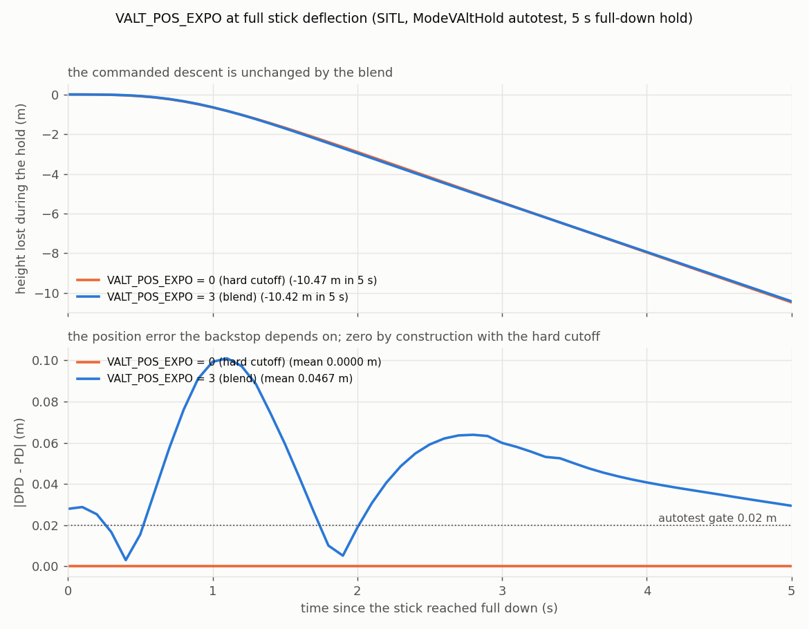

# PR #32270 - VALT velocity alt-hold flight mode

Analysis archive for [ArduPilot/ardupilot#32270](https://github.com/ArduPilot/ardupilot/pull/32270).
Branch `copter-valt-mode` (andyp1per fork), base `master`. No logs are
committed here; the validation is the `ModeVAltHold` autotest and real flights
that stay private.

### Head superseded 2026-10-12: GitHub head `08c5182c90`

The GitHub head is `08c5182c90`, the 2026-10-11 fixes autosquashed and
force-pushed (see the end of the 2026-10-11 section). AP-Review reviewed
it (report 7, REQUEST CHANGES); the 2026-10-12 section at the end answers
it, with fixes on the local branch `fix2/copter-valt-mode`, not pushed.

### Head superseded 2026-10-11: GitHub head `d40430bce0`

The GitHub head is `d40430bce0`, pushed by 2026-10-10. Since the
2026-09-29 rebase it gained `60b7940641` (test-list placement only, code
commits unchanged) and two commits on top: `d5672e0d6e` "Copter: add
FS_EKF_ACTION 4 to switch to VALT" and `d40430bce0`, its test. Four
automated reviews went unrecorded here: 2026-09-12 at `d6d572ad43`,
2026-09-30 at `8727f57fcd`, 2026-10-03 at `60b7940641` and 2026-10-10
at `d40430bce0`, all REQUEST CHANGES. The 2026-10-11 section at the end
answers the last one; its fixes are on the local branch
`fix/copter-valt-mode` as fixup!/amend! commits, not pushed.

### Head superseded 2026-09-29: rebased onto master, head `8727f57fcd`

Rebased onto master on 2026-09-29; the GitHub head is now `8727f57fcd`.
The commit "scripts: add build option for VALT mode" was reworded to
"Tools:" so CI's check_branch_conventions passes; its content is unchanged.
Nothing has been re-measured at this head. Every number below keeps the
commit it was taken on, and any head named above is left as written
because it is the code those numbers came from.

## Status (one line)

Rebased onto master on 2026-08-29 (941 commits behind before) and extended with
three commits: ground idle at mid-stick, its autotest, and a position
correction limit in ground effect. Self-reviewed 2026-09-04
([write-up](self-review-2026-09-04.md)): @peterbarker's avoidance call was still
missing and is now restored, an inherited terrain offset was defeating the
mode's own zero-error premise, and `VALT_POS_EXPO` values at or below 1 are
inert. Code fixed and squashed back into the commits that introduced the
problems (old head 973cf77117, new head d6d572ad43, twelve commits, each
builds); not pushed, and the PR body is not yet updated. A maintainer's
objection to the mode's existence stands unanswered by design.

Superseded 2026-10-11: pushed since; the GitHub head is `d40430bce0` (see
the head note above). The PR body now has the ground-idle and
ground-effect sections but says nothing about FS_EKF_ACTION 4, and
@lthall's objection is still unanswered in the thread.

## What the mode is

The pilot stick commands climb/descent rate instead of driving a jerk-limited
position trajectory. VALT inherits from AltHold and overrides only the flying
state: off-centre, pos_desired snaps to the estimate (velocity control); at
centre it freezes with zero initial position error and the position loop holds.
Any baro offset accumulated during a manoeuvre cancels instead of feeding a
trajectory, which is the point on small, high disc-loading copters with heavy
baro ground effect. `VALT_POS_EXPO` (default 0, inert) blends position
authority back in with stick deflection so a stuck velocity loop has a backstop
at full deflection.

## The three additions

1. **Ground idle at mid-stick.** Mid-stick is VALT's resting hold state, but the
   shared AltHold ground state machine spools the motors up at any stick at or
   above mid while a take-off only triggers on a positive climb rate. Parked at
   mid-stick the vehicle sat spooled-but-not-taking-off with `land_complete`
   true; angle boost while the airframe was handled pushed `throttle_out` past
   hover/2 and the land detector's missing-take-off guard latched a
   `flow_of_control` internal error that blocked arming until power cycle. A
   `Mode::spool_up_at_zero_climb_on_ground()` virtual (default true) lets VALT
   stay in ground idle until a climb is commanded; every other mode is
   byte-identical. Side effects, stated in the message: take-off from mid-stick
   waits for the spool-up, and a parked VALT vehicle auto-disarms after
   `DISARM_DELAY` where AltHold would not.
2. **Autotest** for the ground phase: motor output at mid-stick must sit below
   AltHold's at the same stick (the discriminating observable), the vehicle
   stays landed, and a climb command lifts off.
3. **Position correction limit in ground effect.** Rotor wash steps the
   baro by metres at ground contact; on the SkySakuraH743 baro-only quad
   the estimate stepped 2.4 m (log62) and 3.8 m (log81) while the vehicle
   sat on the floor, and with `PSC_D_POS_P=1` an unclamped loop turns that
   into a climb demand of the same size in m/s (log50 flew five such
   launches in 78 s). While the baro ground-effect flags are set the
   vertical position correction is limited (AC_P_1D turns the speed limit
   into an error limit, so small errors are corrected at full gain and a
   large one saturates). Zero authority was tried first (a snap of
   pos_desired to the estimate): it stops the launch but leaves nothing to
   arrest drift, and hands-off holds wandered 0.53-0.95 m per 20 s.
   Measured drift needs 0.03-0.05 m/s to arrest. The limit was 0.3 m/s for
   the evidence below and was later set to 0.1 m/s, which changed nothing
   measurable and was left in. The limit follows the ground-effect flags,
   so it is also in force through a gentle descent at height.

## How the flights shaped the design

Velocity control started as an AltHold option bit on the 4.6 branch. Three
iterations on a BF_X indoor quad with a rangefinder (logs 166-168, not
committed) set the shape:

- Deweighting position-P alone cut its contribution from 42.6 to 1.2 cm/s
  but surface tracking's velocity offset still ate ~90% of stick authority.
  Surface tracking feeds three paths (pos, vel, accel offsets); the only
  way to clear all three is to skip `update_surface_offset()`.
- Continuously overriding pos_desired with the estimate tracked the stick
  perfectly (DAlt - Alt = 0.000) and drifted 0.6 m in 100 s at mid-stick,
  because the position loop always saw zero error.
- Freezing the override at exactly zero commanded rate gave the hold. It
  works because `get_pilot_desired_climb_rate()` returns exactly 0.0 inside
  the dead zone.

The argument for the mode is that baro consistency, not accuracy, is what a
hold needs: a constant offset cancels because pos_desired and the estimate
saw the same drift. Flown on a baro-only quad, log52 (not committed): hold
std 0.095 m at 3.51 m against 0.27 m of baro noise. Flown on the
SkySakuraH743 quad, log47: 2.745 m held to 0.13 m for two minutes with
throttle varying 0.2%.

That argument stops in two places, both flown:

- A slow baro ramp. Outdoors with no rangefinder and no thrust correction the
  height drifted ~30 m false-low in 35 s (EKF -15 m against GPS +14 m); a
  false-low height makes the loop hold throttle up to "stop descending", so
  the vehicle would not come down (MicoAir743v2 quad, log35, not
  committed).
- A wrong-sign velocity estimate. VALT rides the EKF vertical velocity and
  disables the position loop; on a baro-only source set the velocity is the
  poorly observed state. In a sustained climb with the stick full down the
  EKF read +1.2 m/s (descending) against a real +3 to +9 m/s climb, the
  velocity loop was satisfied, and throttle sat at hover (log36, and the
  same signature indoors on a second quad, log39, with the blend off; not
  committed).

### Why VALT_POS_EXPO is a blend and not a cross-check

The obvious backstop, comparing the commanded descent against the baro
climb rate, was measured on log36 against unfused GPS truth (RMSE m/s;
sign = fraction of moving samples with the right sign):

| regime                     | truth std | baro vs GPS      | EKF vs GPS       |
|----------------------------|-----------|------------------|------------------|
| near ground (VALT's regime)| 0.51      | 1.16, sign 70%   | 0.25, sign 100%  |
| steady hover               | 0.22      | 0.94, sign 60%   | 0.21, sign 100%  |
| big climb (out of envelope)| 2.05      | 1.24, sign 92%   | 3.70, sign 19%   |

In VALT's own envelope the EKF velocity is excellent and baro velocity is
the unreliable one; a baro cross-check would false-trip about one sample in
three during normal indoor flight. The regimes only invert in a sustained
climb. A rangefinder cross-check was ruled out by the operator. What is
left is the well-observed state, position: a position comparison integrates
baro rather than differentiating it, so ground-effect noise averages out
and only sustained divergence accumulates. Folding it into the existing
override as a stick-weighted blend removed the detector, the threshold and
the trip.

Flown on a MicoAir743v2 indoor quad, log77-80, expo=3, no GPS, baro-only
(not committed): deadzone hold std 0.051 m over 65 s with DPD frozen while
PD wandered around it; mid-stick DPD tracks PD; at full down DPD marches
0.15-0.24 m below PD and PD follows. Hold -> velocity -> edge was monotonic
with no bump. The flying was gentle, so this validates no-regression and
the handoff, not a rescue; the backstop has not yet been seen doing real
work.

The same separation reproduces in SITL and is what the autotest now asserts
on. One `ModeVAltHold` run holds the throttle stick full down for 5 s at each
setting; the descent is identical (-10.47 m against -10.42 m) while the
position error the backstop depends on is exactly zero with the hard cutoff
and up to 0.10 m with the blend.



### Ground idle at mid-stick: the decision

Three separable fixes were on the table: (A) stop the land-detector guard
from bricking arming, (B) close the spooled-but-not-taking-off gap in the
shared AltHold ground state, (C) scope it to VALT. A and B change every
altitude mode and were deferred; C1 shipped as the virtual. C2 (a
velocity-independent touchdown cue so a won't-come-down still lands) is
unsafe standalone because a false positive is an in-air disarm; it belongs
with the velocity-estimate fix (#33478). Residual risk accepted: the
`land_detector.cpp:66` latch still bricks arming if reached by any other
path. The bench-handling trigger (hover/2 = 0.14, airframe hand-pitched to
-54 deg, cos 0.59 giving ~1.7x angle boost, one 2.5 ms loop to latch) is
not reproducible in SITL, so the autotest proves the ground take-off, not
the original fault.

## What the rebase fixed

- `MODE_VALT_ENABLED` now depends on `MODE_ALTHOLD_ENABLED` (master made AltHold
  optional after the PR was opened): `#error` in Copter.h and a build_options
  dependency, otherwise the build-options CI links VALT without its base class.
- `extract_features.py` could not detect the feature (no `ModeVelAltHold::init`);
  an explicit entry was added.
- VALT was missing from both AVAILABLE_MODES lists and the `FLTMODE1` values.
- The autotest was ported off the removed `watch_altitude_maintained()` helper
  and `delay_sim_time()` now requires a reason.
- The ground-effect commit message said 0.3 m/s where the flown and committed
  value is 0.1 m/s.

Still needed: a companion mavlink PR adding `COPTER_MODE_VALT = 29`; the pinned
pymavlink still names mode 29 `RATE_ACRO`, which is what MAVProxy prints.

### Superseded 2026-10-11: mode 29 is free in MAVLink

`ardupilotmega.xml` no longer has a mode 29: upstream MAVLink removed
`COPTER_MODE_RATE_ACRO` in 72868697 (2026-07-05), and both this PR's
pinned `modules/mavlink` (5cce5df6) and upstream master's pin (0d734a41,
master a04e2c9334 of 2026-10-09) carry that commit; `COPTER_MODE` ends at
28. The pymavlink half above still stands: `mode_mapping_acm` in the
pinned pymavlink (b7527da9) still maps `29 : 'RATE_ACRO'`, so a pymavlink
change is needed alongside the mavlink one. Neither PR exists yet.

## Key findings from flight

- The clamp does what it says and no more. SkySakuraH743 quad log81, 47 s
  hands-off on the deck (not committed): estimate excursion 3.80 m, |DCRt|
  max exactly 0.3000 m/s, on the rail 44% of samples, actual climb rate max
  0.41 m/s, unclamped counterfactual 3.80 m/s. Duration-matched A/B against
  the snap (10 vs 6 near-ground segments): drift +0.19 +/- 0.26 m,
  detrended std +0.063 +/- 0.084 m - no detectable difference in hold
  quality. Event rates favour the clamp (0.76 vs 3.01 throttle
  collapses/min, 0.31 vs 2.07 jolts/min) with the clamp flights flown at
  least as hard.
- It protects nothing once the estimate error is metres. Same quad, log83,
  with a payload: thrust-corrected baro 1.91 m low, ground-effect gate
  latched 100% of the flight, rail 26% climb / 8% descend, net +0.109 m/s
  climb at mid-stick. The cause of the 1.91 m is not established.
- Tightening the leash 0.3 -> 0.1 m/s bought nothing (log84): the rail
  moved to exactly 0.1000, the on-deck throttle surge did not shrink, and
  the velocity-loop error std was invariant (0.209 vs 0.215). The surge is
  downstream of the clamp. Do not trim it further.
- The on-deck surge is a designed trade. `update_throttle_mix()` needs a
  commanded descent to reach `THROTTLE_MIX_AT_MIN`; VALT mid-stick commands
  exactly zero, so `land_complete` never latches on the floor. Landing must
  never be detected at mid-stick in VALT, so a vehicle parked on the floor
  keeps running the altitude controller and nothing bounds that today.
- The A/B was nearly unrunnable. The ground-effect gate is evaluated on the
  EKF height, which over-read 0.7-1.3 m: arm B was engaged 34%, 8% and 94%
  of the time on three flights until `BARO1_THST_SCALE` was corrected
  (then 100%). Eleven commits including two baro-driver changes landed
  between the arms. The firmware hash identifies nothing on a dirty tree;
  builds were identified behaviourally (fraction of gate-open samples with
  zero position error: snap 98-100%, clamp 16-39% with p99 exactly 0.3000).
- VALT exposes EKF vertical divergence rather than causing it. On a
  MatekH743 flow quad with `EK3_SRC1_VELZ=0` and the rangefinder excluded
  from height (not committed) the estimate ran to 55 m against a clean 2 m
  rangefinder; VALT refused entry ("need alt estimate"). In another flight
  it was allowed in at 11 m vs 2 m because `ekf_alt_ok()` keys off solution
  flags that only drop after full fusion timeout, read VD -2.4
  ("climbing"), cut throttle 0.135 -> 0.09 and sank the vehicle; after a
  re-arm reset the same flight held 194 s. The mechanism (open-loop vertical
  channel filled by ~0.12 m/s^2 of vibration rectification) and the fix are
  #33478.
- "Up then down at launch" is a hold target captured on a bad estimate. On
  a 5-inch baro-only quad (not committed) the pilot centred the stick at
  1.55 m true while the EKF, 1.3 m behind after a -11.3 m spool-up crater,
  read 0.25 m; DAlt froze at 0.2076; 2.5 s later the loop found a 0.86 m
  error and flew 2.1 m down. Taking off in Stabilize and switching to VALT
  skips the window. With #33478 tuned, the same airframe held 36 s
  hands-off at 0.129 m true std.
- "Needs throttle above mid-stick to hover" is takeoff plus expectation.
  MatekH743 flow quad, log t5_019 (not committed): steady hover with the
  stick at 1498 (centre 1499.5), ThO 0.146, 1.39 m held. The above-mid
  stick was the takeoff: `TKOFF_SLEW_TIME=2` hides the response for ~2 s on
  a 14%-hover airframe, so the pilot piles on to ~90% and then overshoots.

## Open

- A VALT-entry consistency gate (baro or rangefinder against the EKF
  altitude at mode entry) would close the window that `ekf_alt_ok()`
  leaves open. Not implemented.
- No flight in the notes exercised the ground-idle change; the PR marks
  it flown.
- The clamp was never flown against the unmodified build at the corrected
  thrust scale, so "is it still needed once the estimate is good" is open.
  Provoking it means a ~3.8 m/s launch; bound that with `PILOT_SPD_UP=0.5`,
  which also clamps the correction (it is where `init()` reads the limit).
- A deliberate provoke-it flight for the expo backstop (sustained full-power
  climb, then full down) has not been flown.
- Mode number 29 is contested: `pr-mode-rate-acro` assigns it to `RATE_ACRO`
  and the pinned pymavlink already carries `29 : 'RATE_ACRO'`. Needs a decision
  and a linked mavlink PR adding `COPTER_MODE_VALT`.

  Superseded 2026-10-11: not contested. `pr-mode-rate-acro` is dead
  (ArduPilot/ardupilot#30570 closed 2025-09-27, checked with `gh pr view`)
  and upstream MAVLink removed `COPTER_MODE_RATE_ACRO` in 72868697; see
  the superseded note under "What the rebase fixed". Still open: the
  mavlink and pymavlink PRs (drafted in the 2026-10-11 section).
- The PR body's ground-effect section says the snap "wandered 0.5-1.0 m per
  20 s" as the reason to prefer the clamp; the duration-matched A/B above puts
  the snap at 0.663 +/- 0.158 m against the clamp's 0.851 +/- 0.212 m and
  concludes no detectable difference. The claim needs replacing with the
  arguments that hold (log62's settle onto the floor, the event rates).
- The PR body carries none of the numbers that answer @lthall, states none of
  the three known limitations of the clamp, and does not mention the A/B
  confound. Prose only; deliberately deferred on 2026-09-04.
- The ground-effect correction limit still has no SITL coverage, and two
  attempts at it were discarded rather than shipped - see the self-review.

## What is here

```
32270/
  README.md                     <- this file
  self-review-2026-09-04.md     pre-push review and the fixes it produced
  plots/
    A_valt_pos_expo_ab.png      VALT_POS_EXPO 0 vs 3 at full stick
    make_plots.py               regenerates it from data/
  data/
    valt_expo_ab.BIN            SITL, one ModeVAltHold run carrying both arms
```

## Reproduce

```
git checkout copter-valt-mode
./waf configure --board sitl && ./waf copter
Tools/autotest/autotest.py --no-configure test.Copter.ModeVAltHold,ModeAltHold
python3 plots/make_plots.py          # from this directory, regenerates the plot
```

The blend measurement is printed by the test itself
("VALT_POS_EXPO=N mean |DPD-PD| = ... m").

Two SITL reproductions are possible and not built: the won't-come-down and
the `VALT_POS_EXPO` backstop (the fusion-off phase of
`test.Copter.EK3_AglKfVelForVelD` on `pr-ekf3-aglkf-veld` manufactures a
2.49 m/s velD error with an injected accel-Z bias and `EK3_SRC1_VELZ=0`;
fly VALT full-down in that state), and the touchdown step and the clamp
(`pr-ground-effect` adds `SIM_BARO_GEFF_M`; the flown amplitudes were -11 m
at spool-up and -16 to -21 m at touchdown).

## Branches and people

- `copter-valt-mode` - the PR branch, force-pushed 2026-08-29 (previous head
  558a9a9e1a).
- Reviewers: @peterbarker (avoidance calls in the VALT flying state - recorded
  here as addressed from 2026-08-29, which was wrong: only the climb-rate call
  was present and `copter.avoid.adjust_roll_pitch_rad()` was restored on
  2026-09-04), @lthall (does not see the justification for the mode; not
  argued, though the numbers to argue it exist - see the self-review).

## 2026-10-11: AP-Review round at d40430bce0, fixes

Answers the AP-Review of 2026-10-10 at `d40430bce0` (REQUEST CHANGES)
and one item from the 2026-09-12 round. Fixes are on the local branch
`fix/copter-valt-mode`, head `31c98cd5e5`: nine fixup! and four amend!
commits on `andyp1per/copter-valt-mode`, not pushed. SITL numbers are at
that head unless marked; "fix reverted" means only that fix was undone
in the working tree for the run.

Folding the fixups in was simulated with merge-tree (no ref moved). The
final tree equals the branch head, and the folded first commit, the
blend commit and the ground-idle commit each build. `ArduCopter/mode.h`
conflicts twice, at `429e9fe1d8` and again at `5286cc1243`, because the
new private member and the ground-idle override both go at the end of
`ModeVelAltHold`. Resolution both times: keep the side without the
`private:` block and append the block at the end of the class.

- V1, GCS take-off in VALT at mid-stick: RESOLVED, `25711cb746` (into
  `5286cc1243`). `get_alt_hold_state_D_ms()` requests THROTTLE_UNLIMITED
  in its take-off branch when `!spool_up_at_zero_climb_on_ground()` and
  the stick is not below mid. AltHold's virtual returns true, so its path
  is unchanged. The 2026-10-10 scratch fix (THROTTLE_UNLIMITED
  unconditionally in `ModeAltHold::run()`'s Takeoff case) was withdrawn
  because it changed AltHold. The land-detector guard of
  `../analysis/topics/valt_takeoff_landdetector_internal_error.md` stays
  unreachable this way: a GCS take-off sets `takeoff.running()` before the
  branch runs, so `is_taking_off()` is true on every cycle that requests
  the spool, and the pilot-triggered path is already unlimited. Derived
  from the source. New subtest "GCS take-off in VALT from mid-stick":
  first sample inside the 9-11 m gate at 9.26 and 9.20 m in two runs;
  fix reverted, "Failed to attain Altitude want 10.0, reached 0.003" after
  the 30 s timeout. Throwaway probe,
  GCS take-off to 10 m, max altitude over 15 s, two runs per build:

  | mode, throttle stick | head `d40430bce0` | fix |
  |---|---|---|
  | ALT_HOLD 1500 | 10.00, 10.00 m | 10.00, 10.00 m |
  | ALT_HOLD 1300 | 0.23, 0.23 m | 0.23, 0.21 m |
  | VALT 1300 | 0.40, 0.39 m | 0.12, 0.38 m |
  | VALT 1500 | 0.00, 0.00 m | 10.01, 10.00 m |

  Every below-mid case ends at servo1 1100. VALT below mid runs the same
  code on both builds, so 0.12 against 0.38 is run-to-run spread. Seen in
  passing and not investigated: a GCS take-off below mid in AltHold hops
  about 0.2 m before settling at idle, on code this PR does not touch.
- V2, surface-tracking round trip: RESOLVED, `dab887965a` (into
  `f5c29c9efe`). New `SurfaceTracking::reset_target_on_next_update()`,
  called from `ModeVelAltHold::init()`. New subtest: analog rangefinder,
  LOITER at 10 m, SIM_SONAR_OFFSET -1, VALT and LOITER by DO_SET_MODE
  back to back, height held to 0.3 m for 10 s. Fix: held 10.56 m and
  10.61 m in two runs; reset call removed: 10.54 to 11.55 m (+1.01 m),
  fails.
- V3, EKF height reset applied twice: RESOLVED by inspection, not
  measured. `429e9fe1d8` (into `f5c29c9efe`) skips the snap and blend on
  the cycle `get_position_D_reset_count()` changes, because
  `D_handle_ekf_reset()` then shifts pos_desired by new minus previous
  estimate. No test: on the hard cutoff the error lives one 400 Hz loop
  (the next snap clears it), PSCD is logged at 10 Hz (one loop in 40),
  and the vehicle's response to a one-loop position error is below what
  an autotest can assert.
- V4, ground-effect guard on unrelated windows: RESOLVED, `dcb1cd1247`
  (into `91a81b18b1`). The check now reads XKF4 core 0 between the sim
  times the glitch was set and cleared and requires SS bit 12 on every
  sample: 64 of 64 in three runs. Test of the test: climbing through the
  glitch (stick 1650 for 1350), the old max(durations) check still passed
  on durations [3.30, 0.60, 2.20, 0.50, 5.40, 0.10, 1.10, 22.90] s (22.9 s
  is the RTL landing) and the new one failed, "ground effect window was
  closed at 144.8 s, inside the baro glitch". Two other breaks left the
  window open (64 of 64): stick at 1500, and GNDEFF_ALT 5. The vehicle is
  over 20 m from its take-off point after the lateral leg, where
  AP_GroundEffect drops the GNDEFF_ALT gate, and a residual negative
  vel_desired at mid-stick counts as a demanded descent (mechanism read
  from AP_GroundEffect.cpp:133-160, not measured). The test's comments on
  the descent and on GNDEFF_ALT 30 name sufficient conditions, not the
  ones holding this window open; left as written.
- V5, flake8 E131: RESOLVED, `f9db3a1977` (into `9b809631bc`).
- INITIAL_MODE @Values: RESOLVED, `55636ef354` (into `f5c29c9efe`), gains
  29:VALT. The list stops at 26 upstream (no 27 Auto RTL or 28 Turtle,
  neither a boot mode).
- V6, mode 29 in MAVLink: DEFERRED. Free, see the superseded notes above.
  The mavlink and pymavlink changes are drafted below, not opened.
- V7, FS_EKF_ACTION 4 fallbacks: PARTIAL. New subtest: FS_THR_ENABLE 1
  and SIM_RC_FAIL 1 put the vehicle in RTL, then GPS off gives "EKF
  Failsafe: changed to Land Mode" and LAND; with the `failsafe.radio`
  branch disabled it went to VALT and the subtest failed. VALT refused
  with AltHold accepted is not tested: VALT and AltHold share every
  `set_mode()` refusal (manual-throttle flag, RC-failsafe entry, fence
  recovery, position), and VALT's `init()` cannot fail, so the fallback is
  reachable only in a build without VALT. Derived from the source. The PR
  description does not mention action 4; addition drafted below.
- V8, unanswered thread: replies drafted below, not posted.
- 2026-09-12 item, `init_pos_terrain_D_m()` keeps `_vel_terrain_d_ms`:
  DEFERRED, measured. Probe: analog rangefinder, LOITER at 10 m, a 1 m
  SIM_SONAR_OFFSET step, VALT entered 0.4 s later while surface tracking
  was still slewing (PSOT.VOT 0.36-0.41 m/s), then 6 s at mid-stick; four
  entries per build.

  | build | max abs(PD - PD at entry) | PSOT after entry |
  |---|---|---|
  | fix head, velocity kept | 0.194, 0.193, 0.232, 0.220 m | POT reaches 0.134-0.138 m |
  | also zeroing terrain vel and accel | 0.118, 0.163, 0.148, 0.114 m | none (POT stays 0) |

  Drift 6 s after entry is the same in both (0.02-0.06 m). Clearing the
  rates takes about 0.07 m off an entry made within a second of a terrain
  step. Not changed: `init_pos_terrain_D_m()` is also called by AC_WPNav's
  terrain legs, ModeGuided and surface tracking's own re-initialisation,
  which would all change unmeasured, and a VALT-only version needs a new
  AC_PosControl entry point. Left for a decision.

All of ModeVAltHold, ModeAltHold, ModeLoiter, TakeoffCheck,
GroundEffectCompensation_takeOffExpected and
GroundEffectCompensation_touchDownExpected pass at `31c98cd5e5`.
VALT_POS_EXPO mean |DPD - PD| in the three runs whose ground-effect and
blend subtests were unmodified: 0.0000 m at 0 every time, and 0.0421,
0.0448, 0.0452 m at 3. Apart from the new VALT subtest no autotest flies a
GCS take-off in AltHold or Loiter (the other NAV_TAKEOFFs in
arducopter.py are GUIDED or mission items), so the AltHold side of V1
rests on the probe table above.

### Drafts, not posted

PR description, new section:

> ### EKF failsafe action 4
> If you fly an airframe whose baro is too disturbed for AltHold's trajectory, an EKF failsafe in Loiter or PosHold switches you into AltHold. FS_EKF_ACTION=4 switches to VALT instead, so the stick keeps commanding a climb rate. It falls back as action 2 does: Land during a radio failsafe, AltHold when VALT is not built in, Land if AltHold is refused too. ModeVAltHold covers the switch to VALT and the radio-failsafe Land; the AltHold fallback is reachable only in a build without VALT, since set_mode() refuses VALT and AltHold for the same reasons.

Reply to @lthall (2026-02-23):

> The case is small high-disc-loading copters whose baro is metres wrong near the ground: on a baro-only quad it read 3.7 m std in descent, jumped 15.28 m in 0.1 s and sat -11 m in ground effect, while VALT held 0.095 m std at 3.5 m against 0.27 m of baro noise. Parameters can't do it: PSC_D_POS_P=0 with surface tracking off also removes the position loop at stick centre, and keeping it there while dropping it off-centre is the mode.

Reply to @peterbarker on surface tracking (mode_valt.cpp, 2026-02-23):

> You're right that VALT gives that up: it skips surface tracking, so like AltHold without a downward rangefinder it holds EKF height and won't climb away from rising ground. Adding the velocities was the first version, and surface tracking's velocity offset then absorbed about 90% of the stick's authority near the ground, where this mode is meant to be flown; a pilot who wants the protection keeps it in AltHold or Loiter.

Reply to @peterbarker on avoidance (mode_althold.cpp, 2026-03-18):

> Thanks, you were right: only the climb-rate call was there. VALT's flying state now calls copter.avoid.adjust_roll_pitch_rad() as AltHold does.

MAVLink, a one-commit PR to ArduPilot/mavlink in the format of 72868697,
subject "ardupilotmega: `COPTER_MODE` add `COPTER_MODE_VALT`", adding
after `COPTER_MODE_TURTLE` in `message_definitions/v1.0/ardupilotmega.xml`:

```
      <entry value="29" name="COPTER_MODE_VALT">
        <description>VALT</description>
      </entry>
```

with a body naming ArduPilot/ardupilot#32270 and noting that 29 was
RATE_ACRO until 72868697 (that mode was never merged, #30570 closed).
A matching ArduPilot/pymavlink PR changes `mode_mapping_acm` in
`mavutil.py` from `29 : 'RATE_ACRO'` to `29 : 'VALT'` (the RATE_ACRO entry
came in e2b1ffc6, 2025-08-04). Once both merge, #32270 bumps
`modules/mavlink` and the test can use the mode name.

Pushed 2026-10-11: `copter-valt-mode` `d40430bce0` -> `08c5182c90` (force, autosquashed), 14 commits; two mode.h conflicts resolved (the private member and the ground-idle override); final tree identical to the tested fix branch; copter builds at every commit. Mechanical gate: one should-fix left as is - mode_valt.cpp has no licence header, like every ArduCopter mode_*.cpp. Mechanical gate (/pr-review checks, with the new squashed-subject scan) clean. PR replies drafted, not posted.

Found 2026-10-11 porting to the SFD beta (topup15): with #34362 on the stack (AP_GroundEffect: stop touchdown_expected latching in cruise) the ground-effect subtest's window closes inside the baro glitch, at 142.0 s, so the tightened check at `08c5182c90` fails there and the subtest exercises nothing. On master it holds today. Once #34362 lands, this subtest needs another way to keep touchdown_expected set through the glitch. The beta keeps the old check and says so in REFRESH_NOTES.

## 2026-10-12: AP-Review round at 08c5182c90, fixes

Answers the AP-Review at `08c5182c90` (report 7, REQUEST CHANGES).
Fixes are on the local branch `fix2/copter-valt-mode`, head
`2b7d8a04e7`: four fixup!, six amend! and one new commit on
`andyp1per/copter-valt-mode`, not pushed. SITL numbers are from a binary
built at `56eb699e52`, whose code equals the head (every later commit is
an empty amend!). "Fix reverted" means only that fix was undone in the
working tree and rebuilt for the run.

Folding the fixups in was simulated with merge-tree and commit-tree (no
ref moved); the final tree equals the branch head. `ArduCopter/mode_valt.cpp`
conflicts twice, because the fixup into the first commit is written
against the snap as the blend commit restructured it: at that fixup, and
again when the blend commit is picked onto the result. Resolution both
times: keep that commit's own snap code, add the line
`const float pos_snap_m = pos_control->get_pos_estimate_U_m() - pos_control->get_pos_offset_U_m() + pos_control->get_pos_terrain_D_m();`
before it (in the blend commit, before `const float expo`), have the hard
snap set `pos_desired` to `pos_snap_m`, and append to the snap comment
"The target is pos_desired plus the position offset and the
(Down-positive) terrain offset, so those come off too or they would sit
in the error." In the blend commit the blend keeps its own `pos_est_m`;
the next fixup removes it. The folded first and blend commits'
`mode_valt.cpp` pass `-fsyntax-only` with the SITL flags against the
head's headers; whole trees were not built. The new calls are
AC_PosControl getters and `G_Dt`, present and unchanged since the merge
base `e204ca77a8` (derived from the source).

- R1, vertical offset carried into VALT: RESOLVED for a held offset,
  PARTIAL for one already unwinding. `61b3d1b2d3` (into `b6f407d3dd`) and
  `b573aa893f` (into `bad5da6436`) snap and blend pos_desired towards the
  estimate less the position offset and the terrain offset, so the target
  D_update_controller() builds (pos_desired + offset + terrain) lands on
  the estimate. New commit `bd310bdf11` (with `fe88341f9f` and amend!
  `56eb699e52`): copter-posoffset.lua holds PSC_OFS_POS_D -3 in Loiter
  (the vehicle rose 2.97-2.98 m), VALT is entered at mid-stick, the stick
  goes to 1600 (0.018 m/s demand) and the height must stay within -0.5 m
  and +1.0 m of entry for 10 s. Fix: 0.18 m in two runs. Fix reverted:
  "Failed to attain Altitude want 12.738, reached 63.882", climbing from
  12.49 m at about 2.5 m/s. A first fix-reverted run died on a
  GLOBAL_POSITION_INT timeout in the RTL of the EKF failsafe leg, before
  the new leg, while another clone's autotest held the host; rerun once.
  A first version of the leg used stick 1620 (0.14 m/s demand) and climbed
  1.38 m against a 1.5 m bound, too close; hence 1600.

  Throwaway probe (not committed), same setup, 9 s windows sampled from
  LOCAL_POSITION_NED at 20 Hz:

  | case, stick 1600 | VALT, fix reverted | VALT, fix | AltHold |
  |---|---|---|---|
  | offset held | +22.76 m, 1.9 to 2.7 m/s up | +0.160 m | +0.162, +0.163 m |
  | offset cleared at the stick move | +3.98 m, -0.34 to +2.66 m/s | -2.85 m, peak 2.03 m/s down | -2.84 m, peak 2.13 m/s down |

  The bot measured 7.6 m in 9 s for the held case; same mechanism, its
  setup differed. With the fix an unwinding offset moves the vehicle by
  what is left of it, as AltHold does: the offset's velocity feed-forward
  (`_vel_offset_ned_ms`, added to the velocity target in
  D_update_controller()) is outside pos_desired, so no snap reaches it.
  Closing that needs the inherited offset cleared at VALT entry.
  `pos_control->D_init_controller()` in `init()` would (D_init_offsets()
  absorbs a held offset into pos_desired and zeroes a timed-out one), but
  it also resets the velocity and acceleration integrators on every
  in-flight entry, which AltHold avoids by initialising only an inactive
  controller; the alternative is a new AC_PosControl call. Neither tried
  or measured; left for a decision.
- R2, VALT_POS_EXPO loop rate: RESOLVED, `6bf3aedf1a` (into
  `bad5da6436`), commit message via amend! `2b7d8a04e7`. The weight is
  computed as before and raised to 400 * G_Dt, G_Dt being the nominal loop
  period. At 400 Hz 400 * G_Dt rounds to 1.0f, so the weight is unchanged
  (derived, not checked bit for bit). The blend subtest's mean
  |DPD - PD| at expo 3: 0.0451, 0.0437, 0.0436 m, and 0.0435, 0.0452 m
  with the R1 fix reverted, against 0.0421-0.0452 m last round. That
  subtest cannot see this change: at full deflection the weight is 1 at
  any rate (derived). Throwaway probe for the decay: expo 1.5, 4 s of full
  down, then stick 1031 (control_in 1, deflection 0.9975, weight 0.99638
  per 400 Hz loop, snap time constant 0.69 s derived), |DPD - PD| from
  PSCD at 10 Hz, time to fall to half (and to 1/e) of the first sample
  after the step:

  | build | 400 Hz | 200 Hz |
  |---|---|---|
  | fix | 0.28, 0.33 s (1/e 0.36, 0.43 s) | 0.38 s (0.54 s) |
  | loop-rate scaling reverted | 0.40 s (0.50 s) | 0.66 s (0.90 s) |

  The decay includes the position loop's own correction, so it is not the
  snap's 0.69 s. With the scaling the 200 Hz decay sits at the top of the
  400 Hz spread; without it, it is about twice as slow. One run per arm at
  200 Hz. 800 Hz could not be flown: SITL's 1000 Hz gyro fails the 1.8x
  loop-rate pre-arm and the main loop reached 641 Hz. The bot's shape
  point stands and is arithmetic (expo 3, 1% stick: weight 0.9703, 83 ms
  at 400 Hz): from expo about 1.5 the blend is a hard snap except within
  about 1% of centre and of full stick. Kept, because it is the 400 Hz
  shape log77-80 flew; reshaping the valley is a design change to fly
  first. DEFERRED. The VALT_POS_EXPO description says nothing per-cycle;
  unchanged.
- R3, round-trip subtest: RESOLVED, `d0b1329531` (into `e1b8015fee`).
  After the 10 s height check the subtest reads MODE from the log and
  requires VALT to have lasted under 1.0 s (SURFACE_TRACKING_TIMEOUT_MS).
  Measured 0.196, 0.220, 0.383, 0.340 and 0.170 s. Test of the test: a
  1.5 s delay_sim_time between the two DO_SET_MODEs fails it with "VALT
  lasted 2.038 s, past the surface tracking timeout"; the height check
  itself passed in that run, since a timed-out tracker re-initialises
  anyway, which is the bot's point.
- Mode number 29: DEFERRED to the MAVLink and pymavlink PRs drafted in
  the 2026-10-11 section, still not opened.
- FS_EKF_ACTION 4 missing from the PR description: DEFERRED, description
  not edited in this round; the 2026-10-11 draft stands.
- Unanswered thread (@lthall, @peterbarker): replies drafted 2026-10-11,
  still not posted.
- Not raised by the bot: `73b2935f87`, `d7abd63bb7` and `5d39ec06b8`, as
  pushed, end in a `Claude-Session:` trailer. amend! `dca13b221a`,
  `a0b1683f3b` and `f2c6d88372` drop it, messages otherwise unchanged. The
  first commit's message said pos_desired is set to the current position
  off-centre; amend! `e9dcc86446` says the target, offsets included, is.

ModeVAltHold (all subtests) and ModeAltHold pass at the head. The flake8
check on arducopter.py and astyle on mode_valt.cpp are clean.

### Drafts, not posted

Replies to the AP-Review:

> Vertical offset: the snap now puts the controller's target (pos_desired plus the position and terrain offsets) on the estimate, so with a script holding a 3 m offset VALT follows the stick, 0.16 m in 9 s for a 0.16 m demand against 22.8 m before, and ModeVAltHold covers it. An offset still unwinding on entry now moves the vehicle by what is left of it, as AltHold does (2.85 m against 2.84 m), through the offset's velocity feed-forward.

> VALT_POS_EXPO: the weight is now the error kept per 400 Hz loop raised to 400 x loop period, so 400 Hz is unchanged; in SITL the 200 Hz decay went from twice as slow to within the 400 Hz spread.

> Round trip: the subtest now reads the time in VALT from the log and fails at 1 s or more; it measured 0.17-0.38 s, and a 1.5 s stay fails it.

### Note 2026-10-13: unflown fixes squashed into flown commits

The 2026-10-11 push (`08c5182c90`) autosquashed review fixes that change behaviour into commits that had flown: the VALT commits now also carry the GCS take-off spool-up, the surface tracking re-init on entry and the single application of an EKF height reset. That breaks the rule now in the root playbook (never squash an unflown behaviour change into a flown commit), so the flight evidence recorded above for those commits covers the code before that push, not this part of it. Not rewritten again, to spare reviewers the churn; the beta carries the change as its own commit (topup15 `a1916a5c35`), and flight results on it will be recorded against that commit. From 2026-10-12 review fixes that change behaviour go on top as new commits.

Pushed 2026-10-13: `08c5182c90` -> `16e20eba19` (force). The behaviour fixes are new commits on top, not squashed: `ee9dc05040` (offset snap, loop-rate scaling), `16e20eba19` (held-offset test). Squashed, as they change no behaviour: the round-trip timing check into `05fa0cf5e1`, and the `Claude-Session:` trailers dropped from `9122517612`, `1eb1248eb0`, `0fb02e707c`. The amend!s that described the new behaviour in the flown commits' messages were dropped. Every flown commit keeps its code (non-test diff 0 against the previous push). Mechanical gate clean. Replies not posted yet.

PR description updated 2026-10-14 (FS_EKF_ACTION 4, the 2026-10-11/13 fixes, no hardware claim for unflown parts); no reply posted.
