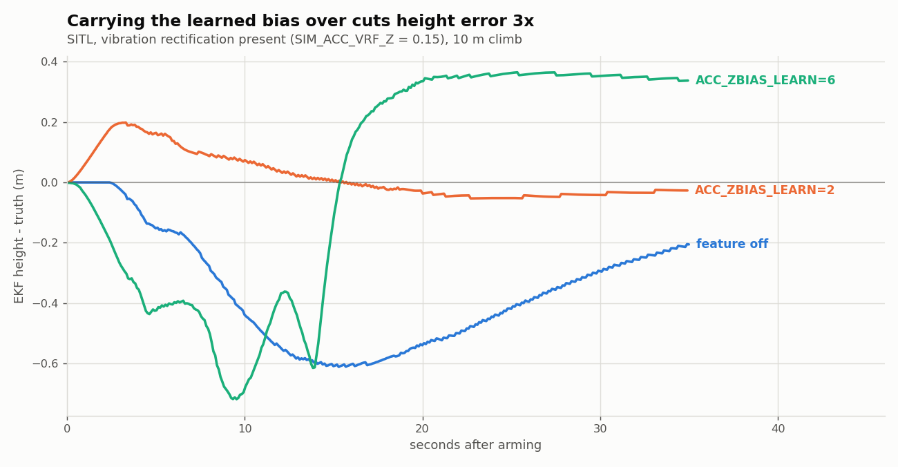
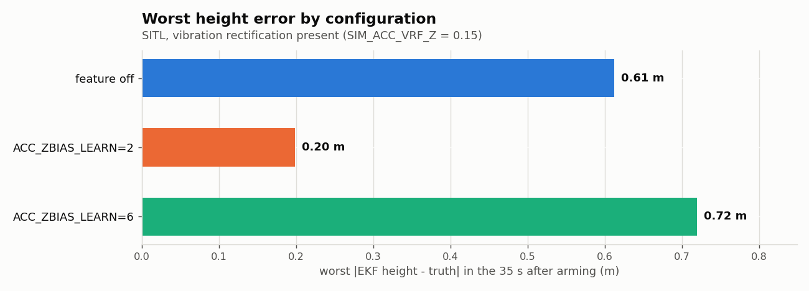
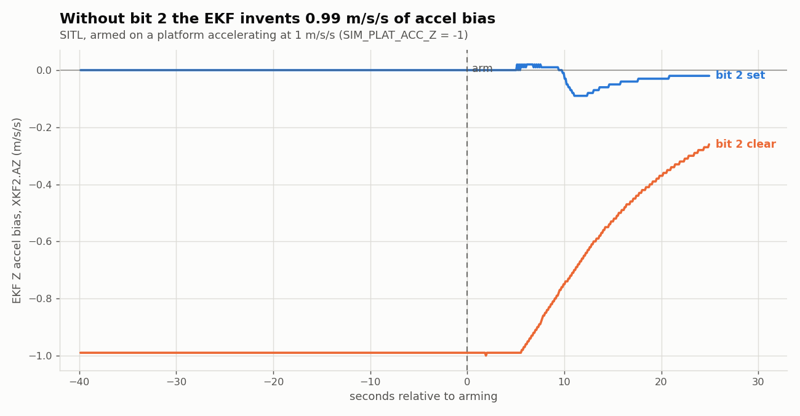

# PR #32471 - hover Z-bias learning for vibration rectification (EKF3 / Copter)

Analysis archive for [ArduPilot/ardupilot#32471](https://github.com/ArduPilot/ardupilot/pull/32471).
Branch `pr-vrf-core` (andyp1per fork), base `master`, approved; head
`b8ad09e9cb` (2026-09-30, 38 commits on master `26c7363f64`; previous
heads `c9f68beab8` 2026-09-29, `7a61baa62e`). Real-flight
numbers inline; no real-flight logs committed. SITL A/B logs and plots added
2026-09-04. Partial: the fleet-wide VRFB history (the frozen-correction /
ground-effect conflict) is not yet here.

> **Read this before changing the code.** Three changes that look obviously right
> from reading the source alone have been measured here and are worse. They are
> listed under "Measured and rejected" below. A 2026-09-04 review pass reasoned
> its way into two of them from the code and had to be reverted; the PR body now
> carries the same list so a reviewer meets it without finding this file.

## Status (one line)

Approved. This records how the vibration rectification bias was measured
independently on two airframes, the one way the learning was seen to go wrong
(a drifting height reference during the learning hover), and - since
2026-09-04 - the first SITL measurement of what the feature is actually worth,
which needed two new simulator capabilities to exist at all.

## The problem

Vibration rectifies into a DC offset on AccZ when motors run. Without a
vertical velocity source (indoor, no GPS) the EKF integrates it into
altitude drift. No stationary calibration can see it: AP_TempCalibration
learns only with !armed && is_still. The PR learns the bias in stable hover
and applies it as a frozen correction from the next boot (`INS_ACC_VRFB_Z`).

### Superseded 2026-09-29 by the code at `c9f68beab8`

Nothing on the branch freezes the correction at boot any more.
`NavEKF3::hoverZBiasCorrection()` reads `dal.ins().get_accel_vrf_bias_z()`
at the point of use, and `RISK` is refreshed every DAL frame from
`AP_DAL_InertialSensor::start_frame()`, so a value saved on disarm, set by
parameter or changed by an accel calibration applies from the next EKF
frame. Derived from the source, not measured. The sentence above is left
because it describes the design the PR was approved on and the real-flight
findings below were made with.

## Key findings

### Measuring the bias independently

Indoor 5-inch quad, log197 (not committed): raw IMU AccZ with motors at idle
(VibeZ ~0.2 m/s^2) against a 50 s hover (VibeZ ~3.2), regressed on IMU
temperature to separate the constant term from thermal drift: VRF
+0.089 m/s^2, thermal coefficient -0.045 m/s^2/C, R^2 0.82. An 18 s hover
(log198) gave +0.048. Positive VRF makes AccZ less negative, the EKF reads
it as downward acceleration, and altitude drifts down. Best estimate +0.09,
a useful pre-load for `INS_ACC_VRFB_Z` and a check on what the learning
converges to.

A 5-inch baro-only indoor quad (not committed): near-level quiet hover
against motors-off at matched temperature (33.3 vs 32.1 C), AccZ -9.8298 vs
-9.9190, a +0.089 m/s^2 shift. Same number on a different airframe.

### The learning is only as good as its height reference

On log198 the learned value converged to -0.066, the wrong sign. The DPS310
cooled 8.5 C in 54 s of hover from prop airflow, drifting the baro
~0.015 m/s (~0.6 m), and an upside-down thermal calibration was adding
+0.359 m/s^2 on top of the +0.089 real bias; the EKF absorbed 69% of the
total into its Z bias (-0.510 -> -0.201). The learner is not gated on the
barometer being trustworthy: it samples in a hover where the EKF Z bias
absorbs whatever the vertical channel cannot explain. On the baro-only quad
the `TCAL_BARO_EXP` correction alone moved the baro +0.41 to +0.66 m per
flight as the board prop-cooled (a ramp, the shape a bias state tracks
worst), so a VRFB learned there freezes a thermal artefact into every later
flight (mechanism only; that vehicle had learning off). Learn only against a
reference that does not drift over the learning window - a rangefinder, or
a baro with the thermal error removed - and zero the stored value after any
change to the IMU calibration so it re-learns. The order applied in the
field was baro TCAL off first, then re-learn.

### INS_ACC_VRFB_Z stores the total hover Z bias, not the on/off difference

`Attitude.cpp` writes totalBias = currentBiasZ + frozenCorrection, in the
EKF's sign convention. On the baro-only quad the stored value was -0.083
with a measured hover total of -0.023, and `XKF2.AZ` sat at +0.04 to +0.05
in flight making up the difference. The pair lands about right; neither
number is the rectification offset on its own. The parameter description
("bias learned during hover to compensate for vibration rectification")
will be read as the difference. Say "total".

Note 2026-09-29: "frozenCorrection" above is the name at the time. At
`c9f68beab8` the learner adds back `ahrs.get_hover_z_bias_correction(imu)`,
the live value the EKF applied (see the note under "The problem"); the
total-bias invariant is unchanged. Derived from the source.

### Range against clamp (fixed 2026-09-04)

The parameter range was +/-0.5, the EKF clamp `MAX_HOVER_BIAS_CORRECTION` 0.6,
and a true value of ~0.57 was measured on one airframe (the reason the clamp
was raised from 0.3). A fourth number, +/-0.3, survived in the `AP_NavEKF3.h`
comment from before that change. Now one named constant `HOVER_Z_BIAS_LIM` at
0.6, with `@Range` and the comment agreeing. The description gap above
("say total") is fixed in the same pass.

## Measured in SITL, 2026-09-04

Neither half of this could be simulated before. `SIM_ACCn_BIAS` is present at
rest, so it is the one case where the correction can only double-count; the
motor vibration in `SIM_VIB_MOT_MAX` is a zero-mean sinusoid and nothing in the
SITL accel path clips it, so no rectification comes out of it either. The PR's
own autotest used `SIM_ACC1_BIAS_Z` and passed with the correction entirely
absent. Two additions fix that:

- `SIM_ACC_VRF` - a motors-on-only accel offset. With `SIM_ACC_VRF_Z = 0.15`,
  IMU0 `AccZ` reads -9.8174 disarmed and -9.6686 in hover, a +0.149 m/s^2 shift
  the EKF then learns as `XKF2.AZ` +0.114.
- `SIM_PLAT_ACC` - the acceleration felt by a vehicle resting on a moving
  platform, applied while on the ground only. It has to go in the sensor model,
  not the physics: `Aircraft::smooth_sensors()` drives reported acceleration
  towards what the vehicle's own trajectory implies and cancels an offset
  injected into `accel_body` within its 0.1 s time constant.

### The feature is worth about 3x, against the mechanism it is named for





Worst |EKF height - truth| over the 35 s after arming, 10 m climb, correct
value preloaded. Two runs each where shown:

| `ACC_ZBIAS_LEARN` | height error | `XKF2.AZ` range |
|---|---|---|
| 0 (off) | 0.609 / 0.612 m | 0.10 |
| 2 (use) | **0.196 / 0.195 m** | 0.01 |
| 3 (learn+use) | 0.193 m | 0.00 |
| 6 (use+inhibit) | 0.713 / 0.476 m | 0.46 |
| 7 (all bits) | 0.711 / 0.476 m | 0.47 |

(Measured 2026-09-04 on code that still carried the ground-effect Z-bias
inhibit. Re-measured without it 2026-09-05, below.)

`=2` and `=3` are indistinguishable, so the 0.196 m is the price of *applying*
the correction, not of learning it. `=6` and `=7` are also indistinguishable,
so the extra 0.5 m is bit 2 alone - learning first and then pinning does not
avoid it.

Measured against a static bias instead the same feature *costs* 0.64 m against
0.036 m with it off. Both numbers are real and they measure different
mechanisms; a test that injects a static bias measures only the harm.

### Bit 2 is about moving platforms, not the motors-off bias



`updateMovementCheck()` compares `|accel| - GRAVITY_MSS` against `accel_limit`
1.0 - a **magnitude**, so direction is invisible - and the rate-of-change terms
are zero for a steady acceleration. With `SIM_PLAT_ACC_Z = -1.0` and 60 s
disarmed, `onGroundNotMoving` stayed true for 100% of the period:

| | `XKF2.AZ` at arm | height error | climb (10 m demanded) |
|---|---|---|---|
| bit 2 clear | **-0.9900** | 4.479 m | 10.44 |
| bit 2 set | +0.0000 | 1.632 m | 9.67 |

-0.99 m/s^2 of invented bias, 10% of g, carried into a flight where the
platform is gone.

Upstream already intends to cover this - `AP_NavEKF3_core.cpp:1187`
(`is_bias_observable`, "on ground and moving (e.g. carried or on a boat)")
is untouched by this PR and fires correctly once the movement check can see
the acceleration: at `EK3_OGNM_TEST_SF = 0.5` the platform run learns +0.0000
with bit 2 clear.

But the threshold cannot be tuned to do both. From `logm2_log4` (real flight,
not committed), 514 pre-arm XKFM samples, counting those able to latch
`onGroundNotMoving`: 0/514 at SF 0.5, 0/514 at 1.0, 11/514 at 1.25, 14/514 at
the default 2.0. Detecting 1 m/s^2 needs SF < 1.0. The binding term is not the
accelerometer (`ALR` peaked at 0.012) but `GDR`, the gyro rate-of-change metric
- median 0.777, p90 1.055, max 1.398. And a threshold too low to latch switches
off the synthetic zero-velocity fusion entirely, which is what learns the gyro
bias before flight, where bit 2 gates only states 13-15. **Bit 2 is the
surgical instrument; `OGNM_TEST_SF` is the blunt one.** Its description now
says so.

### Measured and rejected

Three changes a code-only reading suggests, each measured worse. Do not
reintroduce any of them without redoing the A/B in `data/ab-2026-09-04/`.

| Change | Argument for it | Measured |
|---|---|---|
| Route the four covariance gates off `accelBiasLearningInhibited()` onto `inhibitDelVelBiasStates` (`cb5026417f`) | `ConstrainVariances` zeroes the accel-bias cross-covariances that `Kfusion` reads, so learning cannot restart after the inhibit clears | `=6` **0.713/0.476 m** with it, **0.448 m** without; `XKF2.AZ` range 0.46 vs 0.01 |
| Freeze P during the inhibit instead (withhold only the process noise) | avoids both the collapse and the inflation | **0.905/0.882 m**, oscillation intact - worse than either |
| Inhibit Z accel-bias learning in ground effect | the AccZ offset there is not the hover value, and a downwash-corrupted baro drives the bias wrong | at `=2`, present vs removed: **0.203 / 0.201 m** with no simulated ground effect, **0.169 / 0.168 m** with `SIM_BARO_GEFF_M=1.0`. Removed 2026-09-05 |
| Store the motors-on delta in `INS_ACC_VRFB_Z` instead of the total | the static bias is otherwise applied twice at arm | the stored value is a total across the whole fleet; changing it silently reinterprets every one. The arm-time double count is real and belongs to bit 2: `XKF2.AZ` at arm +0.130 clear vs 0.000 set |

The last row now has a real-flight measurement against it: Replay of SFD-O4
log63 put the stored delta best of four on both cores, ahead of the total
with bit 2. The row's rejection is a compatibility argument and stands
until decided; see "2026-10-30: the first packs flown with apply" below.

#### Superseded 2026-10-30 (later) by Replay of 16 flights and SITL

The delta row is cleared and the PR now stores the delta (local
`pr-vrf-core-delta-v3`, not pushed). Replayed against 16 earlier flights
it beat the total on the airframe where they differ (SFD-O4 flow core
hover rms 0.30 against 0.47 m, total worse than none on 3 of 8, delta on
0); the autotest fails without it (0.430 saved against the motors-on
0.15). The compatibility argument was settled by decision, not
measurement: a stored total is applied as the delta for one flight until
the first learning flight overwrites it, and the commit messages carry
the migration note. "Belongs to bit 2" was half right: bit 2 does remove
the double count, but only for vehicles that set it, and the delta has
its own bit-2 case (it saved -0.005 on alternate flights until the at-arm
bias was taken as zero there). The row stays because its argument, that
the stored value is a total fleet-wide, is what a reviewer will raise.
See the last two sections.

`logjk4`'s proposal to gate the frozen correction on ground effect is also
measured worse - 0.644/0.656 m becomes 0.760 m - and targets the
never-leaves-ground-effect regime, a different case. Lowering
`EK3_OGNM_TEST_SF` instead of using bit 2 does not work either: 0/514 pre-arm
samples can latch below SF 1.25, and the binding term is `GDR` (median 0.777,
p90 1.055) not the accelerometer (`ALR` peak 0.012).

**`cb5026417f` still exists on `pr-acro-bias-inhibit` (#32473)** as
`361da5d064`, with a commit message that argues the collapse mechanism
convincingly. If #32473 merges after this PR the measured-worse behaviour
returns. See `../32473/README.md`.

#### The detail on cb5026417f

It routed four `CovariancePrediction` gates off `accelBiasLearningInhibited()`
so the accel-bias covariance stays alive while bit 2 holds the inhibit. Written
against the SITL subtest; no hardware evidence for the collapse it fixes. The
cost is that P[15][15] inflates across the whole disarmed period and the state
is released at arm into the takeoff transient: `=6` goes 0.713/0.476 m with it
to **0.448 m** reverted, and the `XKF2.AZ` range 0.46 -> 0.01. `=2` is
unchanged at 0.196 either way, confirming the revert is a no-op whenever the
vehicle flag is clear. Withholding only the process noise (freezing P rather
than letting it collapse) is worse still at 0.905/0.882 m with the oscillation
intact, so the instability is in the zeroing and reset gates.

Second arm, 2026-09-04: applying the change also fails the shipped
`AccelBiasMovingPlatform` autotest at 3.9 m against its 2.5 m gate, where the
branch as shipped passes at 1.632 m. The VRF and platform arms agree, and a
plain `test.Copter.AccelBiasMovingPlatform` run catches it without the harness.

### Bit 2's cost, mostly recovered (2026-09-05, shipped as `9b852c9464`)

Bit 2 costs 0.467 m against `=2`'s 0.201 m even with `cb5026417f` gone (0.448
against 0.196 as first measured). It protects the arm-time state and degrades
the correction it is protecting.

The mechanism, from tridge's 2026-09-05 review and confirmed against the
source: while the vehicle inhibit is held, the block at
`AP_NavEKF3_core.cpp:1189-1208` that saves and restores `dvelBiasAxisVarPrev`
sits inside `if (!accelBiasLearningInhibited())` and is skipped entirely, while
`ConstrainVariances` floors P[13..15] at `minSafeStateVar*10`. On release only
`dvelBiasAxisInhibit[index]` gates the restore, and for Z on the ground, level
and not moving, `is_bias_observable` is true, so that flag was never set and no
restore fires. X and Y do recover. Process noise alone would take hours.

His fix is distinct from both rejected alternatives: a bounded one-shot
re-initialisation on the falling edge of the frontend inhibit, using the values
`AP_NavEKF3_Control.cpp:166-170` already uses when the states are first
activated.

```cpp
const bool vehicleInhibit = frontend->getInhibitAccelBiasLearning();
if (prevVehicleInhibitAccelBias && !vehicleInhibit && !inhibitDelVelBiasStates) {
    P[13][13] = sq(ACCEL_BIAS_LIM_SCALER * frontend->_accBiasLim * dtEkfAvg);
    P[14][14] = P[13][13];
    P[15][15] = P[13][13];
}
prevVehicleInhibitAccelBias = vehicleInhibit;
```

Measured with the harness on `d951df4f82` plus that change. Three runs per side
on the arm that matters, so the separation can be read against the noise:

| arm | shipped | with the re-init |
|---|---|---|
| `=6` VRF | 0.467 / 0.473 / 0.472 m | **0.285 / 0.284 / 0.284 m** |
| `=7` VRF | 0.471 m | 0.285 m |
| `=2` VRF | 0.201 m | 0.203 / 0.208 m |
| platform bit 2 clear, `XKF2.AZ` at arm | -0.9900 | -0.9900 |
| platform bit 2 set, `XKF2.AZ` at arm | +0.0000 | +0.0000 |
| platform bit 2 set, height error | 0.176 / 0.176 m | 0.164 / 0.176 m |

The `=6` separation is 0.187 m against a within-arm spread of 0.006 m, about
thirty times the run-to-run noise. `=2` overlaps its own spread across the day
(0.199 to 0.208), which is what a no-op looks like: with bit 2 clear the
inhibit never engages, so the falling edge never fires.

It recovers 0.182 m of the 0.266 m penalty, is a no-op when bit 2 is clear, and
leaves the platform protection - the entire point of bit 2 - bit-identical.

**It converges rather than oscillating, which is what separates it from
`cb5026417f`.** Sampling `XKF2.AZ` after arm: shipped `=6` is pinned at -0.010
with a spread of 0.000 over the last 15 s, because the state cannot move at
all. With the re-init it dips to -0.120 and returns, settling at a spread of
0.010 - the same as `=3`, which has no inhibit. `cb5026417f` ranged 0.46 and
oscillated over 1 m/s^2 while measuring worse.

`AccelBiasMovingPlatform`, `VibrationRectificationBiasLearning`, `Replay` and
the four EK3 accel-bias tests all pass with it applied. That test is the cheap
check this file prescribes for any change in this area, and it is the one that
fails `cb5026417f` at 3.9 m.

Shipped as `9b852c9464` after the repeat runs above. SITL only: the two
previous attempts on this exact problem were both confident code arguments that
measured worse, so a flight is still what would settle it, and this entry
should be revisited when one is available. What tipped it was that the shape
moved as well as the number - a pinned state (spread 0.000) becoming one that
settles where the uninhibited case settles (0.010) - and that the platform
protection, which is the entire purpose of bit 2, is bit-identical either side.

Bit 2 still costs 0.284 m against `=2`'s 0.201 m. Reduced, not resolved.

## What is here

```
32471/
  README.md                       <- this file
  plots/
    make_plots.py                 regenerates all three from data/
    ab_vrf_height_error.png       height error vs time, 3 configs
    ab_platform_accel_bias.png    XKF2.AZ across arming, bit 2 clear vs set
    ab_summary_worst_error.png    worst height error by config
  data/ab-2026-09-04/
    harness.py                    the throwaway autotest probes
    install_harness.py            paste them into a checkout, and take them out
    metrics.py                    read the numbers back out of the logs
    vrf_off.BIN                   ACC_ZBIAS_LEARN=0, SIM_ACC_VRF_Z=0.15
    vrf_use.BIN                   ACC_ZBIAS_LEARN=2, same
    vrf_use_inhibit.BIN           ACC_ZBIAS_LEARN=6, same
    plat_bit2_clear.BIN           ACC_ZBIAS_LEARN=0, SIM_PLAT_ACC_Z=-1.0
    plat_bit2_set.BIN             ACC_ZBIAS_LEARN=4, same
```

The three scripts are the A/B instrument and are reusable for later runs, even
though they live in the 2026-09-04 directory with the first data they produced.
Run an arm with:

```
python3 32471/data/ab-2026-09-04/install_harness.py /path/to/ardupilot
cd /path/to/ardupilot && ./waf copter
VRF_LEARN=6 VRF_SIM=0.15 VRF_PRE=0.15 \
    Tools/autotest/autotest.py --no-configure test.Copter.VRFArmTransient
cp "$(ls -S logs/*.BIN | head -1)" /tmp/arm_6.BIN
python3 32471/data/ab-2026-09-04/install_harness.py /path/to/ardupilot --revert
python3 32471/data/ab-2026-09-04/metrics.py /tmp/arm_6.BIN
```

Each script's docstring carries the gotchas that cost time: the flight log is
the largest BIN not the last, autotest wipes logs/ between steps, PARM must be
read first-wins because context_pop logs its restores, and delay_sim_time needs
a reason argument.

SITL logs only. Real-flight numbers are quoted inline; those logs are not
committed.

## Reproduce

```
git checkout pr-vrf-core
./waf configure --board sitl && ./waf copter
Tools/autotest/autotest.py --no-configure test.Copter.VibrationRectificationBiasLearning
Tools/autotest/autotest.py --no-configure test.Copter.Replay   # AccelBiasInhibit bit, from 2026-09-15
```

`VibrationRectificationBiasLearning` was rewritten 2026-09-04 to use
`SIM_ACC_VRF_Z` and to assert the height improvement via
`assert_ekfs_match_sim_state(max_pos_d_err_m=0.35)`; verified to fail when the
correction is disabled, which the previous version did not.
`AccelBiasMovingPlatform` is new and asserts the bias stays near zero on an
accelerating platform; verified to fail with bit 2 neutered.

To regenerate the plots:

```
cd 32471/plots && python3 make_plots.py
```

A negative test for the wrong-sign case would add `SIM_BARO_DRIFT` during
the learning hover and assert the stored bias is not accepted; it does not
exist yet. The thermal contamination itself has no SITL model (the SITL
baro has no temperature term).

## Review pass, 2026-09-04

Landed on top of the measured work above, after a `/pr-review` of the stack:

- The vehicle's accel-bias learning inhibit now reaches Replay. It was a plain
  frontend bool, so a replayed acro segment learned bias the aircraft did not.
  Added a DAL event pair following `setTerrainHgtStable`, plus the Replay
  dispatch - an event rather than an RFRN bit because the flags byte is full.
- The frozen correction is read from the DAL at the point of use rather than
  pushed in from the vehicle. Only the boot-time load was DAL-visible before, so
  a second arm in the same boot replayed with the wrong correction - which
  `logtc5_2` flew. Landed as a three-commit forwarder dance because the removal
  crosses AP_NavEKF3/AP_AHRS/Copter.
- `INS_ACC*_VRFB_Z` is now `#if APM_BUILD_COPTER_OR_HELI`. The `{Copter}` tag was
  documentation only, so the parameter shipped on Plane, Rover, Sub and Blimp as
  a dead settable knob. Verified: the string is in `arducopter`, absent from
  `arduplane`.
- The parameter is written once on disarm instead of every 100 Hz learning step.
  It made RISJ a per-frame replay message for nothing; EKF3 reads it once.
- `AccelBiasMovingPlatform` grew the positive control this file's own numbers
  imply - it now measures -0.990 m/s/s with bit 2 clear before asserting 0.000
  with it set, so a broken stimulus fails instead of passing.
- The four AHRS accessors no longer gate on `active_EKF_type()`, which could
  swallow a one-shot write during a transient EKF3 fault.

Two changes from that pass were reverted after reading this file: see "Measured
and rejected".

## Review round, 2026-09-05

tridge's automated pass at head `84ddc625b8` raised five findings plus six
smaller ones. Branch head after this round: `d951df4f82`, 27 commits, force
pushed. Every finding was re-derived from source before acting on it.

### Landed

- **`ACC_ZBIAS_LEARN=1` grew the stored value by its own value every flight.**
  `AP_AHRS::get_hover_z_bias_correction()` returned the stored parameter with
  no check of the enable flag, while the EKF applies it only when enabled. The
  learner adds it back to recover the total, so with bit 0 set and bit 1 clear
  it added back a correction that was never applied: `s(n+1) = b_true + s(n)`,
  reaching the 0.6 clamp in seven flights on the measured 0.089. Gated at the
  accessor. **This cannot move any number in this file**: every configuration
  ever measured or flown here is 0, 2, 3, 4, 6 or 7, and the fix is a no-op
  whenever bit 1 is set. It also restores the "stores the total" invariant this
  file defends, which until now held only when bit 1 happened to be set.
- **`RISJ` mis-parsed every pre-existing log.** The PR had added
  `accel_vrf_bias_z` ahead of `instance`. Replay copies the on-disk record into
  the compiled struct, so an older 9-byte record is not truncated but
  misaligned: the old instance byte lands in the low byte of the new float and
  `instance` reads 0, so IMU 1 and 2 overwrite IMU 0. Appending after
  `instance` does not work either - the struct is not packed, so a trailing
  float pads `offsetof(_end)` to 16 against a 13-byte format string, which is
  the "Log structures invalid" trap. Fixed by moving the value to its own
  `RISK` message, following `97b5b0448a` which split `RISJ` out of `RISI` for
  the same reason, and matching what #34292 did with `ROFM` beside `ROFH`.
- **`updateMovementCheck()`** compared `raw - residual` once a correction was
  applied. Reachable only between arm and liftoff, where the displacement is up
  to 0.6 against an `accel_limit` of 1.0. A strict no-op for the platform
  numbers in this file, which are measured disarmed.
- Smaller: the accel-bias inhibit DAL event is written on change instead of at
  1 Hz forever while disarmed; the hover bias is saved after `motors->armed(false)`;
  `rot_ned_to_body` renamed to match what `rotation_matrix()` returns; the INS
  header no longer pulled into everything that includes `AP_NavEKF3.h`.

### The ground-effect Z-bias inhibit was removed

It went through three states in one afternoon - narrowed to a baro height
observation, then held behind the feature flag, then deleted - because each
step made the next question answerable.

The deciding measurement is the inhibit present against removed entirely, at
`ACC_ZBIAS_LEARN=2`, worst |EKF height - truth| over 35 s:

| | inhibit present | removed |
|---|---|---|
| `SIM_BARO_GEFF_M=0` | 0.203 m | 0.201 m |
| `SIM_BARO_GEFF_M=1.0` | 0.169 m | 0.168 m |

1-2 mm, with the baro under-reading by a full metre in ground effect. Once the
correction is applied the bias state has little left to absorb. Its only
measurable effect was on a vehicle *not* using the feature - 0.604 m against
0.650 m - which is a default behaviour change for every EKF3 user, reached
through `takeoff_expected` that Plane sets on the takeoff roll. That is a
separable improvement for its own PR, and it is the one thing this PR now does
*not* do: there is no behaviour change at default settings at all.

### Re-measured without the gate, 2026-09-05

Same probe as 2026-09-04, on `d951df4f82`. Single runs.

| `ACC_ZBIAS_LEARN` | height error | `XKF2.AZ` range |
|---|---|---|
| 0 (off) | 0.653 m | 0.11 |
| 2 (use) | **0.201 m** | 0.02 |
| 3 (learn+use) | 0.206 m | 0.02 |
| 6 (use+inhibit) | **0.467 m** | 0.02 |
| 7 (all bits) | 0.471 m | 0.02 |

With `SIM_BARO_GEFF_M=1.0`, `=0` is 0.650 m and `=2` is 0.168 m: the
correction is worth the same whether or not the baro is corrupted near the
ground.

**This settles the stale `=6` row.** The 0.713/0.476 above was measured with
`cb5026417f` applied; "Still open" quoted 0.448 without it. On current code
`=6` is 0.467 m with an `XKF2.AZ` range of 0.02, confirming the post-drop
value. The tension itself is unchanged: bit 2 costs 0.467 m against 0.201 m.

### Corrections to this file and to claims made during the round

- **The five BINs in `data/ab-2026-09-04/` contain no replay messages.** They
  carry the `RISJ` *format* but zero `RISJ`/`RISI`/`RFRN` records, because that
  harness ran without `LOG_REPLAY=1`. They are fine for the plots, which decode
  by FMT through pymavlink, but they cannot be replayed and they are not
  examples of the misparse above.
- **SITL does model baro ground effect.** `SIM_BARO_GEFF_M`, added by
  `cbe1af2800` and already on this PR's base, makes the baro under-read by up
  to that many metres while the throttle is up, decaying to zero at 2 m AGL. It
  defaults to 0, which is why the 2026-09-04 A/B never exercised it. An
  in-session claim that SITL had no such model was wrong.
- **The EXTNAV/BEACON regression is not a property of the blanket gate.** It
  belonged to `learnZBias`, an SFD-branch design with a `switch` whose
  `default: false` meant "inhibit for the whole flight" on those sources.
  `git log --all -S learnZBias` finds nothing in the ArduPilot tree: it never
  landed here. `cab18be57b`'s commit message describes that history, and it was
  read during this round as describing what its own diff removes.

### `RISK` does not hit the #34292 `IFCHANGED` trap

`../34292/README.md` records that `AP_DAL::WriteLogMessage` returns early when
`!logging_started` without setting the `_end` retry flag, so a record written
only on change can be dropped forever - measured there as `ROFM=1` in one log
and `ROFM=0` in the next log of the same power cycle. That fix is on #34292's
branch, not on this base.

`RISK` escapes it for the same reason `RISJ` does: it is written from
`AP_DAL_InertialSensor::start_frame()` (`AP_DAL.cpp:93`), inside the
`force_write` bracket set at `:46` and cleared at `:120`. That file is explicit
that reasoning about `IFCHANGED` is what failed, so it was counted rather than
argued. Two flights in one power cycle with a log download between them to
force `stop_logging()`:

```
feature on   log 3: RISJ=3 RISK=3  {0:0.15, 1:0.15, 2:0.0}
             log14: RISJ=3 RISK=3  {0:0.15, 1:0.15, 2:0.0}
at default   log 3: RISJ=3 RISK=3  {0:0.0,  1:0.0,  2:0.0}
             log11: RISJ=3 RISK=3  {0:0.0,  1:0.0,  2:0.0}
```

### History

Squashed from 38 commits to 27, each fix folded into the commit that
introduced the problem, content verified byte-identical across the rebase
(`git diff` between the pre- and post-squash heads is empty). Every commit
builds `arducopter`. Two commits do not build the `Replay` tool: adding a value
to `AP_DAL::Event` breaks Replay's exhaustive switch immediately, and the
handler cannot land until `NavEKF3::setInhibitAccelBiasLearning` exists, which
needs the enum. Closing that window entirely would put two modules in one
commit. It was 18 commits wide before this round.

## Review round, 2026-09-15 - the inhibit event never reached Replay

tridge's pass at `9b852c9464` (posted 2026-09-05, verdict REQUEST CHANGES)
found that the on-change guard added in the 2026-09-05 round broke Replay.
Measured before fixing. Local head after this round `7eb93ad76c`: four
commits on `9b852c9464`, **not pushed**, one of them a `fixup!` for an
autosquash.

The "Landed" bullet above, "the accel-bias inhibit DAL event is written on
change instead of at 1 Hz forever while disarmed", is what this section
supersedes. It was a code argument that nobody replayed; the `RISK` counting
in the section above checked the per-frame record and not this event.

### The defect, measured

Mechanism, derived from the source: Copter sets the inhibit from
`one_hz_loop` while disarmed. With `LOG_REPLAY=1` and `LOG_DISARMED=1` the
DAL does not log until `AP_Logger::allow_start_ekf()`, which waits for the
startup messages (every parameter) to be out, so the first tick's `REV3` is
dropped at `AP_DAL.cpp:305` and the guard never writes it again. Replay then
starts with the inhibit clear and learns bias the flight did not, and it also
never sees the true-to-false edge that triggers the bit-2 covariance restore
at `AP_NavEKF3_Control.cpp:180`.

Measured in SITL, 2026-09-15. Sit disarmed 30 s on `SIM_PLAT_ACC_Z=-1.0` with
`ACC_ZBIAS_LEARN=4`, take off in LOITER, clear the platform, hover 10 s,
land, then `build/sitl/tool/Replay` and `Tools/Replay/check_replay.py`. Same
debug build configuration both sides; only `AP_NavEKF3.cpp` and
`AP_NavEKF3.h` differ.

| EKF3 files | inhibit `REV3` in the flight log | `XKF2.AZ` at arm, flight C0/C1 | Replay C100/C101 | check_replay |
|---|---|---|---|---|
| `9b852c9464` | unset at 76.9 s (arm), set at 123.4 s (after landing); **no set before arm** | 0.00 / 0.00 | **-0.99 / -0.99** | 83440 mismatches |
| `bd001d81e9` | set at 4.45 s (first `UpdateFilter` frame; first DAL frame 3.44 s), unset at 76.7 s, set at 123.4 s | 0.00 / 0.00 | 0.00 / 0.00 | 0 |

A first head run the same day paired a non-debug flight binary with a debug
Replay (the autotest's `build_replay()` reconfigures) and read -0.99 / -0.98
with 85424 mismatches. The debug-matched row is the control; the first run
is recorded only so the two counts are not mistaken for a discrepancy.

### The fix, and the alternative rejected

Rejected: dropping the guard, although the review offered it. The same
reviewer's previous round asked for the guard ("3,600 redundant events per
idle hour"), and #32473 turns the Copter writer into a level written every
second in every state, so it would put an event a second in every Copter
log. It would also leave up to 1 s between the cores starting and the next
tick in which Replay runs without the inhibit. Rejected on that cost and that
window, both derived from the source, not measured.

Landed as `bd001d81e9`: `setInhibitAccelBiasLearning()` records the state and
a pending flag, and `NavEKF3::UpdateFilter()` writes a pending change before
`dal.start_frame()` once the cores exist. A replayable log does not start the
cores until the DAL is logging (`AP_AHRS_NavEKF3.cpp:28` gates on
`allow_start_ekf()`, which is half of the DAL's `logging_started`), so the
first write lands. Between frames is where `log_event3()` puts an event anyway,
via its `end_frame()`. Only a change is written, and a vehicle that never calls
the setter writes nothing.

In flight the core reads the frontend flag exactly as before; only where the
event is written moves. That is derived from the source, and the two
behaviour tests were re-run below.

Limit, derived from the source: a second log in the same boot does not get
the state re-written, the same as every other `REV3`-carried state. Such a
log does not contain the EKF start and does not replay exactly anyway.

### Coverage and re-runs at `7eb93ad76c`

- `Copter.Replay` gains an `AccelBiasInhibit` bit (`51f17f7c33`, plus the
  fixup `7eb93ad76c`, which resets the sticks the OpticalFlow bit leaves
  non-neutral - without it arming fails "Pitch (RC2) is not neutral"). Full
  `Replay` with the fix: all 7 bits pass, 0 mismatches each. The new bit
  alone against `9b852c9464`'s EKF3 files: fails, 83440 mismatches.
- `VibrationRectificationBiasLearning`: pass, learned 0.130 against 0.15.
- `AccelBiasMovingPlatform`: pass, -0.990 m/s/s with bit 2 clear and 0.000
  with it set, the same values as 2026-09-04.
- `arducopter`, `arduplane` and `Replay` build.

A control run of the full `Replay` test against head's EKF3 files failed
early in the Beacon bit with "Did not get GLOBAL_POSITION_INT", a harness
timeout unrelated to this change, which is why the control above is the
single bit.

### Other items in the review

- The stale `RISJ` comment in `hoverZBiasApplied()`: `373a931c99`.
- "The 0.448 m recovery ... is still unmeasured": answered by the
  2026-09-05 measurement above, "Bit 2's cost, mostly recovered" (0.467 m to
  0.284 m against `=2`'s 0.201 m, at `9b852c9464`). This round moves no
  flight-EKF behaviour, so those numbers still describe the branch.
- CI failures: all external per the review; a rebase picks up #34303.

### No flight log can show this fix

The defect is in what the flight writes. A log flown on `9b852c9464` with bit
2 set already lacks the set event, and Replaying it through the fixed code
cannot put it back. log197 and log198 remain the hover Z-bias measurement and
are unaffected. Only a new flight with bit 2 and `LOG_REPLAY=1` exercises it.

### Owed

- Squash `7eb93ad76c` into `51f17f7c33`, and ideally fold `bd001d81e9` and
  `373a931c99` into the commits that introduced the guard and `RISK`, then
  rebase for CI. All need a push grant.

## Branches and people

- `pr-vrf-core` - the PR branch, `9b852c9464` as of 2026-09-05. Depends on #32396.
  Local head `7eb93ad76c` 2026-09-15, not pushed (see the 2026-09-15 round).
  `7a61baa62e` 2026-09-17; `c9f68beab8` 2026-09-29 (rebased onto master,
  see the 2026-09-29 section).
- Author: @andyp1per. Approved, then reworked by the 2026-09-04 review pass.
- Distinct from #34209 (XY bias in unaided flight) and #32473 (acro
  inhibit), which still carries `cb5026417f`.

## Pushed 2026-09-15

Rebased onto master `bf08027404` and force-pushed as `bb0a818b52`. The
`fixup!` was folded into its test commit; the two AP_NavEKF3 commits stay
separate. One conflict, in `AP_DAL.cpp`: master's `8ad9ae2314` had removed
the `ahrs_airspeed_sensor_enabled` line next to ours and retired RFRN bit 3,
so the resolution keeps master's removal; this PR uses bit 1, no collision.

The numbers in the 2026-09-15 round were taken on the local commits; they map
to the pushed ones as:

| measured on | pushed as |
|---|---|
| `bd001d81e9` write the inhibit to the DAL once the cores run | `18511cd9f2` |
| `373a931c99` RISK comment | `294b9eb1a2` |
| `51f17f7c33` + `7eb93ad76c` Replay AccelBiasInhibit bit | `bb0a818b52` |

Re-run on `bb0a818b52` before pushing: VibrationRectificationBiasLearning,
AccelBiasMovingPlatform and the full Copter Replay test all pass (SITL).

Reply posted 2026-09-15 11:23Z answering the 2026-09-05 automated round
(https://github.com/ArduPilot/ardupilot/pull/32471#issuecomment-5679359541). The
`AIReview` label was already on, so the next sweep should re-review at
`bb0a818b52`; the 2026-09-05 round is stale from the push. Still open from
this session: #32473's acro A/B measured the bit-2 covariance restore
overshooting on release (8.0 m lost in ALT_HOLD after a 0.5 m/s/s bias step,
against 6.0 m without the restore and 1.5 m uninhibited; single SITL runs, see
`../32473/`). Not yet examined here.

## The release restore, A/B'd (2026-09-15)

The open item above: does `9b852c9464`'s restore of P[13..15] on the
falling edge of the vehicle inhibit help or hurt, now that #32473 makes it
fire on every acro exit as well as at arm. Everything here is tier 2 (SITL),
three runs per cell unless marked.

**Verdict: keep the restore as pushed.** Among the variants that keep the
inhibit, it gives the lowest height error in every arm-release cell and the
lowest sustained error after an acro exit. What it costs is a transient: the
bias estimate overshoots about 2x for a few seconds after an in-flight
release (up to 0.31 m past truth in height), and on a moving platform it
learns the platform acceleration as bias during an armed wait. The 8.0 m
against 6.0 m "altitude lost" in `../32473/` is mostly the vehicle
descending to the height it was really at, sooner. It is not extra error.

### What was run

A local-only probe branch (`probe-32471-restore-ab`, not pushed; diff in
`data/restore-ab-2026-09-15/probe_restore.diff`) on top of the #32473
branch with its acro probe. It picks the release behaviour from
`RESTORE_V` and writes a `PRBR` dataflash record at each inhibit edge with
P[15][15] before and after. The restore code there is the same as on the
pushed `bb0a818b52`: a diff of `AP_NavEKF3_Control.cpp` shows only the probe
lines and an unrelated airspeed-check line.

- V1: restore as pushed, P[13..15] = (0.2 x EK3_ACC_BIAS_LIM x dt)^2,
  logged 6.2e-6
- V2: no restore, P stays at the inhibited floor, logged 5e-8
- V3: no inhibit (control)
- V4: candidate, 1/16 of V1's variance (sigma 0.05 instead of 0.2 m/s/s),
  logged 3.9e-7

Every counted run with an inhibit was checked for a `PRBR` falling edge at
arm (S1) or at the acro exit (S2). None is missing.

Variance arithmetic, derived from the source and not measured: the
per-step accel-bias process noise is (dt^2 x EK3_ABIAS_P_NSE)^2 = 8.3e-12 at
dt 0.012. Natural regrowth over a 20 s acro segment is therefore about
1.4e-8, below the 5e-8 floor, and about 4e-7 over 600 s, which is the
review's "3.7x". A restore to "what the covariance would have grown to"
therefore collapses onto V2 after acro. At arm it collapses onto V1: the
disarmed inhibit rises at boot, when P is still at the first-activation
value (`PRBR` shows 5.76e-6 saved). That candidate was not run; the scaled
V4 was run instead.

S1 is `RestoreArmProbe`: disarmed dwell (60 s, or 90 s on the platform,
plus 7 s per run index), arm, climb to 10 m in LOITER, 40 s hover. Bit 2 is
set (`ACC_ZBIAS_LEARN` 6, or 4 on the platform). Metric: worst |EKF - truth|
height over 35 s after arm, as in the 2026-09-04 harness. S2 is
`RestoreAcroProbe`: the #32473 Lua acro driver at 40 m, a Z accel bias step
injected 3-5 s into acro, 20-24 s of acro, then the driver levels the vehicle
for 4 s before ALT_HOLD. Run index varies pre-hover, step time and acro
length.

### S1, release at arm

Worst height error over 35 s after arm, m, mean (min..max):

| cell | V1 restore | V2 none | V3 no inhibit | V4 1/16 |
|---|---|---|---|---|
| VRF 0.05, correction preloaded | 0.16 (0.16..0.16) | 0.28 (0.27..0.28) | 0.17 (0.16..0.18) | |
| VRF 0.15, preloaded | 0.28 (0.27..0.28) | 0.53 (0.53..0.53) | 0.30 (0.30..0.30) | 0.37 (0.37..0.38) |
| VRF 0.30, preloaded | 0.45 (0.44..0.45) | 1.01 (1.00..1.01) | 0.50 (0.49..0.51) | |
| VRF 0.15, nothing preloaded | 0.28 (0.28..0.28) | 0.70 (0.70..0.70) | 0.65 (0.65..0.65) | 0.36 (0.35..0.36) |
| platform 1.0, prompt takeoff | 0.99 (0.16..2.47) | 2.97 (0.15..8.24) | 6.96 (1 run) | |
| platform 1.0, armed 0 s | 0.56 (0.31..0.88) | 1.07 (0.28..2.44) | 7.18 (1 run) | 0.89 (0.26..1.82) |
| platform 1.0, armed 5 s | 1.01 (0.34..2.11) | 2.70 (0.34..7.15) | 7.03 (1 run) | 1.15 (0.31..2.56) |

The VRF 0.15 preloaded row reproduces the 2026-09-05 table: 0.28 with the
restore against 0.53 without (0.284 and 0.467 then). The code base differs
by #32473's commits.

Two costs show up in S1:

- The restore absorbs the ground spool-up transient as bias. XKF2.AZ moves
  -0.13 m/s/s between arm and liftoff at VRF 0.15 (-0.23 at 0.30), against
  -0.01 for V2. It decays in flight, which is why V1's mean error 10-35 s
  after arm is higher than V2's in the preloaded cells: 0.24 against 0.16 m
  at 0.15.
- On the platform, one run index in each of the three platform cells (97 s
  dwell, liftoff 4-7 s after arm) learns the platform acceleration after
  arm: AZ at liftoff -0.99, -0.81 and -0.96 m/s/s with V1, -0.35 to -0.61
  with V4, -0.06 to -0.14 with V2. That is the invented bias bit 2 exists to
  prevent, re-learned in the seconds after arming. V2 learns nothing in the
  same run, but its height estimate diverges on the ground instead (+5.8 m
  while sitting), which is where its 8.24 m worst comes from. Why only that
  run index was not traced; the movement check is the first suspect. The
  log is `s1_platd5_1.00_v1_r1.BIN.gz`.

### S2, release at an acro exit

Z bias step injected in acro; release at the ALT_HOLD entry. Heights in m,
bias in m/s/s:

| step | variant | error at release | mean error 0-10 s | mean error 10-35 s | overshoot past truth | AZ peak | time to 80% |
|---|---|---|---|---|---|---|---|
| 0.05 | V1 | -0.41 | 0.20 (0.11..0.37) | 0.04 (0.02..0.05) | 0.05 | 0.10 | 0.9 s |
| 0.05 | V2 | -0.42 | 0.47 (0.35..0.66) | 0.12 (0.09..0.18) | 0.00 | 0.04 | not reached |
| 0.05 | V3 | -0.19 | 0.20 (0.12..0.30) | 0.10 (0.08..0.13) | 0.00 | 0.04 | not reached |
| 0.15 | V1 | -1.28 | 0.41 (0.37..0.46) | 0.08 (0.02..0.11) | 0.14 | 0.30 | 0.9 s |
| 0.15 | V2 | -1.40 | 1.45 (1.03..2.10) | 0.36 (0.26..0.54) | 0.00 | 0.14 | 16.9 s |
| 0.15 | V3 | -0.55 | 0.53 (0.51..0.57) | 0.27 (0.24..0.30) | 0.00 | 0.13 | 17.6 s |
| 0.15 | V4 | -1.45 | 1.02 (0.72..1.59) | 0.09 (0.06..0.14) | 0.10 | 0.17 | 3.4 s |
| 0.30 | V1 | -2.80 | 1.61 (0.82..2.03) | 0.21 (0.16..0.24) | 0.27 | 0.68 | 0.8 s |
| 0.30 | V2 | -2.83 | 3.72 (3.65..3.86) | 1.06 (1.06..1.07) | 0.00 | 0.28 | 16.1 s |
| 0.30 | V3 | -1.20 | 1.23 (0.88..1.71) | 0.61 (0.50..0.79) | 0.00 | 0.28 | 16.4 s |
| 0.50 | V1 | -4.70 | 3.21 (3.02..3.32) | 0.33 (0.32..0.35) | 0.31 | 1.01 | 0.8 s |
| 0.50 | V2 | -4.82 | 6.33 (5.90..6.74) | 1.78 (1.77..1.79) | 0.00 | 0.46 | 15.9 s |
| 0.50 | V3 | -1.98 | 2.29 (1.72..2.66) | 1.13 (0.80..1.32) | 0.00 | 0.47 | 15.5 s |
| 0.50 | V4 | -4.59 | 3.88 (2.23..4.82) | 0.33 (0.09..0.45) | 0.23 | 0.58 | 3.6 s |

Truth altitude lost in the 20 s after the exit at the 0.50 step, mean
(min..max): V1 6.20 (5.23..7.34), V2 3.79 (2.89..4.66), V3 0.59 (0.11..1.26),
V4 6.13 (4.99..6.84). The EKF was 4.7 m low at release with any inhibit, so
most of V1's descent is the controller following the corrected estimate down
to where the vehicle really is. About 1.5 m is beyond that correction: the
0.31 m overshoot plus the altitude controller's own transient. V2 has covered
less of the same error 20 s later and still carries 1.8 m of it.

V4 halves the bias overshoot but reaches the corrected height about 3 s later.
It is worse than V1 in every S1 cell it was run in, and no better on the
platform. It is not an improvement on the restore as pushed.

The first S2 matrix is not counted. The Lua driver left acro mid-flip on one
run index (roll 152 to 174 deg, 7-8 m/s descending), and every variant hit
the ground from there; two V1 runs then failed to disarm. The driver now
levels the vehicle before the exit (|roll| at most 33 deg, vertical speed
-0.2 to +3.5 m/s at the exit), and all 36 S2 runs were repeated.

### What this means for the two PRs

- #32471: no change before merge. The restore is the best inhibited variant
  on every height metric measured. Its transients are a 2x bias overshoot for
  a few seconds and absorbing an acceleration the vehicle is exposed to after
  arm; the second is a limit of bit 2 as designed, which only covers the
  disarmed period. Worth one sentence in the PR if it comes up: a moving
  platform with a long armed wait can still teach the filter a bias.
- #32473: V3 (no inhibit) beats every inhibited variant after an in-flight
  bias step. It carries 2.4x smaller error into the exit at the 0.50 step, and
  the release restore is what makes the inhibited case recover at all. That
  weighs against the acro inhibit, not against this restore.

Numbers taken 2026-09-15 on the probe branch in `../../ab-32471` at
`31137aa3d0` (first S1 matrix), `af5ec2054b` (levelled S2) and
`18755b2da3`/`b1dbfafd40` (armed dwell and V4). V1, V2 and V3 behave
identically across those commits; only V4 and the harness changed. Logs
kept: the 0.50 step for V1, V2 and V3 at run index 0, and the platform run
that learns the acceleration after arm. `runs.spec`, `rows.csv` and
`tables.md` hold every run; `analyse_restore.py` and `aggregate.py`
regenerate the tables from logs made with `run_restore.sh`.

Result posted on the PR 2026-09-15 13:34Z
(https://github.com/ArduPilot/ardupilot/pull/32471#issuecomment-5681060411):
the arm-release table, the platform case with its spread and the one run that
learned the platform acceleration after arming, the acro-exit numbers, and the
1/16 variant rejected. No code change.

### Superseded 2026-10-29 for the acro exit

A real acro exit carrying a velocity error had the restore learn it as
-0.8 m/s/s of bias; see `../32473/` "2026-10-29". #32473 now skips the
restore for a hold that stayed armed to its end, so S1 here is unchanged
and an acro exit behaves as V2 in S2. The tables are left as measured.

## Review round of 2026-09-15 13:52Z: the learner saved one accel's bias under another (2026-09-17)

The round found `getAccelBiasForIMU()` matching a core on `coreImuIndex[i]`,
the IMU it was set up with, while `readIMUData()` moves a core onto
`get_first_usable_accel()` when its own accel is unusable. The hover learner
then read the other accel's bias and saved it under the unusable accel.

Reproduced in SITL at `bb0a818b52` (local, not pushed), EK3_IMU_MASK 3,
SIM_ACC2_BIAS_Z 0.3, SIM_ACC_VRF_Z 0.15, ACC_ZBIAS_LEARN 3, INS_USE 0, 30 s
hover, as a new leg of VibrationRectificationBiasLearning:

| code | INS_ACC_VRFB_Z | INS_ACC2_VRFB_Z |
|---|---|---|
| `bb0a818b52` | 0.430 | 0.430 (leg fails) |
| `f09abf42bc` | 0.000 | 0.430 (leg passes) |

Fix `f09abf42bc`: match the core's active accel (`getAccelIndex()`, new core
accessor for `accel_index_active`) and return false for an accel that is not
usable. Chosen over returning `inactiveBias[imu_index]`, which would have
started saving values for hot-spare accels no core runs on, against the
learner's "only save for an IMU some EKF core is actually using". Derived
from the source, not measured: the hover correction the learner adds back is
the same accel's, so the sum stays consistent.

Test `7a61baa62e`. VibrationRectificationBiasLearning, AccelBiasMovingPlatform
and Replay pass; copter and plane build; gate clean. Both commits are on
local `pr-vrf-core`, not pushed. The covariance-restore maintainer look the
round asks for is outside our control. Reply drafted.

SITL here needed a local, uncommitted harness change moving SERIAL1 from
tcp:2 to tcp:4, because port 5762 is held on the Windows side.

### Pushed and answered (2026-09-17)

Fast-forward `bb0a818b52` -> `7a61baa62e`: `f09abf42bc` (getAccelBiasForIMU()
matches the accel a core is actually using) and `7a61baa62e` (the INS_USE 0
leg in VibrationRectificationBiasLearning). Reply posted 08:56Z
(https://github.com/ArduPilot/ardupilot/pull/32471#issuecomment-5711708721).
The EKF3 maintainer look at the covariance restore remains the open item.

## Rebased, and disarm no longer writes back a stale bias (2026-09-29)

Head `7a61baa62e` -> `c9f68beab8`, rebased onto master `26c7363f64`. All 34
commits build. #32473 is restacked directly on it (`../32473/`).

### The rebase conflict

Master made the covariance matrix `P` const for writes, with `Pmut` as the
writable alias. `9b852c9464`'s re-initialisation of P[13..15] (quoted in
"Bit 2's cost, mostly recovered") wrote `P` and no longer compiled; it now
writes `Pmut[13][13]`, `Pmut[14][14]`, `Pmut[15][15]`, same values, and
reads `P[13][13]` back as before. Derived from the source, not measured:
the arithmetic is unchanged, so the 2026-09-05 and 2026-09-15 restore
numbers still describe it, on the commits they were taken on.

Old -> new hashes for the commits this file cites by hash:

| was | now | subject |
|---|---|---|
| `9b852c9464` | `78326a5b3b` | restore accel bias uncertainty when the vehicle inhibit clears |
| `18511cd9f2` | `fa57d6798f` | write the accel bias inhibit to the DAL once the cores run |
| `294b9eb1a2` | `fddeb4fd6f` | the hover Z-bias correction is logged in RISK, not RISJ |
| `bb0a818b52` | `540fd3450e` | Replay AccelBiasInhibit test |
| `f09abf42bc` | `cd7b846838` | return the accel bias of the accel a core is actually using |
| `7a61baa62e` | `8ed31266f6` | INS_USE 0 leg of VibrationRectificationBiasLearning |
| `e6742bcf8c` | `e49b2faab2` | seeding commit, renamed and extended below |

### AP-Review BUG: disarm restored a cleared bias (confirmed, fixed)

Disarming wrote `_hover_bias_learning[]` back to `INS_ACC*_VRFB_Z`, and that
array was seeded from the parameter only at boot. Anything that changed
the parameter since - an accel calibration, a parameter reset, a GCS
set - was overwritten on the next disarm, with or without a hover. It
also qualifies the 2026-09-04 bullet "The parameter is written once on
disarm": still true, but at that head it could write a value the flight
never learnt.

Fix, in the seeding commit, now `e49b2faab2` "Copter: seed the hover
Z-bias learner and save only what it learnt" (was `e6742bcf8c` "... when
only saving"):

- `Copter::seed_hover_bias_learning()` loads the array from the parameter
  and clears `_hover_bias_learned`. Called from
  `init_hover_bias_correction()` at boot and from `AP_Arming_Copter::arm()`
  straight after `motors->armed(true)`.
- `update_hover_bias_learning()` sets `_hover_bias_learned`;
  `save_hover_bias_learning()` returns without writing unless it is set.

New test commit `c9f68beab8` "autotest: check a cleared VRF bias is not
restored on disarm": a subtest of `VibrationRectificationBiasLearning`
that clears `INS_ACC_VRFB_Z` before arming, and again while armed, then
arms and disarms without a hover and checks it stays 0.

SITL A/B, 2026-09-29 (tier 2), on the rebased branch with parts of the fix
taken out:

| build | result |
|---|---|
| without the arm-time seed (before the flag existed) | fails, "came back as 0.133092" |
| arm-time seed, no `_hover_bias_learned` flag, cleared while armed | fails, "came back as 0.100000" |
| both (`c9f68beab8`) | passes |

The 0.133 is the previous flight's learned value, still in the array, not
a boot value. An earlier message worded it "the value seeded at boot";
that was wrong and was corrected.

Derived from the source, not measured: none of the archived numbers in
this file move. Every harness here is a single flight from boot, where the
arm-time seed reloads the value boot loaded, and each counted run reaches
a hover, so the save still fires.

Accepted edge, not fixed: hover, then set the parameter while still
armed, then disarm without another hover - the learnt value is saved,
because learning did run that flight.

### Corrections to the record

- The correction is not frozen at boot on this branch (see the note under
  "The problem"). `libraries/AP_NavEKF3/CLAUDE.md`'s sections that describe
  a frozen correction and a `one_hz_loop` path are stale for this branch;
  that playbook was not edited, and a review leaning on it should re-read
  `hoverZBiasCorrection()` instead.
- Stale code comments fixed in the same rebase: the
  `init_hover_bias_correction()` header in `Attitude.cpp`, `system.cpp`,
  and `AP_DAL_InertialSensor.cpp`'s "only moves when saved on disarm", now
  "moves when the vehicle saves it on disarm, or on an accel calibration or
  a parameter set".

### Still open (Codex, not fixed; design questions)

- With `ACC_ZBIAS_LEARN=3` and bit 2 clear, the residual sensor bias can be
  corrected twice straight after arming: while disarmed the EKF relearns it
  into `inactiveBias`, and the saved total already includes it. This is
  the arm-time double count the "Measured and rejected" row on storing the
  delta assigns to bit 2 (`XKF2.AZ` at arm +0.130 clear vs 0.000 set).
  Answered 2026-10-30 by storing the delta (`pr-vrf-core-delta-v3`, not
  pushed): the bias at arming is no longer saved.
- Bit 2's inhibit is only asserted from the 1 Hz task, leaving up to 1 s
  after disarm, and after startup, in which the EKF can learn the
  motors-off bias. Derived from the source, not measured.

Replay against a flight for this commit: none applies. The defect is in
what the vehicle writes to a parameter on disarm, which Replay does not
re-run. Not yet added to `../REPLAY_LOGS.md` (outside this update).

## AP-Review round of 2026-09-30 00:50Z: AHRS never saw the correction (2026-09-30)

Review of `c9f68beab8`, verdict REQUEST CHANGES. Answered and pushed as
`b8ad09e9cb` (force, autosquashed; tree identical to the pre-squash tip
`pre-squash/pr-vrf-core-20260930-1832`), reply posted as
issuecomment-5916406231.

### The blocker, confirmed and fixed

`correctDeltaVelocity()` takes the applied hover Z-bias off the IMU data
before the bias state sees it, so the state holds only the residual.
AHRS builds `accel_ef` and the corrected delta velocity from raw IMU data
minus `NavEKF3::getAccelBias()`, which exported that residual, so both
stayed offset by the applied correction all flight. Consumers: the Z
accel loop (`get_estimated_accel_D_mss()`), the land and crash
detectors, throw mode, precision landing, iBus telemetry, video
stabilisation logging.

Fix `1d21d3888d` "AP_NavEKF3: add the applied hover Z-bias to the accel
bias AHRS removes": the frontend `getAccelBias()`, whose only caller is
AHRS, adds `hoverZBiasApplied()` for the core's active accel.
`getAccelBiasForIMU()` (the learner) and XKF2 stay residual-only, so the
learner does not double count. XKF2.AZ is therefore not the total bias
AHRS removes; the applied part is in RISK.

SITL A/B (tier 2), new subtest of VibrationRectificationBiasLearning,
`59ea3788c4`: mean `PSCD.AD` over the held hover of the carried-over
flight (SIM_ACC_VRF_Z 0.15, learned INS_ACC_VRFB_Z 0.130):

| build | untrimmed mean | trimmed (2 s off each end) |
|---|---|---|
| `c9f68beab8` + test only (no fix) | +0.155 | +0.141 (offline, same log) |
| `4a30518ec5` (fix, pre-squash) | +0.023, +0.025 | +0.011 |

Threshold 0.05. The untrimmed window included the end of the climb and
the start of the descent, worth about +0.015 on the failing side, so the
trim went in before the push.

Not measured: AHRS now carries the correction on the ground at idle, as
the EKF already did, because both are gated on armed rather than on
vibration. SITL applies SIM_ACC_VRF in full whenever the motors are on,
so it cannot show the idle difference. Worst case 0.6 (the clamp)
against the land detector's 1.0 m/s/s; derived from the source, not
measured.

### Covariance, fixed for the hover term only

`34d313d697`: `CovariancePrediction()` built `dvz` from the raw delta
velocity, which still carries the applied correction the bias state no
longer holds. Now takes `hoverZBiasApplied() * delVelDT` off. Master
already ignores `inactiveBias` there; that was left alone so the change
is bit-identical with the feature off. No test separates it;
VibrationRectificationBiasLearning, AccelBiasMovingPlatform and
Copter.Replay pass at `4a30518ec5`.

### AccelBiasMovingPlatform flake

`b8ad09e9cb`: poll the log for EV 10 before reading the bias at arm. The
first attempt (`4a30518ec5`, a fixed 2 s delay) named the wrong
mechanism - a disarm closing the log. The harness sets `LOG_DISARMED=1`
and `LOG_FILE_DSRMROT` is 0, so the file stays open; the logger holds
records in its write buffer until a 2048-byte chunk fills or 2 s pass.
Buffering is the mechanism by inspection; the flake itself was not
reproduced.

### Review findings declined, with the reason

- `getAccelBiasForIMU()` preferring the primary core: the bot marked it
  optional; Codex audit lists it OPEN. Left.
- AHRS reads raw accel at `getPrimaryCoreIMUIndex()` = the gyro index
  while the bias belongs to the accel index. Same on master; out of
  scope. The added hover term makes an existing mismatch larger only
  when a core's accel and gyro indices differ.
- Double count at arm without bit 2 (whole-PR reviewer, "possibly
  must-fix"): already the open design question under "Still open" above
  and what bit 2 is for. Not re-decided.
- NaN guard on the hover mean (Codex cold): SITL traps FE_INVALID, so a
  NaN crashes the firmware before it is logged.
- A contiguous-plateau check for the hover window (Codex cold): the test
  flies a single hold and the trim drops its ends.

Also fixed: `hoverZBiasCorrection()`'s header comment named
`HOVER_Z_BIAS_LIM`, gone since the inactive-IMU commit, now folded into
that commit.

### Hashes

| was | now | subject |
|---|---|---|
| `8c0a0aee87` | `0a33d2fa9f` | inactive IMU compare (comment fixup folded in) |
| `e49b2faab2` | `1a08db9afd` | seed the learner, save only what it learnt |
| `a76545fd29` | `fc90ed8926` | Replay record-length fix |
| `78326a5b3b` | `dbdf6c4a32` | restore accel bias uncertainty |
| `fa57d6798f` | `97b2587c2b` | inhibit to the DAL once the cores run |
| `fddeb4fd6f` | `4eac25a0fd` | RISK not RISJ |
| `540fd3450e` | `ecbba1cf6f` | Replay AccelBiasInhibit test |
| `cd7b846838` | `e354754512` | accel bias of the accel a core uses |
| `8ed31266f6` | `2cc99c1fa8` | INS_USE 0 leg |
| `c9f68beab8` | `2528c3ab56` | cleared bias not restored on disarm |
| new | `1d21d3888d` | AHRS accel bias includes the applied correction |
| new | `34d313d697` | covariance hover term |
| new | `59ea3788c4` | AHRS acceleration subtest |
| new | `b8ad09e9cb` | arm-event poll |

#32473 is stacked on this branch and needs restacking onto `b8ad09e9cb`.

Pushed 2026-10-03: e7a56f1389 -> 1f357b2429 (fast-forward; one new commit re-indenting the test registrations).
Reply posted 2026-10-03: https://github.com/ArduPilot/ardupilot/pull/32471#issuecomment-5973680930
Open, not selected: per-IMU learned flag on the disarm save (bot 2026-10 round); reply says not changed.

## 2026-10-30: the first packs flown with apply

SFD-O4 on the 4.7.2 beta `52b1d36f`, which carries this PR, #32473 and the
beta's `7ab6409ca3` (variance kept when an armed hold ends). GPS lane (core
0, `EK3_SRC1_VELZ` GPS) primary; flow on core 1, whose only vertical
reference is the baro. LOITER hover at 2-3 m. Flight card item 2
(smallfastdrone `Tools/SFD/FIELD_PLAN.md`).

- log62 (3408138/641), `ACC_ZBIAS_LEARN 9` (learn, acro bit): 58 s hover.
  `XKF2.AZ` -0.050 on both cores disarmed and at arm, -0.020/-0.026 at the
  end of the hover; disarm saved -0.0291/-0.0354 (PARM records), the total,
  as the code intends.
- log63 (3408138/643) flight 1, `ACC_ZBIAS_LEARN 11` (learn, use, acro bit;
  bit 2 clear): 65 s hover applying -0.0291/-0.0351 (RISK). AZ -0.020/-0.030
  at arm, up to +0.04 within 20 s, +0.01 at the end; saved -0.0183/-0.0254.
  Flight 2 on the same boot (flow lane, full stick) saved -0.0437/-0.0486:
  0.025 between consecutive flights.
- EKF height against the range finder over the first 20 s after liftoff,
  rms, core 0/core 1: 0.04/0.64 m on log62 against 0.14/1.10 m on log63.
  The baro stayed within 0.2 m of the range finder on both, so core 1 was
  following its own vertical estimate, not the baro.

### Replay of log63 flight 1

Built at smallfastdrone `0cb49e7dfb` (`52b1d36f` plus an autotest commit).
The correction is read from RISK at the point of use, so a copy of the log
with `RISK.VRFBZ` rewritten changes the correction and nothing else. Bit 2
reaches the EKF as REV3 events 16/17, so a copy with 16 inserted on the
first frame after 2.5 s (EKF running) and 17 at arming replays the flight
as if 15 had been flown. The as-flown replay reproduces C=0/1 exactly.

| Run | Core 0 height err, 2-20 s rms | Core 1 | Core 1, whole hover | Core 1 AZ swing |
|---|---|---|---|---|
| 11 as flown: total, bit 2 clear | 0.14 m | 1.10 m | 0.89 m | 0.07 |
| no correction (RISK 0) | 0.12 m | 0.65 m | 0.56 m | 0.04 |
| 15: total with bit 2 (REV3 inserted) | 0.33 m | 0.75 m | 0.59 m | 0.10 |
| motors-on delta, bit 2 clear (RISK +0.021/+0.015) | 0.11 m | 0.54 m | 0.47 m | 0.03 |

The delta is log62's hover AZ minus its ground AZ, a value predicted from
the previous flight, not fitted to this one.

- 11 double-counts the ground bias, as the "Store the motors-on delta" row
  says it will with bit 2 clear: the residual has to climb by about the
  previous flight's ground bias (log62's -0.05; it climbed 0.06/0.07). The
  card prescribed 11; it should have been 15.
- 15 removes the double count at arm (AZ 0.00/0.00), but the release at arm
  restores the bias variance and the bias swings to +0.06/+0.09 within 5 s of
  liftoff. Core 0 is worse than with no correction (0.33 against 0.12 m),
  core 1 better than 11 but worse than none. This looks like the release
  overshoot #32473's acro A/B found (8.0 m against 1.5 m, one SITL run),
  here at takeoff; mechanism not separately measured.
- The delta is best of the four on both cores.

What this does not settle: one flight, on an airframe whose vibration
offset is small (+0.02 to +0.03 m/s/s, log62's hover minus ground), with
bit 2 emulated by inserted events rather than flown. The next flight is a
pack at 15. Until then, 9 (learn, do not apply) is what the evidence
supports on SFD-O4.

## 2026-10-30: ACC_ZBIAS_LEARN made AP_UInt8, restarted-log gap fixed on #32473

AP-Review at `b399a6ab1b` (COMMENT). Two should-fix items: the parameter
type, and the Replay gap for a log restarted while disarmed, which was
still listed as follow-up. The bot also took back its late-start item:
the set event does arrive one frame late in a late-started log, but
Replay's EKF is still bootstrapping then, so no filter update runs
uninhibited.

### AP_UInt8

Master's `bdfab84fa0` moved the Copter bitmasks to the unsigned types,
which left `ACC_ZBIAS_LEARN` the only one still `AP_Int8`. Storage does
not change. `AP_UInt8` is `AP_ParamT<uint8_t, AP_PARAM_INT8>`
(`7e2ea001d7`), and `AP_GROUPINFO` records the class's `vtype`, so the
stored header type is `AP_PARAM_INT8` for both and saved values load as
before. The parameter's values are 0-15, so the sign never matters.

The change was folded into the commit that adds the parameter, since it
changes no behaviour. The branch was rebuilt with cherry-picks from
`5b36047100`: `35aedf7506` became `35005cf440`, and the new head is
`1c14ca0a3e`. The old head is kept as `r1030/32471-orig`. Running
`git diff b399a6ab1b 1c14ca0a3e` shows only the one declaration. In the
range-diff 41 commits are `=` and one is `!`, differing only in that
line (`range-diff.txt` in scratch). Copter builds at `35005cf440`;
copter and replay build at `1c14ca0a3e`. No SITL run on this branch on
its own, but #32473's restack carries the same line, and
VibrationRectificationBiasLearning, AccelBiasMovingPlatform and Replay
pass there. Not pushed.

### The restarted-log fix, moved here

The latch is this PR's code: `_inhibitAccelBiasLearningLogged`, from
`b3d36ad887` "log the accel bias inhibit until the DAL takes it". The
fix was first made on #32473 (see its notes), but nothing in it needs
#32473, since the test uses bit 2 alone. Andy chose to carry it here,
and the three commits were cherry-picked from #32473's
`b2dd7dd478`/`a047afa128`/`9b0b2e5138`. Their messages are unchanged,
and none of them mentions bit 3 or acro:

- `feddc0eea2` AP_DAL: say whether DAL data is being logged
- `3973add04c` AP_NavEKF3: log the accel bias inhibit again in a
  restarted log
- `d9e7d85f5c` autotest: check a restarted log carries the accel bias
  inhibit

The test commit conflicted in its registration and method context with
#32473's acro tests. It now adds the same 64 lines as `9b0b2e5138`. New
head: `d9e7d85f5c`.

What the fix does: while the DAL is not logging, the EKF forgets the
level it logged. A held inhibit is then sent again when the DAL itself
sees logging start, which is when it writes its own records again. It
lands one frame after the new log's first DAL frame, as in a log
started late. Shared limitation: `AP_Logger::logging_started()` is true
while any backend runs, so a file log that restarts while the MAVLink
backend stays active is missed. The DAL's own records miss it too.

SITL on this PR alone, AccelBiasInhibitLoggedAfterLogRestart, run on
`1c14ca0a3e` with the commits applied uncommitted (earlier test text):

| build | boot log | restarted log | result |
|---|---|---|---|
| DAL accessor and test only (`56df3c93`) | set | no REV3 in 9906 frames | FAIL |
| plus the EKF commit (`24c3e490`) | set | set after the first frame | PASS |

Replay probe on the same two builds: erase the logs while disarmed,
then 60 s on a platform accelerating at 1 m/s/s, then replay the
restarted log. The flight's `XKF2.AZ` stays 0.000 in both. Replay's
cores learned -0.990 and -0.980 m/s/s without the fix and stay at 0.000
with it. This closes the "Replay gap for a log restarted while
disarmed" follow-up.

At `d9e7d85f5c` (SITL): AccelBiasInhibitLoggedAfterLogRestart, Replay
(all bits) and VibrationRectificationBiasLearning pass. The CI replay
job also passes, with no warnings: replay with `--debug
--disable-scripting`, then tool/AP_DAL_Standalone with `--no-gcs`
added. The test polls tolerate a log that is deleted or still being
written. The one case they cannot catch is pymavlink 2.4.49's fast
indexer exiting the process on a log cut inside an FMT record; see
#32473's notes.

Gate at `d9e7d85f5c`: three subject-length notes on older commits, and
branch conventions pass. Not pushed.

Andy's decision: the restarted-log fix lives on #32471, where the code it
fixes is; #32473 is restacked on it.

Pushed 2026-10-30 to andyp1per with a lease on the old head: `b399a6ab1b`
-> `d9e7d85f5c`.

## 2026-10-30 (later): the delta prototyped, and replayed against 16 flights

Andy's decision the same day: store the motors-on delta if it is better,
accepting that saved totals are reinterpreted, but only after replaying a
range of earlier flights.

### The prototype

Local branch `pr-vrf-core-delta` on this PR's head `d9e7d85f5c`, not
pushed, three commits: `4464fa06e7` Copter (record each IMU's EKF Z bias at
arming, in `seed_hover_bias_learning()`, and learn the hover total minus
it), `d4b361f013` AP_InertialSensor (parameter text: the change between
arming and hover), `b4a8e0f7b0` autotest. With bit 2 set the EKF holds no
ground bias, so the delta equals the total and nothing changes there.
Names and indexes are kept: only 62 and 63 are free in the INS group, not
three, so a stored total is applied as the delta for one flight until the
first learning flight overwrites it. That is a choice, not a constraint;
a rename plus re-index is the alternative if a hard reset is wanted.

The autotest's two second-accel subtests (static `SIM_ACC2_BIAS_Z 0.3` with
`SIM_ACC_VRF_Z 0.15`) now require the motors-on 0.15 within 0.06 instead of
anything over 0.15. Without the learner change the test fails,
`INS_ACC2_VRFB_Z` 0.430; with it, 0.141 and 0.146, and the whole test
passes (SITL, 2026-10-30).

#### Superseded 2026-10-30 (later) by review and SITL

"With bit 2 set ... nothing changes there" is wrong. With bit 2 the EKF
learns no Z bias on the ground, so through a disarm it keeps the previous
flight's hover bias, and that is what the prototype recorded at arming.
Learning the hover total less it saved almost nothing on every other
flight: 0.441, -0.005, 0.444 m/s/s over three flights in one boot. v2, in
the last section, takes the at-arm bias as zero when bit 2 is set.

### The sweep

The learner is vehicle code, which Replay does not run; what Replay can
test is the value each design would have stored, applied by the unchanged
EKF. So each flight was replayed with `RISK.VRFBZ` rewritten to the value
predicted from the *previous* flight of the same vehicle (the total, or the
total minus that flight's AZ at arm) and `RFRN.Flags` bit 1 set so it is
applied, against the same log with no correction. All arms through one
binary, the beta `52b1d36f`'s EKF (Replay at smallfastdrone `0cb49e7dfb`),
so "no correction" on older logs is today's EKF, not the flight as flown.
Metric: EKF height change against the range finder's, rms over the first
20 s after liftoff and over a steady hover window. Flights and predictions
from a survey of 1126 logs on this machine.

SFD-O4 (3408138), where total and delta differ (the predecessor's ground
bias at arm was -0.02 to -0.14 on 2 October, +0.02 to +0.07 on 21-22
October). Core 1 has no GPS VZ; P6 had no GPS fix on either core:

| Flight | Core 1 hover rms: none / total / delta | Core 1 first 20 s | Core 0 hover |
|---|---|---|---|
| log26 (562) | 0.85 / 0.43 / 0.40 | 0.91 / 0.71 / 0.66 | 0.37 / 0.35 / 0.32 |
| log28 (566) | 0.18 / 0.70 / 0.09 | 0.21 / 0.84 / 0.10 | 0.24 / 0.28 / 0.23 |
| log29 (567) | 0.21 / 0.23 / 0.19 | 0.35 / 0.36 / 0.37 | 0.16 / 0.15 / 0.19 |
| log30 f0 (571) | 0.12 / 0.46 / 0.10 | 0.13 / 0.52 / 0.10 | 0.18 / 0.20 / 0.18 |
| log30 f1 (571) | 0.44 / 0.44 / 0.45 | 0.45 / 0.44 / 0.45 | 0.55 / 0.48 / 0.58 |
| log50 (617), no GPS fix | 0.13 / 0.13 / 0.13 | 0.10 / 0.10 / 0.10 | 0.10 / 0.10 / 0.10 |
| log54 (624) | 0.62 / 0.46 / 0.60 | 0.86 / 0.79 / 1.08 | 0.54 / 0.23 / 0.24 |
| log63 f1 (643) | 0.56 / 0.89 / 0.47 | 0.65 / 1.10 / 0.54 | 0.17 / 0.22 / 0.13 |
| **mean** | **0.39 / 0.47 / 0.30** | **0.46 / 0.61 / 0.43** | **0.29 / 0.25 / 0.25** |

The total is worse than no correction by more than 0.1 m on core 1 in
three of eight hovers (log28 +0.52, log30 f0 +0.34, log63 +0.33); the
delta in none, and in one first 20 s (log54 +0.22 m, whose delta was
predicted from log50, a flight with no GPS fix). Both help on log26 and on
log54's core 0.

Q25v1 (2818322, one core, baro only) cannot separate the two: it arms
10-23 s after boot, before the EKF has learnt any ground bias, so total and
delta are the same +0.02. Against no correction, hover rms over eight
flights (T1F2 115, T1F3 116, T2F2 119, T2F3 120, T3F2 124, T4 127 twice,
grass 132): 0.64 m applied, 0.61 m none. The correction does not help
there.

Limits: log30's two flights and T4's two share a log, and RISK is patched
for the whole log, so the second flight of each inherits the first's arm.
AZ is logged to 0.01 m/s/s and the predictions use it, where the learner
filters at 2 s.

Reading: the delta is the better thing to store. It removes the cases
where applying made the flow lane's height worse, and on average it beats
both alternatives on the airframe where they differ. Whether applying at
all is worth it is a separate and weaker result: 0.39 -> 0.30 m on SFD-O4,
mostly one flight (log26), and nothing on Q25v1.

Decided 2026-10-30: the one-flight carry-over is acceptable, so the
prototype keeps the parameter names and indexes. A stored total is applied
as the motors-on part until the first learning flight overwrites it.

## 2026-10-30 (later): reviewed, rewritten as v2

A /pr-review round on the prototype (Claude per-commit and whole-diff
readers, Codex verify and cold passes) asked for changes:

- The bit-2 alternation above, measured in SITL.
- The PR body contradicts the change: it lists the delta under
  alternatives measured and rejected, and says the parameter stores the
  total. It has to be rewritten before this is pushed.
- The four parameter descriptions and the `.h` comment still described a
  total in places.
- The autotest's tolerance was loose, it covered only the second accel,
  and nothing exercised bit 2.
- Users with `ACC_ZBIAS_LEARN` 2 (apply, never learn) keep a stored total
  applied unchanged as the motors-on part; they need telling to clear it
  or learn once.
- A vehicle armed while moving or in the air records whatever bias the
  EKF holds then as its baseline (derived from the source, not measured).

Local branch `pr-vrf-core-delta-v2` on the PR head `d9e7d85f5c`, not
pushed, each commit building and the gate clean:

- `9479937c24` Copter: record each IMU's EKF Z bias at arming in
  `seed_hover_bias_learning()`, zero when bit 2 is set, and learn the
  hover total less it. The message names the readers of the saved value
  that were checked (the EKF applies it while armed, AHRS removes the
  applied part with the EKF's own bias, an accel calibration clears it,
  the boot report prints it) and states the in-air arming case.
- `26036007e9` AP_InertialSensor: the four descriptions and the `.h`
  comment; the message carries the migration note for value 2.
- `0124a93a3d` autotest: with `SIM_ACCn_BIAS_Z 0.3` and `SIM_ACC_VRF_Z
  0.15`, the second accel (first unused) and the first (both in use) must
  save 0.15 within 0.06, with the height within 0.35 m of the simulator's;
  with bit 2, three flights in one boot must each save 0.45 within 0.06.

SITL, 2026-10-30: 0.141, 0.142 and 0.146 saved, and 0.441, 0.435 and
0.442 over the bit-2 flights. Without the learner change the second-accel
check fails (0.430 saved); without the bit-2 handling the bit-2 check fails
(0.441, -0.005, 0.444).

## 2026-10-30 (later): second review round, v3

A Codex audit closed all seven round-1 findings and a Codex cold read of
v2 approved, without building or replaying it. A Claude cold read found
nothing must-fix in the code but raised the text and tests:

- With bit 2 clear, a vehicle armed on a moving platform records the
  platform's acceleration as its baseline. On `SIM_PLAT_ACC_Z -1` the
  record above measured `XKF2.AZ` -0.99 at arm with bit 2 clear, so the
  learner would save 0.15 + 0.99, clamped to 0.6, and the next flight from
  still ground would apply about 0.45 m/s/s too much until it relearns.
  The total design was immune. Derived from the source and that recorded
  measurement, not run. Bit 2 is already the documented setting for such
  vehicles; v3 adds the consequence to `ACC_ZBIAS_LEARN` and the INS
  descriptions rather than code, since nothing short of bit 2 tells the
  learner the vehicle is on a platform.
- The saved value means the whole bias with bit 2 set and the motors-on
  part with it clear, so a value learned under one and used under the
  other counts the static part twice until relearned: v3's text says to
  relearn after changing bit 2.
- The INS text read as if the early-arming caveat belonged to bit 2; it
  is now its own sentence, and "learns nothing on the ground" is "learns
  no accelerometer bias".
- Commit messages: the bit-2 failure is now quoted as the committed test
  sees it (second flight, -0.005 saved; the three-flight figures came from
  a throwaway run that did not stop at the first failure), the Replay
  sentence says the values were predicted from the previous flight's
  logged bias and run through a 4.7 beta's EKF, and that most of the gain
  over no correction is one flight (log26); the INS message carries the
  bit-2 exception. Two `Copter.h` comments now mention bit 2.
- Tests: the three static-bias flights now check first that the primary
  core held the static 0.3 at arming (`XKF2.AZ`, within 0.06), so slow
  ground convergence reads as that rather than as a learner failure; the
  first-accel subtest also checks the second accel saved 0.15, the only
  place two IMUs with different baselines learn in one flight.

Not changed: a quick re-arm with bit 2 clear, before the EKF has relearnt
the ground bias after a flight whose correction was off, saves a value
short by what it has not relearnt; it converges over flights and its size
is not measured. The height check after applying the saved value is not
shown to discriminate (no run with the old total), so it is not cited as
coverage of the double count; the learned-value check is.

SITL, 2026-10-30, v3: bias at arming 0.28 on all three static flights;
saved 0.139 (second accel, first unused), 0.147 (second accel, first back
in use), 0.141 and 0.141 (first and second, both in use); bit 2 0.441,
0.435, 0.442. The test passes and the gate is clean.

Local branch `pr-vrf-core-delta-v3` on the PR head `d9e7d85f5c`, not
pushed: `85dbca9896` Copter, `117508173e` AP_InertialSensor, `04e501e13d`
autotest. The code is v2's; only text, comments and the test changed. v2
(`9479937c24`..`0124a93a3d`) is kept. The one-flight carry-over stays as
decided above. Owed before pushing: the PR body (the review found three
passages that argue against this change: the stored total, the rejected
delta row, and the "Review fixes" bullet), a line on the parameter's new
meaning and its migration, and a reply to Paul Riseborough's comment that
the stored value "includes all bias sources", which this change answers.

Pushed 2026-10-30 by Andy as a fast-forward: the PR head is now
`04e501e13d` (`d9e7d85f5c` plus the three v3 commits). The PR description
was rewritten the same day to describe v3: the outline is cut to about 370
words, the "Measured and rejected" row on storing the motors-on part is
replaced by a section on what changed (the log63 replay table), and
"Depends on #32396" is dropped, as it merged in April. Paul Riseborough's
7 April review comment got a reply (discussion_r4427750014) saying the
saved value no longer includes the sensor offset with bit 2 clear, with
the log63 replay numbers. AP-Review will review the new head.

## 2026-10-30 (later): v3 on SFD refresh12

Taken by SFD refresh12 as topup2: `a825555a04` Copter, `dca757eee8`
AP_InertialSensor, `8455b99ddb` autotest. One conflict: the
`ACC_ZBIAS_LEARN` description against #32473's bit 3, which the stack
carries and this PR does not. Merged as v3's sentences on what is learned,
relearning after changing bit 2 and the moving-platform consequence, plus
#32473's acro clause, its take-effect sentence and its bit 3 text. The
learner runs only from `update_throttle_hover()`, which manual-throttle
modes skip, so v3's baseline never meets #32473's acro hold.

VibrationRectificationBiasLearning on the stack: 0.141 learned against a
0.15 VRF; 0.140 and 0.141 with a static 0.3 on the first accel (bias at
arming 0.28); with bit 2, 0.441, 0.437 and 0.442. The same figures as
master's v3 run above. With `a825555a04` reverted it fails:
"INS_ACC2_VRFB_Z=0.430590 is not the motors-on offset 0.150000", the old
total. SFD set 115 of 115.

SFD's default `ACC_ZBIAS_LEARN 8` learns nothing, so no board changes out
of the box. A vehicle already learning with bit 2 clear (SFD-O4 flew 11)
holds a saved total that v3 would apply as the change since arming, once,
until it relearns: the SFD flight card for refresh12 zeroes
`INS_ACC_VRFB_Z` and `INS_ACC2_VRFB_Z` before the first v3 flight.

## 2026-10-31: the bit 2 tests against #34942's ground height check

On SFD refresh12 topup3, with #34942 at `3da7a8cf2e`, three of this PR's
tests fail, and all three pass with #34942's EKF3 reverted. In each, the
arm #34942 refuses is one where the EKF's vertical velocity really is wrong
on the ground: `ACC_ZBIAS_LEARN` bit 2 stops the EKF learning what it would
have absorbed there. #34942 changes nothing these tests check: it does not
touch bias learning or the inhibit.

- AccelBiasMovingPlatform's bit 2 leg and Copter.Replay's AccelBiasInhibit
  leg (`SIM_PLAT_ACC_Z -1` for 60 s and 30 s, disarmed): with nothing
  absorbing the platform's acceleration, VD runs -2.4 to -6 m/s on it, with
  a forced reset after each 5 s unhealthy. The positive control leg left the
  platform on, so the bit 2 leg rebooted onto it.
  - Fixed in the tests as refresh12 `405dc4d041`, ported here as
    `54d41e98c1`, a fast-forward of `04e501e13d`, pushed 2026-10-31. The platform
    starts once the EKF is ready, and each call starts with it off. The
    vehicle steps off before arming, and the bias is read as it steps off.
  - Passes with and without #34942: the positive control learns -0.99, the
    bit 2 leg holds 0.000, and arming is allowed 2 s after stepping off.
  - With the bit 2 hold removed, it fails, learning -0.99. With the inhibit
    event left out of the log, Replay fails `check_replay` on the
    AccelBiasInhibit leg (log 28).
  - Quick review: gate clean, Codex cold read NO FINDINGS, APPROVE.
- VibrationRectificationBiasLearning's bit 2 leg (`ACC_ZBIAS_LEARN 7`) is
  not fixed: it is a bit 2 design question. With #34942 reverted, core 0's
  VD at each arm is:
  - 1.25 m/s at the leg's first arm. Bit 2 stops the EKF learning IMU0's
    static 0.3 m/s/s on the ground.
  - -0.65 m/s after flight 0. It holds the in-flight 0.43, motors-on part
    included.
  - 1.27 m/s after flight 1. With bit 1 it holds 0, and the static 0.3
    returns when the motors-on correction stops.

  With #34942 the first arm is refused on "height error" (1.4 to 3.8 m,
  for two minutes).

Open, then settled the same day: with bit 2, every disarm leaves the EKF's
vertical velocity wrong on the ground by roughly 4 s times the bias step it
may not learn. Before #34942 the next arm went up with it, the same class of
error as the Q25 climbs; with #34942 that arm is refused. SFD does not set
bit 2 (8 by default; the refresh12 card uses 9 and 11). Andy: bit 2 is meant
to stop all learning so that slow movement cannot inject a wrong bias, so it
stays as it is and the test changes (below).

## 2026-10-31 (later): the bit 2 leg fixed in the test

The bit 2 leg of VibrationRectificationBiasLearning now boots each flight
with bit 2 clear, so the EKF learns the static 0.3 on the ground. It sets
bit 2 just before arming, where `seed_hover_bias_learning()` reads it, and
asserts that the EKF held the 0.3 at each arm. The whole bias differs from
the change since arming only when the EKF holds one, so the first flight
now tests it too; before, that flight armed holding 0.

- Clearing bit 2 on the ground between flights works on SFD but not here.
  This PR's `update_accel_bias_inhibit()` only sets the inhibit, and only
  `arm()` clears it, so the inhibit holds until arming. That is consistent
  with this PR's `@RebootRequired: True`. #32473's rewrite re-reads bit 2
  every second.
- Measured: on this PR alone the toggle armed flight 1 with the EKF still
  at 0.43 (V15 held at its 5e-8 floor), while on the SFD stack V15 was
  restored to 5.8e-6 and the bias relearned 0.44 to 0.28. A reboot per
  flight works on both.
- Results: every flight saves 0.437 on this PR alone and on SFD refresh12
  with #34942, against 0.3 + 0.15.
- With bit 2's zeroed baseline removed (`_hover_bias_at_arm[imu] = 0`
  commented out), the first flight saves 0.148 and the test fails, on both.
- Commits: refresh12 `0d1d920c32` (the toggle) and `b0718dc190` (the
  reboot); on this PR one commit, `5afa8d69fb`, a fast-forward of
  `54d41e98c1`, pushed 2026-10-31. Quick review: gate clean (the same three older
  subject notes), Codex cold read NO FINDINGS, APPROVE.

## 2026-10-31: v3 flown, SFD-O4 logs 66-71

SFD refresh12 topup3, firmware `ea8cef60` (the flight card commit, same code as `f93bd10a`), the saved values zeroed first.

Pack 1 (log66, `ACC_ZBIAS_LEARN 9`, 68 s hover) saved -0.0053/-0.0076.
XKF2.AZ read -0.030 at arming and -0.039/-0.034 over the last 3 s of
hover, so v3 saves end minus arming, as designed (AZ logs at 0.01). The
next flights saved +0.020 to +0.030 (log67 0.025/0.022, log68
0.029/0.020, log69 0.030/0.024). log70, nearly all acro, learned nothing
and kept its value. Pack 1 armed with the least negative ground AZ of the
six (-0.03, against -0.04 to -0.07), and the delta takes up the ground
bias's spread from boot to boot. That is a hypothesis from one airframe.

Pack 2 (log67, 11) applied pack 1's near-zero value, so the apply was
measured by Replay with RISK.VRFBZ patched. The beta's Replay reproduces
both cores as flown to 1e-7, except log67 after its 29.87 s arm-pending
bootstrap reset, which came before liftoff. Height error is the EKF height
minus the tilt-corrected range, both taken from liftoff, rms over 2-20 s.
This measure reads log63 flight 1 as 0.15/0.83 m; the 0.14/1.10 recorded
above took core 1 differently.

| Flight, correction | Core 0 | Core 1 | AZ swing |
|---|---|---|---|
| log68, as flown (0.025/0.022) | 0.17 m | 0.42 m | 0.03/0.03 |
| log68, none | 0.18 m | 0.59 m | 0.05/0.05 |
| log67, as flown (-0.005/-0.008) | 0.11 m | 0.43 m | 0.04/0.05 |
| log67, log68's value (0.025/0.022) | 0.08 m | 0.30 m | 0.01/0.03 |
| log71 (bit 2), as flown (0.030/0.024) | 0.18 m | 0.44 m | 0.08/0.12 |
| log71 (bit 2), none | 0.19 m | 0.47 m | 0.06/0.10 |

v3's learned value takes 0.13-0.17 m off core 1 and halves the AZ swing on
both flights. Core 0 barely moves. This is the flight evidence the 2026-10-30
log63 replay predicted from log62's delta.

log71 flew 15, not the card's 12. REV3 16 came at boot and 17 at arming,
AZ read 0.00 at arming and Replay matches. AZ swung 0.08/0.12 within 2 s of
the release, and the correction made little difference there. It saved
-0.042/-0.039, the whole hover bias, as the bit 2 documentation says, so a
return to 11 needs log69's 0.030/0.024 restored. The restarted-log case
(a log erased from the GCS) was not flown.

## 2026-10-31: description and replies posted

Reply posted: https://github.com/ArduPilot/ardupilot/pull/32471#issuecomment-6548809767 (quick re-arm left as is, each normally armed flight learns afresh; the flight: +0.020 to +0.030 saved, 0.59 to 0.42 m with the correction applied).

## 2026-10-31: squashed after the flight audit

Pushed `5afa8d69fb` -> `0ffebdf4c3` (force, 50 commits to 44, same tree; backup `pre-squash/32471-1031`). What folded and what stays on top, and why: `squash-audit-2026-10-31/squash_A.md`.

## 2026-11-02: AP-Review at the squashed head

COMMENT at `0ffebdf4c3` (round 14): nothing blocks, and the quick re-arm point is closed as an accepted limitation. Should fix: `get_accel_bias_z_for_imu()` and `set_inhibit_accel_bias_learning()` (AP_AHRS.cpp) touch EKF3 state without `_rsem`, and Lua `arming:arm()`/`disarm()` reach them on the scripting thread; `resetHeightDatum()` and `set_home()` on the same path take it. The getter is const, so the lock needs the method made non-const or the semaphore reached another way. Minor: one sentence on bit 2 now covering a second flight in the same boot (SITL: about 1.2 m rms height error over the first 20 s with bit 2 against 0.55 m without).

## 2026-11-02: the wrapper locks, bit 2 text and both-ways inhibit

Round 14's should-fix and minor, plus what the cold reads found (Codex out until 11-04; cold reads by Claude). On refresh12 `915f070c11`, `2e7a5f895c`, `7094e5ccd6`; on the PR (`sq/32471-1102c`, head `0581269c93`, not pushed):
- `adca24a54e` AP_AHRS: `get_accel_bias_z_for_imu()` and `set_inhibit_accel_bias_learning()` take `_rsem`, as `resetHeightDatum()` and `set_home()` on the same arm path do; the getter loses its const. A Lua or DDS arm runs Copter's arm and disarm hooks off the main thread (Lua's arming binding takes no semaphore; DDS goes through `AP_ExternalControl::arm()`). For the inhibit the lock also keeps a set out of the middle of a frame: EKF3 logs the level at the start of `UpdateFilter()` and each core reads it again later. Cold read: no lock inversion, no caller already holds `_rsem`.
- `32b95fab9e` Copter: one sentence on bit 2: with it set the EKF cannot correct a bias on the ground, so a static offset from boot, or the hover bias still held after a landing, reads as vertical velocity at rest and as extra height error early in the next flight (the bot's SITL figures: 0.3 m/s/s offset read as +1.25 m/s; second flight 1.2 m rms against 0.55 m).
- `c6c80f7dab` autotest: AccelBiasMovingPlatform's docstring says disarmed (raised on #32473; the bit 2 leg arms after stepping off).
- `0581269c93` Copter, PR only: the 1 Hz loop drives the bit 2 inhibit both ways. Found by the first cold read: the loop only set it and only arm() cleared it, so an arm from Lua or DDS landing between the loop's armed check and its set left learning inhibited for the whole flight. Not reproduced (a microsecond window); #32473's version already writes the level both ways, and that has flown on refresh12. Side effects, in the message: clearing bit 2 while disarmed lifts the inhibit within a second, and the loop now owns the flag.

AccelBiasMovingPlatform, AccelBiasInhibitLoggedAfterLogRestart and VibrationRectificationBiasLearning pass on the port; all five bias tests pass on refresh12. Reply drafted, not posted.

## 2026-11-02: pushed

Pushed to `0581269c93` (refresh12 `b1093230e6` locks it). Reply posted: https://github.com/ArduPilot/ardupilot/pull/32471#issuecomment-6576455088.

## 2026-11-03 (night): Q25 VALT after a relearn on 722d77b (hypothesis, waiting for logs)

Tester A reflashed to the topup8 beta (`722d77b5de`) and relearned the hover
Z-bias. VALT then climbed and descended uncommanded, and twice descended
into a land state after a throttle change back to mid stick (boots 110 and
111, "VALT Test 1/2"). Replay of both through `c46a09ec56`, tester A's last good
build, matches the flown EKF exactly, so the week's EKF changes are not it.

- `INS_ACC_VRFB_Z`: +0.042 (boots 59-60), +0.013 (69-70, "bad althold"),
  -0.059 (110-111). The applied value plus the bias the EKF still learns in
  flight is about +0.10 m/s/s on every one of them, so the vehicle did not
  change; the saved correction did. The EKF now carries 0.155 m/s/s itself.
- Upstream EKF3 (`1053daaf90`, 2023) zeroes all three delta-velocity bias
  states when one axis variance reaches 5e-9. On the Q25 that fires every
  ~27 s in flight (boots 69, 70, 110, 111; not 59, 60). Each reset throws
  away the 0.155 the EKF had learned: boot 110 at 149.7 s, throttle centred
  8 s either side, climbed 1.4 m (range +1.41, baro +1.09) after the reset
  while the EKF read 0.08 m/s down.
- The learner low-passes the EKF bias with a 2 s time constant
  (`HOVER_BIAS_TC_S`, there since the first version) and saves at disarm, so
  the saved value is about the last few seconds of hover, wherever that fell
  in the reset cycle. That fits the scatter above.

Not yet shown: the relearning flight itself (boots 71-109, asked for). An
earlier guess, a relearn armed with the previous flight's bias still held,
is less likely than the reset plus the 2 s snapshot. Advice for tester A: set
`INS_ACC_VRFB_Z` to about 0.10 and do not relearn. Possible fixes: average
over the whole hover, and skip samples until the EKF bias settles after a
reset; separately, why the variance reaches the floor every 27 s here.

### 2026-11-04: good flights on c46a09e, the reset cause, and a test

Tester A's boots 82 and 83 (c46a09e, Loiter, "really good") had `INS_ACC_VRFB_Z`
+0.013, an EKF residual of +0.05 to +0.06 and one accel bias reset each.
Their VALT stretches held: EKF height drift from the range finder 0.09-0.14
m, against 0.40-0.50 m on boots 110 and 111. The current beta replays them
exactly as flown, as c46a09e replays 110 and 111. BARO1_THST_SCALE was
already -205.2 and flow quality was the same (median 39-46). The learning
flights are lost.

Correction: the resets are not driven by #33478's AGL KF velD fusion
(EK3_OPTIONS bit 4). XKFA velFused is 0 throughout on the Q25 too. The Z
accel bias variance reaches the 5e-9 floor because tester A set EK3_ABIAS_P_NSE
to 0.005 (default 0.02): in SITL at 0.02 it settles at 7.3e-9 and never
resets, at 0.005 it resets every 34 s or more.

#### Superseded 2026-11-04 (evening) by the boot 83 log itself

"XKFA velFused is 0 throughout" does not hold for boot 83 ("Loiter good",
c46a09e, STAT_BOOTCNT 83, EK3_OPTIONS 92): XKFA.VFuse (velFused, AGL KF
velocity fused as velD within 250 ms) is 1 on 65% of its 2064 records.
Boots 125 and 127 (a8487f0, EK3_OPTIONS 92) fuse it on 81% and 79%. Which
log the 0 was read from is not recorded. The P_NSE conclusion is untouched
(the 0.015 sweep replayed these flights with the fusion as flown, and no
reset fired), but "not driven by" is not shown: velD fusion is extra
vertical information that lowers the Z bias variance towards the floor, so
it is a plausible contributor to how thin the Q25's margin is (1.08x at
0.015). Not measured. The original line is left because the SITL figures
beside it stand.

Test `HoverBiasLearnAcrossEKFReset` (refresh12 working tree, not
committed; text in the session scratch): flow only, 200 Hz loop,
EK3_ABIAS_P_NSE 0.005, SIM_ACC_VRF_Z 0.10. It hovers in Loiter, reads the
first reset from the log, drops to SIM_SPEEDUP 1 so the next is read within
a second, and lands 2 s after it. The learner saves 0.038 (twice, landing
2.4 and 2.6 s after the reset) against 0.100, failing the 0.03 tolerance.
A landing 6 s after a reset saves 0.077, and one far from any reset 0.099.

### 2026-11-04: learner fix

The learner now skips its samples for 10 s after the EKF's Z accel bias
steps by more than 0.02 m/s/s between hover samples (a reset, or the
convergence after takeoff). A variance gate was considered and not used:
the converged variance differs with the aiding, so any threshold is a
configuration guess, where the step at a reset is unambiguous.

- refresh12: `8e2731391b` (Copter), `30bf37ca30` (test).
- #32471: `015b674440`, `402355ec3d` on `sq/32471-1104b`; #32473 restacked
  on it as `sq/32473-1104b` (one test-insertion conflict, both kept).
- HoverBiasLearnAcrossEKFReset: 0.037 without the fix, 0.100 with it, on
  both branches. VibrationRectificationBiasLearning learns 0.141 against
  0.15 ("0.130 before" was wrong: it learns 0.141 with no fix too, see
  below). AccelBiasMovingPlatform,
  AccelBiasInhibitLoggedAfterLogRestart, and on #32473
  AccelBiasLearningInhibitedInAcro and AccelBiasAcroExitVelocityError pass.
- Not flown.

### 2026-11-04: learner fix redone on the EKF's reset time

A cold review of the step version found it compared each hover sample with
the last one, and the learner only samples in a hover, so drift through a
climb or forward flight read as a step and held it off for the first 10 s
of every hover; and that the step was a proxy for a reset the EKF itself
knows about. Neither step commit was pushed. The fix now has the EKF record
when a core zeroes its accel biases (at start and at the variance floor),
AHRS pass it on per IMU, and the learner take no samples for 10 s after it.

The 10 s, measured on tester A's three Q25 logs (two 722d77b VALT, one c46a09e
loiter), 12 resets: the EKF's Z bias 10 s after each was within 0.01 to
0.03 m/s/s of its value before the reset, and stayed there to the next. It
first came back within 0.02 of it 1.8 to 8.5 s after. The variance is no
convergence signal: V15 falls thirtyfold in the first 2 s after a reset
while the bias is still 0.08 to 0.24 out. In SITL the EKF overshoots (0.18
at 4 s against 0.10) and is at 0.10 to 0.11 by 10 s.

Master has moved EKF reset reporting to event counts (pbarker, ab1de86a1e
and the yaw and attitude counterparts), since its consumers only detected
events. This one needs how long ago, which a count gives only with state of
its own in the learner, updated outside the hover; a core switch would
also change the count with no reset. So a time on both branches.

- refresh12: `46d0769aa8` (AP_NavEKF3), `4881da1067` (AP_AHRS),
  `02fa7f689f` (Copter, replacing the step), `4fcec27a12` (test: closes
  its log readers, late guard 2 s, checks the EKF's bias within 0.03 of
  SIM_ACC_VRF_Z 10 s after the first reset), `7d65eccc93` (notes),
  `850b2275fa` (test: own closed reader per poll, latest reset first).
- #32471: `284b2dbf6e`, `4853089ae5`, `063809c7f1`, `8ccebed8cc` on
  `sq/32471-1104e` from the pushed `479590c600`; #32473 restacked as
  `sq/32473-1104e`, its own diff unchanged.
- HoverBiasLearnAcrossEKFReset: refresh12 0.038 without, 0.101 with
  (EKF 0.110 at 10 s); #32471 0.037 without, 0.0997 with (EKF 0.100);
  #32473 0.0997. VibrationRectificationBiasLearning 0.141 with no fix, the
  step fix and this one: that test has no reset in flight (V15 jumps only
  at EKF start, 43 s before arming). AccelBiasMovingPlatform,
  AccelBiasInhibitLoggedAfterLogRestart, AccelBiasLearningInhibitedInAcro
  and AccelBiasAcroExitVelocityError pass.
- Replay of the two 722d77b VALT logs (nine resets) through refresh12's
  new EKF: identical to the flown cores.
- Not flown.

Quick review of the four new #32471 commits (gate, audit, one cold Codex
read each):

- Audit of the step version's five findings: four closed, the reader churn
  partial, then fixed below.
- EKF: the reset time is kept per core, not per IMU, so after an accel
  switch a core reports the reset of the accel it used before. Not
  changed: the learner then holds off for up to 10 s it did not need to,
  after an IMU failure, and never misses a hold. A switch that loads an
  unconverged inactive bias is a relearn the time does not report, but the
  learner's per-IMU lookup already returns the wrong core's bias in that
  case (inherited, a follow-up AP-Review lists).
- Test: on master `dfreader_for_path()` keeps every reader until the test
  ends, so a few hundred polls held a few hundred indexes of the growing
  log. The earlier cold review said so; it was dismissed here as wrong
  after checking refresh12's older harness, which does not keep them. That
  dismissal was wrong for master. The test now opens its own reader and
  closes it. It also takes the latest reset in a read as the first (a read
  catching two would otherwise leave the landing late), and on master uses
  `context_set_speedup(1)` so the harness scales its timeouts to match.
  Re-run: #32471 0.0376 without the fix, 0.0997 with; refresh12 0.101.
- The PR's AccelBiasInhibitLoggedAfterLogRestart also polls through
  `dfreader_for_path()`, but only a fresh log after an erase, once a
  second for up to 120 s; left as it is.

### 2026-11-04: tester B's logs, and the cause is EK3_ABIAS_P_NSE

Tester B's seven 4-inch logs (4.7.0 and 4.7.2; LOG_DISARMED 0, so all in
flight) have the same floor reset every 35 to 48 s; tester B also flies
EK3_ABIAS_P_NSE 0.005. His bias sits at -0.02 to -0.06 before each, then
swings 0.13 to 0.79 m/s/s away within 2 to 8 s and is up to 0.12 out at
10 s, so a 10 s hold would not cover his quad. He runs ACC_ZBIAS_LEARN 6
(no save bit), so the learner is not his problem; the resets themselves
are a disturbance in flight.

The zero-and-restart reset is Paul's backstop from #23807 (2023,
`1053daaf90`), which also raised the default EK3_ABIAS_P_NSE to 0.02 so
the variance does not reach the floor; before it, the reset kept the
biases and set the variance just above the floor, and he changed that to
recover from a bias learnt wrong while collapsed. 0.005 puts both
vehicles in the backstop regime. Replay through refresh12 at 0.02 against
as flown, replayed core: resets B62 4 to 0, B63 3 to 0, tester A VALT1 5 to 0,
VALT2 4 to 0. Tester A's vertical innovations in the 10 s after where the resets
were: IPD 0.752 to 0.597 and 0.584 to 0.349 m, IVD 0.076 to 0.035 and 0.052
to 0.018 m/s. B63's Z bias 2-98% range -0.10..+0.25 to -0.04..+0.13; his
IPD stays 1.0 to 1.6 m RMS either way (no vertical velocity aiding), so the
resets are not the whole of his height trouble.

A time hold is a heuristic, and the logs show no hold length that fits
both vehicles. Proposed instead: the EKF counts accel bias resets, and a
flight in which the count changed is not saved, with a GCS message naming
EK3_ABIAS_P_NSE. At the default no reset fires in flight in any of these
replays, so ordinary flights learn as before.

### 2026-11-04: does 0.02 learn bad biases where 0.005 does not?

The concern: the builds run TCAL so the bias is near constant, and a low
EK3_ABIAS_P_NSE keeps the EKF from learning a bias in sequences nothing
validates, such as acro. The build default is 0.02 (AP_NavEKF3.cpp); tester B
and tester A set 0.005 themselves. Replay of five flights at 0.005 (as flown)
and 0.02, replayed core, from 10 s after arming to disarm:

| log   | V15 above 2e-8, 0.005 / 0.02 | bias travel X, Y, Z m/s/s, 0.005 | 0.02 |
|-------|-----------|------------------|------------------|
| B62  | 41% / 9%  | 8.13, 8.56, 4.46 | 2.32, 2.49, 0.61 |
| B63  | 46% / 10% | 8.17, 8.24, 5.19 | 2.34, 2.23, 0.90 |
| VALT1 | 32% / 7%  | 4.69, 5.32, 2.31 | 0.50, 0.39, 0.51 |
| VALT2 | 19% / 8%  | 4.81, 3.59, 2.22 | 0.99, 0.72, 0.66 |

(travel is the sum of the bias changes; B69's source log has a bad FMT
record and was left out.) Between resets 0.005 is the stiffer, its
variance sitting near the 5e-9 floor against about 1e-8 at 0.02, but every
30 to 40 s the variance collapses and the backstop restarts it at the
startup value, and the bias then moves freely for seconds. In acro, 10 s
after arming: B62 (no reset in the segment) travels the same at both,
Z 0.28 against 0.26; B63 has a reset mid-acro at 0.005 and travels twice
as far, Z 1.20 against 0.53, X 3.49 against 1.77. Tester A's acro, with
ACC_ZBIAS_LEARN bit 3, moves the bias at most 0.01 at either value. So a
low P_NSE does not keep acro from learning; bit 3 does. Open loop
(Replay), two vehicles, three acro segments.

### 2026-11-04: is there a value below 0.02 that is still good?

Replay sweep of EK3_ABIAS_P_NSE over five flights (B62, B63, tester A VALT1,
VALT2, loiter2), replayed core, in flight. Floor resets, and the lowest Z
bias variance as a multiple of the 5e-9 floor:

| P_NSE  | B62     | B63     | VALT1    | VALT2    | loiter2  |
|--------|----------|----------|----------|----------|----------|
| 0.005  | 4        | 3        | 5        | 4        | 3        |
| 0.0075 | 3        | 3        | 4        | 4        | 3        |
| 0.01   | 2        | 2        | 4        | 6        | 3        |
| 0.0125 | 0, 1.05x | 0, 1.03x | 3        | 3        | 1        |
| 0.015  | 0, 1.29x | 0, 1.31x | 0, 1.08x | 0, 1.08x | 0, 1.09x |
| 0.0175 | 0, 1.55x | 0, 1.57x | 0, 1.27x | 0, 1.27x | 0, 1.27x |
| 0.02   | 0, 1.82x | 0, 1.85x | 0, 1.45x | 0, 1.45x | 0, 1.46x |

The margin grows about linearly with P_NSE; the Q25 crosses the floor
near 0.014, tester B's quad near 0.0123. Without resets the bias moves 10 to
50% less at 0.015 than at 0.02 (Z travel B62 0.43 against 0.61, VALT1
0.27 against 0.51); once it resets it moves 3 to 9 times more. 0.015 is
the lowest value with no reset in these flights, with 8% margin on the
Q25; 0.0175 has 27%, 0.02 45%. The steady variance depends on the
aiding and the flight, so the margin, not the bare absence of resets,
is what to choose on.

### 2026-11-04: 0.015 on 26 more flights

Replayed at 0.015, 0.0175 and 0.02 through refresh12: tester A's five c46a09e
Q25 flights and the seven earlier MicoAir logs of the #34942 set (all
flown at 0.005, with 2 to 17 floor resets each), and 14 SFD-O4 flights
(flown at 0.02, none). No floor reset at any of the three values on any
of the 26. The lowest Z bias variance on the Q25 and Q25v1 at 0.015 is
1.08 to 1.10x the floor on every flight of any length (1.27x at 0.0175,
1.45x at 0.02), so it is the filter's steady value for that setup rather
than chance: thin, but repeatable, and a change that lowers it (more
aiding, a faster EKF step, another IMU) would cross. SFD-O4 sits at 1.12
to 1.46x at 0.015. Against 0.02, 0.015 buys little on these flights: total
bias travel X 7.81 against 8.71, Y 11.95 against 8.33, Z 9.57 against
10.47 m/s/s (Z less on 16 logs, more on 7), and the baro height innovation
RMS is the same to 0.03 m except on the q25-308a runaway (8.52 against
8.29 m).

### 2026-11-04: the time hold replaced by a no-save rule

Proposed by the author: EK3_ABIAS_P_NSE 0.015 for the vehicles that ran
0.005 (no reset in 31 replayed flights, 8% margin on the Q25; not yet
settled), and the learner saves nothing from a flight in which the EKF
restarted its accel bias estimate, so whatever the value, a flight with a
reset cannot teach the learner its relearning. No time or threshold.

- EKF3 counts, per accel and per core, every restart of the bias estimate
  (zeroed at start or at the variance floor, or a switch onto or off the
  accel), kept across a core restart; the frontend returns the sum over
  the cores for an IMU. AHRS passes it on. Copter reads it before the bias
  at arming and checks it after the bias at each hover sample, marking the
  IMU if it changed; a marked IMU skips the save at disarm with
  "Hover Z-bias not saved: EKF accel bias reset". A count, as master now
  reports position and yaw resets.
- #32471 on `sq/32471-1104i`: `f51a339fb7` (AP_NavEKF3), `078e0bf6b5`
  (AP_AHRS), `6bc9422b24` (Copter), `1ff6d62b40` (autotest
  HoverBiasNotSavedAfterEKFReset, replacing HoverBiasLearnAcrossEKFReset).
  #32473 restacked as `sq/32473-1104i` (`30343c7ae7`), its own commits unchanged but for
  the ACC_ZBIAS_LEARN description line, which both edit.
- refresh12: `73f97b47ad`, `b4ae684738`, `6da53f93ee`, `3f576c7473`,
  `b323776746`, `0674518c6e`, `7a6a4a7b6a`, `7c44030ff2`, `2192a62b39` on
  top of the hold commits, with notes commits after them.
- Tests: HoverBiasNotSavedAfterEKFReset keeps a saved 0.05 over a flight
  with one reset and sends the warning; without the Copter commit the
  flight saves 0.10 and sends nothing. VibrationRectificationBiasLearning
  (no reset at the default) still learns 0.141 against 0.15; the bias and
  acro tests pass. Replay of the two 722d77b VALT logs through refresh12's
  EKF is identical to the flown cores.
- Quick reviews (Codex cold reads, three rounds): the count was per core,
  so an accel switch could hand an IMU another accel's count; the arming
  read took the bias before the count, so a reset between them (arming off
  the main thread) could hide; and a switch off an accel left that accel's
  count unchanged while getAccelBiasForIMU() moved to another core. All
  three fixed. Counting the switch off then failed a subtest of
  VibrationRectificationBiasLearning: an accel brought back into use on
  the ground after landing moved the other accel's count, and the check
  at disarm threw away a clean hover. The count is now checked at each
  hover sample instead, so only a restart while learning stops the save.
  The accel switch paths in flight are not exercised by any test.
- Not flown.
- Pushed 2026-11-04: pr-vrf-core `479590c600` -> `1ff6d62b40` (fast
  forward), pr-acro-bias-inhibit `ac401e0deb` -> `30343c7ae7` (forced,
  after two GitHub internal errors during a Pull Requests incident).
- Promoted 2026-11-04 as refresh12 topup9 (`a8487f02aa`, code at
  `75771ce09b`), squashed from 23 commits: the full SFD set 122 of 122 and
  Rover OSDEKFLanesDCMFallback; SmallFastDronev1 md5 `bf1f14ed`,
  MicoAir743v2 md5 `c00ca28a`. EK3_ABIAS_P_NSE stays 0.02 by default; the
  field plan asks tester A and tester B for 0.015. Not flown.

### 2026-11-04 (evening): Q25 relearn on topup9 (a8487f0), boots 125 and 127

Tester A relearned with EK3_ABIAS_P_NSE 0.015 and INS_ACC_VRFB_Z 0 (ACC_ZBIAS_LEARN
9, learn and save without applying), nine VALT flights in one boot ("01 ZBias
Learn"), then flew VALT with the result applied ("02 VALT Test", ACC_ZBIAS_LEARN
10). Tier 1, from the logs; not replayed.

- BARO1_THST_SCALE was 0 on both, against -205.2 on boot 83 (c46a09e, "Loiter
  good"). Baro minus range finder in hover: -0.27 +/- 0.19 m on boot 83, +6.1
  to +6.5 m (std to 3.1 m) on boots 125 and 127, which is 205 Pa x 0.38
  throttle. On the first VALT takeoff the baro read +12 m while the vehicle
  rose 0.44 m and settled back on the ground; the EKF followed it to 8.4 m,
  VALT cut the throttle to zero and the vehicle sat on the ground for 5 s.
  The reported "fails to take off ... struggles to hold altitude ... lands
  with the motors at hover throttle" is this, not the learner. The re-arm
  height errors of 2.6 to 4.3 m that forced arm-pending bootstrap resets fit
  the same baro error.
- At 0.015 the Z accel bias variance sits 8 to 10% above its 5e-9 floor once
  converged (XKV2.V15 5.4-5.5e-9), and no floor reset occurred in either log.
  XKF2.AZ then moves by less than its 0.01 logging step through a whole
  flight. The learner's motors-on delta (hover bias minus bias at arm) is
  therefore set almost entirely by the state at arm: after an arm-pending
  bootstrap reset 1 s before arming the baseline is 0 and the flight saves
  the whole bias the EKF relearns (flights 2, 3, 6, 9: +0.064, +0.063,
  +0.065, +0.062); after a quick re-arm the baseline is the last flight's
  hover bias and it saves about 0 (flights 4, 5, 7: +0.004, -0.001,
  +0.003). The quick re-arm half is the limitation accepted at 0ffebdf4c3;
  the bootstrap reset half is new: a reset before arming is outside the
  restart count the learner reads at arm, so it is not flagged, and the
  save then includes whatever the EKF would have learned at rest. Flights 1
  and 8 saved nothing and logged no message; not explained.
- With 0.0624 applied, VALT flight 1 (armed 2.6 s after the EKF started)
  settled to an EKF residual of 0.00 to -0.02 after a takeoff swing to
  +0.43 driven by the baro spike, so 0.062 is close to the hover total on a
  flight that starts from a fresh EKF. Whether it double counts a static
  part on a flight armed after a long rest is not shown by these logs, and
  the whole learning session ran with the baro thrust error in it.
- AGL KF velD (EK3_OPTIONS bit 4) was set and fused on 79-81% of records in both logs, but not at the first VALT takeoff: the EKF stayed AID_NONE until 20 s (aiding started 19.2 s, 7 s after lift-off) and velD needs a horizontal velocity estimate, so it first fused at 23 s. The +12 m baro spike at 11-13 s had no vertical velocity measurement against it. A takeoff made 2.6 s after boot, before flow aiding has started, gets no velD.
  - Superseded 2026-11-04 (night) by SITL and Replay (../33478/README.md, the AID_NONE prototype): "velD needs a horizontal velocity estimate" was read from the gate's name and is wrong for a copter. With no aiding the synthetic position fusion keeps filterStatus.flags.horiz_vel true, so velD fuses in ALT_HOLD with no GPS or flow (100% of a 60 s SITL hover). What held it off at this takeoff was the AGL KF velocity settling check: XKFA.VAglStd 0.36-0.38 m/s against the 0.2 limit from 13 to 20 s while the vehicle rested at 0.03 m of range, so fusion started at 23 s. The baro spike point stands; the stated cause does not.

### 2026-11-04 (night): the at-arm baseline after an EKF bias restart, measured

SITL (tier 2), beta a8487f02aa (worktree r1104/vrf-arm-baseline, throwaway
probes VRFArmBaselineProbe/2, not committed): flow only, baro height, one
core, SIM_ACC1_BIAS_Z 0.20 (static), SIM_ACC_VRF_Z 0.10, ACC_ZBIAS_LEARN 1,
30 s ALT_HOLD/Loiter hovers. The EKF settles at 0.18 at rest and 0.26-0.27 in
the hover, so a correct save is the 0.08 increment. Arms after EKF_RESET
(aux 187) or boot were forced to reach tester A's timings.

| armed after the EKF last started the Z bias | AZ at arm | saved, P_NSE 0.015 / 0.02 |
|---|---|---|
| 3.5 s, after a reset | 0.05 | 0.223 / 0.224 |
| 4.6 s, after boot | 0.09 | 0.185 / 0.178 |
| 5.7 s, after a reset | 0.13 | 0.145 / 0.147 |
| 7.5 s, after a reset | 0.16 | 0.113 / - |
| 13.6 s, after boot | 0.18 | 0.085 / - |
| 14.7 s, after a reset | 0.18 | 0.081 / 0.087 |
| 20 s or more, after the EKF's own reset at rest | 0.18-0.19 | 0.083-0.084 / - |
| quick re-arm 4 s after landing, no restart | 0.26 | 0.017 / - |

- At rest after a restart the Z bias stays 0.00 for about 2 s, reaches
  0.10 at 5 s and is within 0.02 of 0.18 at 8 s and 0.01 at 10 s (five
  restarts, both P_NSE values). After landing with no restart it does not
  relax towards the static value at all: 0.26-0.28 for the 10 s of rest
  recorded. The Q25 (boot 125, OGNM 1 throughout, so not inhibited) reached
  0.02 about 10 s after the EKF started and 0.03 at arming 24 s after; the
  final static value there is not known.
- On this beta the EKF also restarts at rest by itself: after each flow-only
  SITL landing, "EKF3[1] height error 1.1m" was followed by #34942's forced
  reset 3-20 s later. The flights that saved correctly after a long rest
  did so because that reset relearned the static bias from zero, not
  because the bias relaxed.
- So a restart count cannot separate the cases: a restart since the last
  disarm (or since boot) precedes the correct saves (13.6 s after boot, 20 s
  after a forced reset) as well as the wrong ones (1-6 s). What separates
  them is the time since the restart, about 10 s at rest. The variance at
  arm separates them as well in SITL (wrong: XKV2.V15 1.3e-6 or more;
  correct: 9.5e-8 or less; Q25 converged at rest 4.7e-8), but a variance
  threshold is the configuration guess the 2026-11-04 time-hold review
  rejected.

Decision needed (Andy): a flight armed less than 10 s after the EKF last
restarted that IMU's accel bias is not saved, with the existing warning.
Copter can record the time it sees the restart count change while
disarmed, so neither AHRS nor EKF3 changes. Not implemented. The quick
re-arm limitation is unchanged by it.

### 2026-11-04 (night): second Q25 relearn, baro thrust scale restored (boot 131)

BARO1_THST_SCALE -205.2 again, ACC_ZBIAS_LEARN 3, P_NSE 0.015, VRFB 0 at boot, three VALT flights. Height fixed: EKF minus range finder -0.21 +/- 0.07, -0.38 +/- 0.16, -0.50 +/- 0.19 m; no arm-pending reset, no failsafe, AGL KF velD fused. The learner did not produce a usable value: flight 1 (armed 10.6 s after the EKF started, Z bias +0.01 at arm, +0.06 to +0.07 in hover, the one flight whose baseline was an at-rest estimate) saved nothing and sent no message, as flight 1 of boot 125 did; flights 2 and 3 were re-armed 1.3 s and 3.7 s after landing and saved -0.002 and -0.005. No floor reset, no accel switch (IMU0 AH never 0) and ground-effect flags clear by 3 s, so neither restart path nor the ground-effect check explains flight 1. In VALT the logged desired climb rate (CTUN.DCRt) is non-zero on every 10 Hz sample of every flight (medians 0.006-0.114 m/s), against the learner's exact-zero test; saves on other flights show the 100 Hz loop does find qualifying samples, so this is open, not explained. Needs a SITL VALT run.

### 2026-11-04 (night, later): why flight 1 saved nothing, and the first-flight rule

Flight 1 of both Q25 learning boots (125, 131) and flight 8 of boot 125
took no learner sample at all, so the save skipped them with no message.
The learner samples only from Copter's hover-throttle path, which needs
the position controller's desired climb rate to be zero (`is_zero()`).
PSCD.DVD (the desired Down velocity; CTUN.DCRt is the target velocity,
which includes the position correction, and is not the field to read)
decays to 1e-12 and below on every flight that saved, and holds 0.003 to
0.018 m/s on the three that did not. The throttle stick rested at a
median of 1598, 1603 and 1600 us on those three against 1491-1500 on
most others. With RC3 987-2011, RC3_DZ 30 and THR_DZ 100 the deadband
top is about 1597.5 us, so the stick sat just above it: a steady climb
demand the learner never samples. Tier 1, from the logs. Not a bug in the
learner's arithmetic; a pilot resting the throttle at the deadband edge
learns nothing, and was not told.

Andy's decision (2026-11-04): save only from the first flight after the
EKF restarts an IMU's accel bias at rest, and only if armed at least 10 s
after the restart (the at-rest settle time measured above). Built on the
beta as branch `r1104/vrf-first-flight` (worktree r1104-vrf-arm), local:

- `a8807ac325` Copter: report an EKF accel bias reset before the first
  hover sample (the bot's minor at `1ff6d62b40`: the save tested learnt
  before restarted).
- `c1cc9d4ef8` Copter: save the hover Z-bias only from the first flight
  after a rest. Copter samples the restart count at 100 Hz while
  disarmed (the boot start counts) and notes when it changed; at arming
  the baseline is OK only if a restart was seen, no flight has been made
  since, and it is at least 10 s old. Taking off (not just arming) uses
  the slot up, as after any flight, including a manual-throttle one, the
  bias at rest stays the hover bias. A restart in flight is absorbed at
  disarm and does not open a new slot. With bit 2 any flight saves, as
  before (the baseline is 0 by design). Messages at disarm, one per
  flight: "...not saved: EKF accel bias reset", "...not saved: armed
  <10s after EKF start", "...not saved: not first flight", and "Hover
  Z-bias not learned: no steady hover" for a first flight that took no
  sample. ACC_ZBIAS_LEARN description gains one sentence.
- `f1d59698d0` autotest: HoverBiasSavedFirstFlightAfterRest, five flights
  in one boot, flow only, static 0.20, motors-on 0.10 (tier 2):

| leg | without (a8807ac325) | with (c1cc9d4ef8) |
|---|---|---|
| first flight, armed 15 s after EKF start | 0.0847 | 0.0846 |
| re-arm 2 s after landing | saved 0.0063, no message | kept, "not first flight" |
| armed 2 s after an EKF reset at rest | saved 0.2329, no message | kept, "armed <10s" |
| first flight, throttle 1605 (above the deadband) | nothing saved, no message | "not learned: no steady hover" |
| reset at rest, armed 15 s after | 0.0863 | 0.0863 |

  With the change the test passes; without, it fails at the second leg
  (the per-leg "without" column is from a non-failing variant of the
  same legs). VibrationRectificationBiasLearning (0.141 against 0.15),
  HoverBiasNotSavedAfterEKFReset, AccelBiasMovingPlatform,
  AccelBiasInhibitLoggedAfterLogRestart, AccelBiasLearningInhibitedInAcro
  and AccelBiasAcroExitVelocityError pass with the change; none needed
  adjusting. Copter and plane build. Not flown; not ported to #32471.
- Open: whether the learner should sample a small steady climb demand
  rather than an exact zero (a stick at the deadband edge is a hover);
  that is a change to a gate shared with hover throttle learning, left
  for Andy.

### 2026-11-04 (night): third Q25 relearn, first flight after a rest, AltHold (boot 137)

Tester A rebooted, waited for relative aiding (15.0 s) and armed 21.8 s after the EKF started, in ALT_HOLD (ACC_ZBIAS_LEARN 3, P_NSE 0.015, BARO1_THST_SCALE -205.2, VRFB 0 at boot). Flight 1: Z bias +0.01 at arm, +0.06 to +0.07 in hover, saved +0.0624. A #34942 forced reset fired 5.9 s before flight 2 was armed; flight 2 flew with 0.0624 applied, its EKF residual stayed +0.01 to +0.03 (mean +0.012) in hover, and it saved +0.0565. So the motors-on increment on the Q25 is about +0.06 with a static part near +0.01, and a correction of 0.062 leaves the EKF a residual of about 0.01 (tier 1, one boot). Under the first-flight rule (r1104/vrf-first-flight) flight 2 would have kept 0.0624 ("armed <10s after EKF start"). The earlier "no qualifying sample in VALT" reading of CTUN.DCRt was the wrong field (it includes the position correction; PSCD.DVD is the demand): flight 1 of boots 125 and 131 saved nothing because the throttle rested at 1598-1603 us, just above the deadband edge (about 1597.5 us), where VALT demands a steady 0.003-0.018 m/s climb and the learner, which needs an exact zero demand, takes no sample.
- 2026-11-04 (night), boot 140 ("07 VALT after althold zbias learn"): flown with VRFB 0.0565 applied but EK3_OPTIONS 76 (bit 4 cleared); the poor VALT and the crash were the baro without AGL KF velD (record in ../33478/README.md), so this flight says nothing about the VRFB value.
- 2026-11-04 (night), boot 142 ("08 VALT after EK3 OPTIONS 92"): bit 4 back on, VRFB 0.0565 applied, four VALT flights with no failsafe or reset; EKF minus range finder +0.01 +/- 0.43 and +0.35 +/- 0.14 m on flights 1 and 2. VibeZ mean 21.4 (p95 32) against 15-16 earlier in the evening, the flight controller mount loose; the EKF residual Z bias in hover was +0.03 to +0.04 on top of the 0.0565 applied (total about 0.09, against about 0.07 at boot 137), consistent with more rectification at higher vibration. One boot, not replayed.

### 2026-11-04 (night): first-flight rule, review round 2 on the beta

Full review of r1104/vrf-first-flight (a8807ac325, c1cc9d4ef8, f1d59698d0;
three Claude reviewers, four Codex cold reads). Fixed as new commits on
the same branch, not yet folded or ported:

- dc53f21285 Copter: time armed on the ground is not rest (armed, the
  EKF fuses no zero velocity): a disarm with no flight restarts the 10 s
  if the restart count changed while armed or the flight was TOO_SOON;
  update_hover_bias_rest() returns unless ACC_ZBIAS_LEARN bit 0 is set
  (ARCH-4); "armed <10s after EKF reset"; "not learned: no steady hover"
  only with bit 2 clear; comments say what was measured ("~10 s at
  rest"); the Lua/DDS interleave is documented as accepted. "Took off"
  stays !ap.land_complete (Andy, 2026-11-04: it is the flag the learner
  samples on; no second takeoff flag). This commit also moved the restart
  test to the count at disarm, which 33ea78968f takes back.
- 33ea78968f Copter: the restart is read at each hover sample again, not
  at disarm. Reading it at disarm failed VibrationRectificationBiasLearning
  ("An accel that learnt nothing keeps a value set while armed": an accel
  brought back into use after landing moves the other accel's count, and
  the clean save of INS_ACC2_VRFB_Z was refused) - the case recorded above
  on 11-04 as tried and dropped, re-introduced by the review item that
  asked for a count at disarm. What stays: the count is read before the
  IMU-in-use test at each sample, and the save tests the restart before
  it, so a core switching off the IMU in flight is reported, where before
  it was skipped without a word.
- b679b58eb0 AP_InertialSensor: the four INS_ACCn_VRFB_Z descriptions
  state the first-flight rule.
- 9d72ba3336 autotest: four new legs and test fixes (below);
  HoverBiasNotSavedAfterEKFReset waits for the full "EKF accel bias
  reset" text, as its prefix matched the new messages.

HoverBiasSavedFirstFlightAfterRest at 33ea78968f, SITL static 0.20,
motors-on 0.10, two runs: first flight 0.0848 / 0.0847 (held to 0.085
+/- 0.02); second flight with SIM_ACC_VRF_Z doubled kept, "not first
flight"; bit 2 not-first flight 0.2865 / 0.2865 (held to 0.285); armed
2 s after a reset kept, "armed <10s"; reset, 3 s rest, arm without flying
(auto-disarm), immediate re-armed flight kept, "armed <10s"; settled
rest, arm without flying, then a flight 0.0824 / 0.0817 and nothing said
at the ground disarm; throttle above the deadband "not learned"; INS_USE
0 in flight kept, "EKF accel bias reset"; reset then 15 s: 0.0860 /
0.0864. The same test on f1d59698d0 (recording, not failing): the armed
wait leg saved 0.098 with no message, and the INS_USE leg said nothing;
the bit 2 and settled-ground-arm legs pin existing behaviour and pass
there, and fail on 33ea78968f-era code with the bit 2 exemption removed
(0.085 kept against 0.285) or every non-flight disarm restarting the
10 s (0.5 kept against 0.085). HoverBiasNotSavedAfterEKFReset,
VibrationRectificationBiasLearning (0.141 against 0.15),
AccelBiasMovingPlatform, AccelBiasInhibitLoggedAfterLogRestart,
AccelBiasLearningInhibitedInAcro, AccelBiasAcroExitVelocityError pass.
Copter and plane build; gate clean but for the 13 pre-existing E131s.
Not flown.

### 2026-11-04 (night): first-flight rule folded and ported to the PR (pushed 2026-11-05)

Beta: bit 2 latched at arming, as Codex found the baseline chosen with bit 2 at arming but the save reading it at disarm (`07483b392c`, test `5e2877ade9`: bit 2 set mid-hover keeps 0.5 with "Hover Z-bias not saved: ACC_ZBIAS_LEARN changed"; without the latch the message is not sent). Folded on `r1104/vrf-first-flight-sq` (tree-identical to `r1104/vrf-first-flight`): `f87bb0e5d6` Copter, report every EKF accel bias reset the learner sees (the restart tested before whether the learner sampled and whether the IMU is in use; a8807ac325 kept as its own fix, widened by 33ea78968f's in-use ordering); `447a13307e` Copter, the first-flight rule with the armed-time, bit-0 poll and bit-2 latch fixes; `1b418d8b03` AP_InertialSensor descriptions; `a4b027a5b6` the test; `bc47a8452f` HoverBiasNotSavedAfterEKFReset full text. Each builds.

PR port `r1104/32471-first-flight` (worktree r1104-32471-ff) on `1ff6d62b40`: `793dc2fb26`, `34c63c0940`, `132b6b8fa3`, `7ab3872f68`, `255d534264`. ACC_ZBIAS_LEARN sentence hand-ported onto the PR's parameter text; test takeoff() given altitude_min for master; the one-line wait fix left as its own commit so the push stays a fast-forward. On master's EKF (SITL): HoverBiasSavedFirstFlightAfterRest passes twice (first flight 0.0849, bit 2 flight 0.286, later first flights 0.081/0.085), HoverBiasNotSavedAfterEKFReset, VibrationRectificationBiasLearning, AccelBiasMovingPlatform and AccelBiasInhibitLoggedAfterLogRestart pass; copter and plane build; gate clean but for three pre-existing subject-length notes; check_branch_conventions passes. GPS spot check (throwaway probe, GPS copter, static 0.20, motors-on 0.10): after an EKF reset at rest the Z bias was within 0.01 of its final 0.18 from 6.2 s; a first flight armed 11.4 s after a reset saved 0.0952, one armed 30.4 s after 0.0955, so 10 s holds with GPS on master's EKF.

Pushed 2026-11-05 as a fast-forward, `1ff6d62b40..255d534264` on
`pr-vrf-core`. No /pr-review state was saved at the port head; the full
review ran on the beta copy of the same five commits
(`r1104/vrf-first-flight-sq`). Posted the same day: the correction to the
31 Oct "learns afresh" reply
(https://github.com/ArduPilot/ardupilot/pull/32471#issuecomment-6653781117)
and the description edits (first-flight paragraph, opening "With bit 2
clear" because bit 2 still saves every flight; the parts-that-look-wrong
bullet; both tests; the quick re-arm bullet replaced by the 10 s and
deadband notes).
