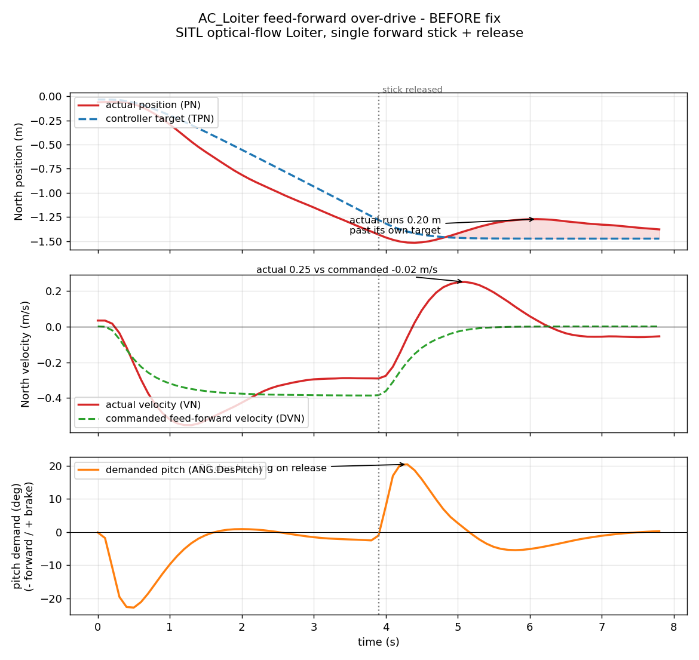
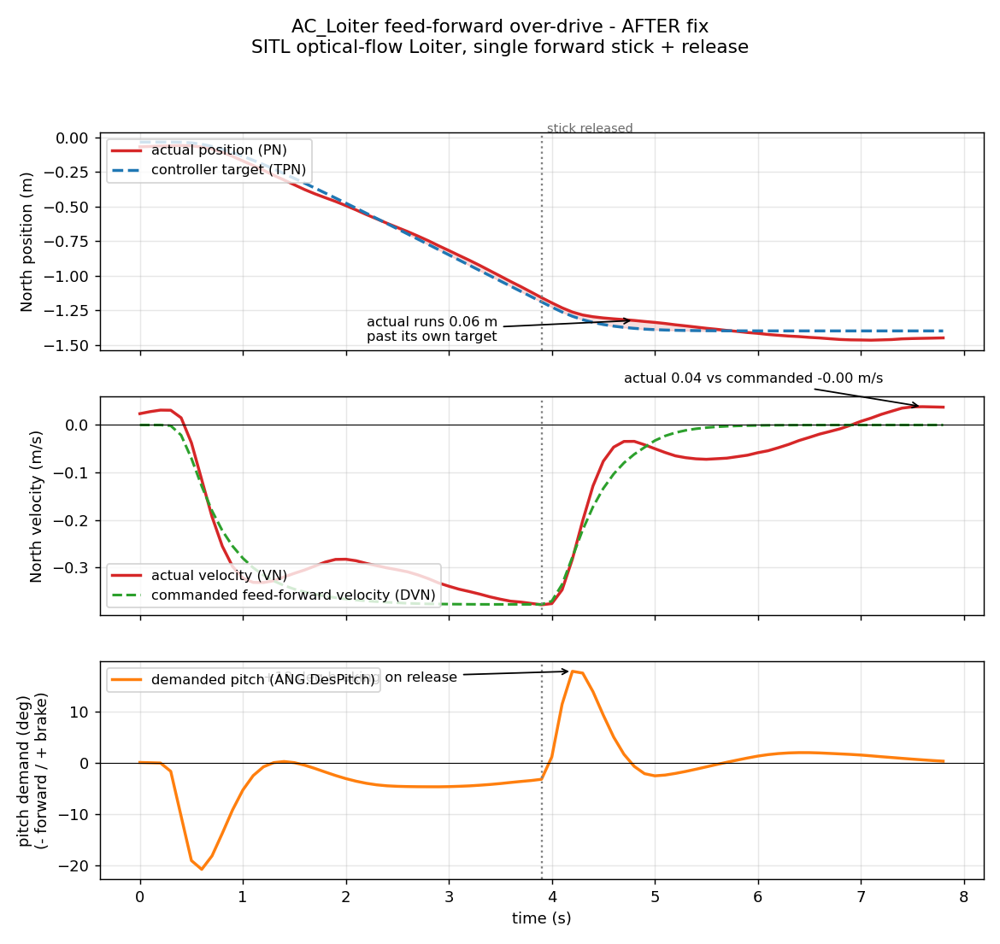

# PR #33318 - AC_Loiter drag/feed-forward consistency fix

Analysis archive for [ArduPilot/ardupilot#33318](https://github.com/ArduPilot/ardupilot/pull/33318).
Branch `pr-loiter-brake-drag` (author andyp1per), head `f8277625ff`
(2026-07-27). Committed plots/data here are from SITL; the real-flight forensic
numbers (logs 276/278) are cited inline only, no real-flight logs are committed
to this public repo.

### Head superseded 2026-09-29: rebased onto master, head `a6e4e018a1`

Rebased onto master on 2026-09-29; the GitHub head is now `a6e4e018a1`.
The `AC_Loiter:` commit prefix was reworded to `AC_WPNav:`, the library
the file lives in.
Nothing has been re-measured at this head. Every number below keeps the
commit it was taken on, and any head named above is left as written
because it is the code those numbers came from.

## Status (one line)

One-line kinematic-consistency fix in `AC_Loiter::calc_desired_velocity`.
SITL-validated, confirmed on the vehicle across three indoor optical-flow flights
(log276 before, log278/log279 after), and forensically cross-checked against the
reviewer's root-cause analysis - the two agree on the mechanism and the fix takes
load off the velocity-PID integrator in the regime where the bug lives. log279
also makes the case for the reviewer's larger follow-up fix (see below).

## The problem

In Loiter, `calc_desired_velocity` shapes the desired velocity toward the speed
limit with a "drag" deceleration. That drag is subtracted from the desired
velocity, but only the *braking* term was subtracted from the acceleration
feed-forward handed to the position controller - the drag was left in. So the
`(velocity, acceleration)` pair was not kinematically consistent: the
feed-forward over-drove the vehicle past its own speed-limited desired velocity,
built a position error, and the position loop then corrected it abruptly. A
forward stick produced a backward lurch on release.

The error scales with the drag term, `pilot_accel_max * speed / gnd_speed_limit`.
It is pronounced on optical-flow Loiter at low height - the EKF collapses
`gnd_speed_limit` to `(FLOW_MAX-1) * HAGL` (sub-metre/s near the ground), so the
drag term balloons - and negligible with GPS, where the speed limit is high.

## The fix

Subtract the drag from the feed-forward as well, so it equals `d(desired_vel)/dt`:

```cpp
// libraries/AC_WPNav/AC_Loiter.cpp, calc_desired_velocity()
loiter_accel_decel_mss = desired_vel_norm * (_brake_accel_mss + drag_decel_mss); // was: * _brake_accel_mss
...
_desired_accel_ne_mss -= loiter_accel_decel_mss; // now removes drag + brake, not just brake
```

The braking term was already removed from both paths; the drag was only removed
from the desired velocity. This makes the two paths consistent. The drag *model*
is untouched.

## The conclusion and why

This is the right narrow fix for the overshoot. It does not change the drag
model, it changes only whether the drag term is consistent between the velocity
it shapes and the acceleration it feeds forward. The reviewer (Leonard) and this
analysis agree the deeper issue is the drag formula treating the EKF
observability cap as a terminal velocity; that is a larger behaviour change
(scale `pilot_acceleration_max` and `gnd_speed_limit` down together) and belongs
as its own piece. See `analysis.md` for the forensic exchange.

## Key finding: the fix removes integrator abuse, it does not hide behind it

The review raised a fair concern: that the patch "works because the velocity
PID's I-term absorbs the mismatch" and so papers over the real bug. Following the
same steady-state relation through both regimes shows the opposite in the regime
that matters. Real-flight logs (log276 before, log278 after, same airframe and
params):

| velocity-PID integrator | pre-fix | post-fix |
|---|---|---|
| GPS, calibrated cap | `real_drag - drag ~ 0` | `real_drag` (small load added) |
| flow, collapsed cap | `real_drag - drag` = `-drag` (large) | `real_drag ~ 0` (small) |

The bug and the logs live in the flow/collapsed row. There the *old* code leaned
on the integrator (it had to wind to ~`-drag` to track, and lagged in
transients - the overshoot). Measured: integrator magnitude P95 2.9 m/s^2 (peak
3.7) before, 0.16 (peak 0.19) after; along-track position error +/-0.9 m -> +/-0.1 m.
The concern is real but applies to the GPS/calibrated row, where the added load
is tiny.

## Follow-up: log279 - the fix holds, and exposes the drag magnitude

A third indoor flight (log279, same airframe, fix in firmware fea9ea77) was flown
with a deliberate "twitch in the middle" to probe it. 175 s of optical-flow Loiter,
HAGL mean 0.39 m, cap collapsed throughout. The fix confirms again: velocity-PID
integrator P95 0.18 m/s^2 (peak 0.23), along-track position error P95 0.059 m
(peak 0.10), and through a burst of 8 rapid forward jabs the position held within
+/-0.07 m with no overshoot and no backward lurch (over-drive ~1.2x).

The "twitch" is not the old bug and not a spontaneous event - every lean spike
>10 deg followed stick activity within the preceding second. It is the braking
response to that 8-jab burst: on each release the controller commands a sharp
rearward lean of 15-19 deg. That lean is the drag deceleration, now correctly in
the feed-forward, braking cleanly to a stop (hence the tiny position error). What
makes it read as a twitch is magnitude, not direction: `drag_decel` reaches
~5 m/s^2 (0.92 of pilot_acc_max) to arrest a <0.86 m/s velocity, because
`gnd_speed_limit` is the collapsed EKF flow cap (0.5-2.5 m/s here). The brake is
kinematically correct but absurdly aggressive.

Two things make it worse at this height, both worth raising upstream:

- The rangefinder is dropping out at its minimum range. `RFND.Status` shows value
  2 (OutOfRangeLow) and `Dist` floors at 0 with a max of 1.02 m, while the EKF
  `HAGL` drifts to 1.7 m. So `HAGL` swings 0.3-1.7 m, the cap swings 0.5-2.5 m/s,
  and the drag magnitude (hence the brake lean) jumps from jab to jab.
- The fix routes drag into the feed-forward, so this inflated, cap-noise-modulated
  drag is now directly visible as attitude rather than being filtered through the
  desired-velocity / position loop.

This is the cleanest evidence for both halves of the review: the consistency fix is
correct and removes the overshoot, and it inherits the inflated drag magnitude the
reviewer flagged (cap treated as terminal velocity). It supports shipping the fix
and pursuing his scaling follow-up (pull `pilot_acceleration_max` down with the
cap), plus a separate look at the rangefinder min-range dropout corrupting the cap
below ~1 m. log279 is a real flight and is not committed here; numbers only.

A third, independent lever turned up while tracing this: the flow speed cap that
drives the drag term ignores the 2-state AGL KF and rides the noisy legacy
`terrainState`, even though the AGL KF is enabled and clean. That is a small EKF3
plumbing fix in its own right - see `agl_kf_speed_cap.md`.

## Telling this apart from the flow lockout (#33484)

A different Loiter flyaway on another airframe had this fix in the firmware
and was not this bug. Drag bug: a backward lurch on release from a settled
hold, with a healthy velocity estimate. Lockout: a hard brake against a
velocity the vehicle does not have, after an acro-to-Loiter switch, with
`XKF5.NI` pinned at 255 and one of `FIX`/`FIY` in the thousands while the
other stays small. See `../33484/`.

## Plots

All SITL (`LoiterFlowBrakeOvershoot` autotest: optical flow, no GPS, ~2 m height,
`LOIT_ANG_MAX=30`, deterministic forward jab + release).

| | |
|---|---|
|  | **A** - before: feed-forward over-drives actual velocity past the commanded trajectory; actual position runs ahead of target; braking lurch on release |
|  | **B** - after: feed-forward tracks the desired velocity, position holds near target, no backward lurch |

## What is here

```
33318/
  README.md          <- this file
  analysis.md        <- forensic write-up (the PR comment to the reviewer)
  agl_kf_speed_cap.md  <- related finding: speed cap ignores the 2-state AGL KF (candidate separate PR)
  forensic_drag_analysis.py  <- reusable: reconstructs drag_decel + vel-PID I-term from a log
  plots/             <- A/B before/after PNGs + make_plots.py (regenerates from data/)
  data/
    before.BIN       <- SITL LoiterFlowBrakeOvershoot, drag left in feed-forward
    after.BIN        <- SITL LoiterFlowBrakeOvershoot, with the fix
```

All BINs are SITL (ArduCopter 4.7-beta, CMAC default home, hundreds of `SIM_*`).

## Reproduce

Plots, from this directory:

```
python3 plots/make_plots.py
```

The SITL behaviour, in an ardupilot checkout on the PR branch:

```
./waf configure --board sitl && ./waf copter
Tools/autotest/autotest.py --no-configure test.Copter.LoiterFlowBrakeOvershoot
# compare PSCN.PN vs PSCN.TPN and PSCN.VN vs DVN in the forward-jab window
```

To capture the "before" trace, revert the one-line change in
`calc_desired_velocity` (`loiter_accel_decel_mss = desired_vel_norm * _brake_accel_mss`)
and rebuild.

## People

- Author: @andyp1per.
- Reviewer: Leonard Hall (attitude/position-control author) - agreed on the root
  cause, raised the I-term concern (addressed above and in `analysis.md`), and
  proposed the larger drag-model scaling fix as separate future work.

## Round of 2026-09-30 (AP-Review at a6e4e018a1): reworked as an opt-in, 2026-10-03

On local branch fix/33318 (not pushed), over head ddd7135b95.

The bot's GPS regression reproduced (SITL jab test, metrics: peak speed over
desired along the jab, most backward speed in 8 s after release): master flow
1.47x/-0.39 m/s, GPS 1.00x/0.00; PR head flow 1.10x/-0.07, GPS 1.01x/-0.22.

The cause, re-derived. #33639 (lthall, merged 2026-07-07, not in the 4.7
beta) made the modelled drag A*v/LOIT_SPEED_MS whatever the EKF cap, so the
June logs' 4.65 m/s/s cap-inflated drag no longer happens. What remains is the
model itself: LOIT_SPEED_MS reached at the maximum lean. With LOIT_SPEED_MS 5
at 30 deg (the SFD indoor setting, and the test's) the model asks for 5.7
m/s/s at 5 m/s; the Nazgul10 cruise log (tier 1, groundspeed, wind not
separated) leans about 0.8 more at 5 m/s than in a hover, and its lean grows
about linearly with speed (linear fit residual 0.099 against quadratic 0.330).
With LOIT_SPEED_MS 12.5 the same SITL flow flight has no pull-back on master
(-0.02 m/s).

Tried and rejected, all SITL: scaling pilot accel by cap/LOIT_SPEED (undoes
#33639's stick feel, flow 0.96x/-0.20); weighting the PR's drag removal by the
cap (1.26x/-0.02); making the feed-forward consistent with the speed clamp
(1.31-1.35x/-0.14 to -0.27); removing only a quadratic-drag "excess" (1.23x/
-0.07, but its premise is refuted by the Nazgul10 data above).

Kept: LOIT_OPTIONS bit 1 (FF_INCLUDES_DRAG), opt-in, subtracting the modelled
drag from a local feed-forward. Bit clear: identical to master. Flow jab with
the bit set: 1.08-1.13x and -0.05 to -0.08 m/s; bit clear -0.33 to -0.38;
GPS default 0.00. The test asserts all three and fails on a master binary.
SFD must set LOIT_OPTIONS 2 in its hwdef defaults to keep the beta's
behaviour, and #33639 is now on the SFD list.

### Superseded 2026-10-03 (later): the SFD O4's own drag matches the model

The Nazgul10 figure above is from a different, GPS-only airframe at cruise
speeds, and does not describe the SFD O4 the indoor flow work was flown on.
The O4's own indoor logs (tier 1, EKF core 0 speed, calm air), steady
segments, lean acceleration above hover: log281 0.48 m/s/s at 0.5 m/s and
0.70 at 1.0; log280 0.38 and 1.52. LOIT_SPEED_MS 5 at 30 deg models 0.57 and
1.13. At the speeds the O4 flies indoors the model matches it within the
noise, so the "several times too much drag" account does not hold for it.

What that leaves, as a hypothesis to fly: the O4's step-back was the EKF cap
inflating the drag (4.65 m/s/s at 0.5 m/s in the June logs, before #33639),
which #33639 removes; the SITL step-back at LOIT_SPEED_MS 5 / 30 deg is the
SITL airframe having far less drag than the O4. Flying #33639 on the O4 with
LOIT_OPTIONS clear would settle it. The opt-in bit and its SITL numbers above
stand as measured; whether SFD needs it does not.

## Codex cold read (2026-10-03)

One coverage gap, verified: the autotest never sets EK3_OPTIONS bit 3, so the
`aglKfH` branch the AP_NavEKF3 commit adds to the flow control limits never
runs, and a regression there would pass. The Loiter maths, units, NE frame,
bit-clear behaviour (identical to master) and the bit 1 docs were clean. To be
picked up when the PR is unparked after the O4 flies #33639.

## 2026-10-30: SFD-O4 Loiter with the bit clear, not the test asked for

SFD-O4 flies `LOIT_OPTIONS 1`, so bit 1 is clear and this PR's change did
not run on any of the beta `52b1d36f` flights of 2026-10-30; #33639 is in
the build. The question above (does the O4 step back with the bit clear,
once #33639 removes the cap's drag inflation?) is only partly answered.

log63 (3408138/643) flight 2, flow lane at 3-6 m, `LOIT_SPEED_MS 15`: after
each of five full-stick pushes released at 2.8-9.6 m/s, velocity along the
push direction never went negative, but the pilot gave stick again 1.1-3.0 s
after each release with the vehicle still moving at 0.85 m/s or more, so no
stop completed hands-off. And at 3-6 m the EKF cap was 20-36 m/s, above
`LOIT_SPEED_MS`, so the drag inflation the hypothesis is about could not
occur. The flight that settles it holds still after a release below 2.3 m,
where the cap binds. log61 (3408138/639): Loiter on the GPS lane entered at
10.5 m/s with a 30 deg lean and stopped in 1.8 s.

Correction 2026-11-05: the premise above is wrong. The beta at `52b1d36f`
carries this PR's change unconditionally (there is no LOIT_OPTIONS bit 1
in it; the opt-in rework was never pushed or merged into the beta), so the
drag subtraction did run on those flights. What log63 shows is the
subtraction active with the cap above `LOIT_SPEED_MS`, and log61 the same
on GPS.

## 2026-11-05: AP-Review at 3ec57dc67d - the opt-in, on a local branch

Branch `r1105/33318-fix` (not pushed), on the PR head rebased onto
802db19de1. SITL A/B with four binaries through one harness (flow jab 3 s
at 2 m, LOIT_SPEED_MS 5 / 30 deg; GPS jab 8 s at 12.5 default and at 5 /
30 deg; a climb through the height where the flow cap crosses
LOIT_SPEED_MS 3), along the jab: over-drive, most backward speed after
release, velocity I-term peak, position error after release.

| | master | PR head | cap gate | opt-in, bit clear / set |
|---|---|---|---|---|
| flow, 5/30 | 1.37-1.39x, -0.33 to -0.38 m/s | 1.13-1.16x, -0.04 to -0.06 | 1.08-1.10x, -0.05 to -0.09 | -0.40 / 1.11x, -0.07 |
| GPS 12.5 | -0.02, I 1.70, err 0.56-0.59 m | -0.17, I 3.98-4.04, err 0.99-1.02 m | as master | as master / as head |
| GPS 5/30 | -0.41 to -0.43, I-mean -2.83 | -0.11 to -0.12 | as master | as master / -0.12 |
| cap crossing, feed-forward step | 0 | 0 | 4.31 m/s/s in one 0.1 s sample, speed 2.26 -> 3.68 m/s | 0 |

- The bot's GPS regression reproduces (its figures: I 1.13 -> 2.88,
  error 0.57 -> 1.16 m, -0.03 -> -0.25 m/s; different jab length).
- The bot's suggested gate (subtract only while `gnd_speed_limit_ms <
  _speed_max_ne_ms`) fixes GPS at 12.5 but is rejected: the pull-back
  follows LOIT_SPEED_MS against the airframe (GPS at 5/30 pulls back like
  flow and the gate leaves it), #33639 makes the modelled drag
  cap-independent, and the gate steps the feed-forward at the crossing.
- Kept the 2026-10-03 opt-in design, re-done on the current head as
  separate commits on top of the flown `b35595a852`: `39535b9775` (EKF
  commit message reworded, `aglKfH` -> `aglKf.hgt`, tree unchanged),
  `e94bd58d6f` (comment names FuseOptFlow), `7331433ef4` (ground clearance
  floor on the speed limit only; with the AGL KF compiled out the
  function's disassembly is master's operations reordered, while the old
  head also floored the gain scaler), `aa4d7a4638` (feed-forward comment:
  matches d(desired_vel)/dt only below the speed clamp), `07db700221`
  (drag in a local, not `_desired_accel_ne_mss`), `23cb239922` (LOIT_OPTIONS
  bit 1, `FF_SUBTRACTS_DRAG`), `643ed47833` (test asserts).
- Sub accumulation, from the source: Sub's `auto_terrain_recover_run()`
  calls `loiter_nav.update()` every loop after `clear_pilot_desired_acceleration()`
  and `init_target()`, which seeds the desired velocity and predicted
  acceleration from the current targets, and never sets the pilot
  acceleration again, so `_desired_accel_ne_mss -=` builds up each loop.
  Master already accumulates the braking term there; the PR added the drag.
  Copter's Loiter, PosHold, ZigZag and QuadPlane's QLoiter reset it every
  loop, and precision loiter reads it before `update()`. Not run in SITL.
- Test `LoiterFlowBrakeOvershoot`: fix passes twice (bit clear 1.40x /
  -0.35, -0.36; set 1.08-1.09x / -0.06, -0.07; GPS 0.99-1.00x / 0.00);
  fails on master (bit set -0.37 against -0.38) and on the old head (bit
  clear -0.06; GPS -0.22).
- Builds: each commit copter; copter, plane, sub at the head; param_parse
  for Copter, Sub and Plane. Gate and branch conventions clean; Codex cold
  read of the six commits: nothing.
- Not done: the 10-03 Codex note (the test never sets EK3_OPTIONS bit 3,
  so the AGL KF branch of the control limits is not exercised) is still
  open. SFD: the beta flies the unconditional change; to keep that with
  this branch its hwdef defaults would need LOIT_OPTIONS bit 1, though the
  O4's own drag measured close to the model (see above).

### Superseded the same day: the option dropped, keyed on the source set instead (`r1105/33318-srcset`, not pushed)

Andy rejected the LOIT_OPTIONS opt-in, as he had the 2026-10-03 version,
and chose the EKF source set instead: subtract the drag only while the
active source set takes horizontal velocity from optical flow
(EK3_SRCn_VELXY 5), and leave GPS and every other source as master. The
change was made for flow and has flown on flow; GPS gets master's
feed-forward without a parameter. The bot's EKF-cap gate stays rejected
for the step it puts in the feed-forward at the crossing.

Branch from `07db700221` (the EKF commits, comment fixes, gain floor and
local feed-forward kept): `10f62e958b` NavEKF3::get_velxy_source() (the
primary core's set, configuration not fusion), `608ec8954f`
AP_AHRS::get_velxy_source() (false unless EKF3 is the active estimator;
nothing equivalent existed on AHRS, NavEKF3 or in the Lua bindings, only
the set index), `c3bf036a04` AC_Loiter uses it, `ff59584ac8` test. The
option commits stay on `r1105/33318-fix` for reference.

SITL (same harness, plus a GPS<->flow source set switch on RC8 at 5 m,
3.8 m/s desired, LOIT_SPEED_MS 5 / 30 deg, where the flow cap of 7.5 m/s
does not bind):

| | master | source set |
|---|---|---|
| flow 5/30 | 1.37-1.38x, -0.35 to -0.39 m/s | 1.07x, -0.06 to -0.08 |
| GPS 12.5 | -0.02 to -0.03, I 1.70-1.71 | identical |
| GPS 5/30 | -0.42 to -0.43 | identical |
| switch GPS -> flow: FF step, speed over 3 s | none, -0.00 / +0.28 m/s | -4.27 m/s/s, -1.31 / +0.73 |
| switch flow -> GPS | none, -0.19 / +0.01 | +4.26 m/s/s, -0.60 / +1.15 |

The switch lands about 0.5 s after the RC change (aux poll). A throwaway
1 s ramp of the drag's weight (one float, two lines; not committed) spread
the step to 0.43 m/s/s per sample but left most of the speed change
(-0.94 / +0.42 and -0.27 / +0.78 m/s), since the I-term still has to
settle; not added (ARCH-7).

Test: passes twice on the branch (flow 1.08-1.09x / -0.06; GPS 0.99-1.00x
/ 0.00); fails on master (flow -0.37), on the option build with the bit
clear (flow -0.39) and on the old head (GPS -0.22). Builds: each commit;
copter, plane, sub; copter and plane with HAL_NAVEKF3_AVAILABLE 0. Gate
and conventions clean.

Codex cold read, two points, both left as designed and recorded here:
EKF2 returns false, so EKF2 flow keeps master's feed-forward (EKF2 is
compiled out by default, and its "not GPS" is not "flow"); and the gate
reads the configured set, not what is being fused, so with EK3_SRC_OPTIONS
bit 0 a GPS set that has lost GPS and flies on flow keeps master's
feed-forward, and a flow set also fusing GPS subtracts the drag. A fusion
test would follow sensor health and step the feed-forward at failovers.

SFD beta impact. The beta flies the subtraction unconditionally, so its
GPS lane flights (log61, the 10.5 m/s Loiter entry) flew it; with this
branch GPS sets get master's feed-forward. SFD flies EK3_SRC_OPTIONS 8
(GPS on core 0, flow on core 1), and the accessor reads the primary
core's set, so the subtraction follows the primary lane, and a lane
switch between the cores at speed steps the feed-forward like the source
set switch above (4.3 m/s/s at 3.8 m/s with LOIT_SPEED_MS 5 / 30 deg).
Not measured as a lane switch.

## 2026-11-06: SFD-O4 log73 is not the A/B

The topup11 card's pack 1 (beta `52ec3c77`, LOIT_OPTIONS 1 against 65 via
the temporary bit 6) began with log73 (2026-11-05, LOIT_OPTIONS 1, this PR
on). Loiter drifted in the direction of each stick release and would not
hold, and the hand carries that followed (logs 74-77) showed why: indoors
after dark, looking straight down at the semi-glossy floor, the flow sensor
read about 0.1-0.3 of the real motion at 0.8 m and 0.5 at 1.7 m (0.77-0.96
over a plain matte rug, 0.88 on the same floor in June daylight). Nothing
in log73 measures this PR. Pack 1 is to be flown again in daylight or over
a matte mat.

## 2026-11-06: the A/B flown on SFD-O4 (logs 79-80), and a correction

Correction to the 2026-10-30 section above: the SFD beta never carried the
opt-in (bit 1) rework, which stayed on the local branch fix/33318. Every
beta since June (`5fe8c79f8d`; `52b1d36f`, `ea8cef60`, `52ec3c77` checked)
has this PR's change unconditionally, so it ran on log61-65 and every flight
since, including log63's full-stick pushes released at 2.8-9.6 m/s on the
GPS lane, none of which pulled back (none stopped hands-off either). The
"did not run" there is wrong.

Topup11 added an SFD-only switch, LOIT_OPTIONS bit 6, which puts the drag
back in the feed-forward as master has it. SFD-O4, beta `52ec3c77`, indoors
in daylight on flow, LOIT_SPEED_MS 15, LOIT_ANG_MAX 45, LOIT_BRK_DELAY 1:
log79 with the change (LOIT_OPTIONS 1), log80 without (65), one flight
each, the same short pitch pulses (0.2-0.5 s, a third of full stick, 1-1.7
m/s) every 2-2.5 s along one line at 0.75-1.2 m. The flow read 0.72-0.85 of
the speed against the rotor-drag reference on both. Tier 1:

| | log79, change on | log80, change off | SITL, on / off |
|---|---|---|---|
| peak speed / desired, median of 19-20 pulses | 1.06 (0.92-1.17) | 1.11 (0.94-1.23) | 1.08 / 1.44 |
| roll-back after the longest hands-off release | -0.07 m/s | -0.14 m/s (with a small counter nudge) | -0.08 / -0.40 m/s |
| target minus position along the motion, 2 s after a release, mean | +0.10 m (18) | -0.00 m (10) | - |

Without the change the O4 runs about 0.1 m further ahead of its target as
it stops, the predicted direction, about three times the scatter between
releases but a tenth of SITL's effect, and neither flight pulls back. Two
reasons it is small here: the drag term scales with speed and these stops
began at 1-1.7 m/s, and at these settings the model,
g tan(LOIT_ANG_MAX) v / LOIT_SPEED_MS = 0.65 m/s/s per m/s, is about twice
the O4's own drag (body X specific force on log63's GPS lane, 0.28-0.37
m/s/s per m/s from 2 to 10 m/s, wind not separated). With the model at
twice the airframe's drag, the velocity integrator carries about half the
modelled drag either way, about 0.3 v with the change and 0.35 v without;
with a matched model it carries almost nothing with the change and all of
it without. (That split is derived from the steady-state relation in
`analysis.md`, not measured here.)

Kept on the beta as LOIT_OPTIONS 1 by Andy's decision (2026-11-06): the
O4 is to fly Loiter fast, where the drag term reaches 6.5 m/s/s at 10 m/s.
Still open for the PR: no hands-off stop at speed has been flown either
way; the head on GitHub is the unconditional change, with AP-Review's GPS
SITL roll-back (-0.03 to -0.25 m/s at full stick on default settings; reproduced below) unanswered and the
opt-in rework unpushed; and the AP_NavEKF3 commit (the AGL KF height for
the flow limits, untested by the autotest) is a different subsystem and
belongs in its own PR.

## 2026-11-06: GPS Loiter stops in SITL, AP-Review's roll-back reproduced

A throwaway probe (`LoiterStopProbe33318`, in a scratch worktree of the SFD
beta at `0c193625ca`, not committed): GPS Loiter at 20 m, LOIT_ACC_MAX_M 2,
LOIT_BRK_ACC_M 2.5, LOIT_BRK_JRK_M 5 unless stated. Full stick forward or
back for 2-3 s, release, 8 s hands off, four stops per row, with this PR's
change (LOIT_OPTIONS 1) and without it (65, the SFD switch that restores
master's feed-forward). Along the push, from PSCN/PSCE, and the velocity
I-term from PIDN/PIDE. Two airframes: SITL's default quad, and one with
linear drag at the O4's measured 0.30 m/s/s per m/s (frame JSON `refSpd`
10, `refAngle` 17, `mdrag_coef` 1; measured 0.30-0.31 from 2 to 9 m/s in
the probe). SITL caps Loiter's lean at ATC_ANGLE_MAX (30 by default), so
LOIT_ANG_MAX 45 needs ATC_ANGLE_MAX raised; the O4 flies 80. Tier 2, no
wind.

| airframe | LOIT_SPEED_MS, lean (model drag per m/s) | model / real drag | stop from | change on: past target, slide back, roll-back | change off |
|---|---|---|---|---|---|
| default quad | 5, 30 deg (1.13) | about 3 | 3.8 m/s | 0.31 m, 0.28 m, -0.10 m/s | -0.54 m/s: stops early, back, then forward |
| default quad | 15, 30 deg (0.38) | about 1 | 6.6 m/s | 0.57 m, 0.39 m, -0.13 m/s | clean |
| default quad | 15, 45 deg (0.65) | about 1.5 | 8.0 m/s | 0.79 m, 0.65 m, -0.24 m/s | -0.23 m/s: early stop, creeps forward |
| O4 drag | 15, 45 deg (0.65) | 2.1 | 8.4 m/s | 0.48 m, 0.38 m, -0.11 m/s | -0.33 m/s: early stop, back, 0.7 m forward |
| O4 drag | 33, 45 deg (0.30) | 1.0 | 8.2-8.6 m/s | 0.46 m, 0.26 m, -0.06 m/s | clean: within 0.3 m of target, no reversal |

The I-term at release says why. With the change it carries the airframe's
real drag (+0.3 to +1.2 m/s/s at release, winding to +1.6 to +2.9 after)
and keeps pushing after the stick is released, so the vehicle runs past its
target and slides back, by more the more drag the airframe has. Without it
the I-term carries real minus modelled drag (-2.2 at three times, -0.7 to
-1.2 at 1.5-2 times, +0.1 matched), and when the model is too high it
brakes the vehicle ahead of the plan: it stops early, rolls back while the
target is still moving, then moves forward to it. So master's feed-forward
is consistent when the model matches the airframe, as lthall said, and this
PR's is consistent only for an airframe with no drag; each is better where
the other's error is larger, and they cross near a model of twice the real
drag. AP-Review's GPS finding reproduces wherever the model is about right.
The June case the PR was written for (the flow cap inflating the drag about
eight times, before #33639) is the far end of the first row.

Stop length, metres per m/s of release speed, O4-drag airframe:

| setting | change on | change off |
|---|---|---|
| 15 m/s, 45 deg, LOIT_BRK_DELAY 1 | 1.66 | 1.34 |
| same, delay 0.5 | 1.51 | 1.21 (roll-back -0.43 m/s) |
| same, delay 0.5, LOIT_BRK_JRK_M 20 | 1.48 | 1.17 (-0.46) |
| 33 m/s, 45 deg, delay 1 | 2.59 | 2.26 |
| same, delay 0.5, jerk 20 | 2.21 | 2.01 |
| same, delay 0.2, jerk 20 | 2.11 | 1.81 (still clean) |

Matching the model lengthens the stop, because Loiter's modelled drag is
both the stop profile and, in master's feed-forward, the assumed airframe
drag. LOIT_BRK_ACC_M is already at the top of its documented range (2.5).

### The airframe's drag in the feed-forward, prototyped

Both feed-forwards assume something about the airframe's drag: master that
it equals the stop model (A v / LOIT_SPEED_MS), this PR that it is zero.
Prototype (scratch worktree only, not for commit): keep this PR's change,
so the modelled drag only shapes the stop, and add back k v_desired, the
lean the airframe's own drag needs at the desired speed, with k a temporary
parameter LOIT_DRAG_K. k = 0 is this PR; k equal to the model's A /
LOIT_SPEED_MS is master. O4-drag airframe, 15 m/s at 45 deg, the same
probe:

| k (true 0.30) | brake delay | I-term at release / 1 s after | roll-back | past target, slide back | stop, m per m/s |
|---|---|---|---|---|---|
| 0.30 | 1 s | -0.01 / +0.02 m/s/s | none | 0.17 m, 0 | 1.50 |
| 0.30 | 0.5 s | -0.00 / -0.01 | none | 0.17 m, 0 | 1.40 |
| 0.20 | 0.5 s | +0.31 / +0.64 | -0.01 m/s | 0.13 m, 0.10 m | 1.42 |
| 0.40 | 0.5 s | -0.31 / -0.65 | none | stops slightly early | 1.36 |
| this PR alone (0) | 0.5 s | +0.96 / +1.93 | -0.13 m/s | 0.48 m, 0.40 m | 1.51 |
| master (65) | 0.5 s | -1.18 / -2.32 | -0.43 m/s | early stop, back, forward | 1.21 |

With the true drag the I-term stays at zero through the push and the stop,
the vehicle stays within 0.14 m of its target, and the stop keeps the
strong model's length; a third too low or too high still stops without a
reversal. So the stop profile and the airframe's drag are two things, and
the consistent feed-forward needs both. Where k would come from: a Loiter
parameter, or EK3_DRAG_MCOEF (the EKF's rotor drag per m/s for wind
estimation, unset on the O4; log63 puts it near 0.30), which keeps one
source of truth but turns on the EKF's drag fusion with it. Defaulting k
to the model's A / LOIT_SPEED_MS gives master's behaviour unchanged.

Not flown. The O4's drag figure is from log63's GPS lane up to 10 m/s,
wind not separated.

### 2026-11-06 (later): LOIT_DRAG_COEF indoors, SFD-O4 logs 82-83

The airframe-drag feed-forward, as `LOIT_DRAG_COEF` on the SFD beta (topup12,
`9b4d90f9de`, test `650930dcc8`), flown indoors in daylight on flow:
log82 at 0, log83 at 0.3, LOIT_OPTIONS 1, LOIT_BRK_DELAY 0.3. Flow against
the drag reference 0.75-0.88. Median peak speed over desired 0.99 and 1.04;
releases with 3 s or more hands off: three in log82 (from 1.5-1.9 m/s,
roll-back at most 0.07 m/s), one in log83 (from 0.5 m/s, 0.09 m/s); after a
release the vehicle sat a median 0.15 and 0.06 m behind its target. No
difference these speeds can show (the drag lean is under 3 deg at 1.5 m/s),
and nothing worse: with 0.3 it stopped and stayed, no creep forward. The
outdoor test at 8-10 m/s is still to fly.

## 2026-11-06 (later): the PR reworked as LOIT_DRAG_COEF (local, not pushed)

Commit hashes above: the SFD beta was rebased onto `909cde934e` and pushed
the same day, so the topup12 commits cited earlier as `9b4d90f9de`
(AC_WPNav) and `650930dcc8` (autotest) are now `6b6e59d60d` and
`83465e9ad2` on the beta, and the logs 79-80 record `0c193625ca` is
`c690633256`. Logs 82-83 flew a build reporting `9b6b564a`, the
pre-rebase head, the same code.

Local branch `r1106/33318-v2` on the PR's base `802db19de1` replaces
`b35595a852` (the drag taken out of the feed-forward for everyone):

- `35e9aa089d` AP_NavEKF3: the AGL KF height for the flow speed limits,
  `3ec57dc67d` unchanged.
- `c8f00ae46b` AC_WPNav: LOIT_DRAG_COEF (AC_Loiter index 12), the
  vehicle's drag per m/s. Set, the feed-forward carries the lean that drag
  needs at the desired speed and the modelled drag only shapes the stop.
  At 0, the default, the modelled drag stands in and the feed-forward is
  master's exactly (`brake + (drag - drag)`). Unlike the beta's topup12,
  where 0 means the drag out.
- `3bdb50c65b` autotest: LoiterAirframeDragFeedForward, two GPS stops on
  `models/quad-linear-drag.json` (linear drag 0.30 m/s/s per m/s) at
  LOIT_SPEED_MS 15, 45 deg, ATC_ANGLE_MAX 80. Most backward speed after
  release: -0.37 m/s at 0 (master's feed-forward), -0.00 at 0.3.
  LoiterFlowBrakeOvershoot (master's, no assertions) still runs.

Throwaway probe on the same branch (not committed), master's flow jab
(LOIT_SPEED_MS 5, 30 deg, about 2 m, SITL's default frame), twice each:
most backward speed -0.39 m/s at 0, -0.01 at 0.3. So the coefficient
fixes the PR's original flow case as well as the GPS case the earlier
version made worse. Tier 2. Gate: check_branch_conventions passes against
the base, astyle clean. Not pushed (a force push over the PR head), the
description not updated; both wait for Andy.

Pushed 2026-11-06 as a force push with a lease, `3ec57dc67d..3bdb50c65b`
on `pr-loiter-brake-drag` (the three commits above), no `/pr-review` run
first by Andy's choice, left to the review bot. Title now "AC_WPNav: feed
the vehicle's own drag forward in Loiter (LOIT_DRAG_COEF)"; description
rewritten (the user-visible stop, the two jobs of the drag model, the
SITL table, and the earlier version's GPS regression as the reason for the
default).

## 2026-11-06: AP-Review at `3bdb50c65b` (COMMENT), fixed (`r1106/33318-fix2`)

Rebuilt on the base `802db19de1`: the three pushed commits with the EKF
one's message reworded (tree identical to `3bdb50c65b` after the third),
then four on top.

- `b5c0ec3d85` AP_NavEKF3 (was `35e9aa089d`): message says aglKf.hgt, and
  no longer says the cap feeds the Loiter drag term (the speed limit
  cancels out of it in calc_desired_velocity) or that the default is
  unchanged (the next fix makes it so).
- `d53edafe4e` AP_NavEKF3: the comment names FuseOptFlow (was
  `e94bd58d6f` on `r1105/33318-fix`).
- `5dc10bde3b` AP_NavEKF3: the ground clearance floor on the speed limit
  only, as master; with the option off or compiled out the function is the
  base's (was `7331433ef4`).
- `046acca4cc` AC_WPNav: the drag term subtracted only from the
  acceleration handed to the position controller, not stored in
  `_desired_accel_ne_mss`. The value the position controller receives is
  unchanged to rounding; Sub's terrain recovery (clears once at
  ArduSub/mode_auto.cpp, then updates every loop) no longer accumulates it.
  Not exercised in SITL.
- `079952af70` AC_WPNav: LOIT_DRAG_COEF text: the magnitude, from steady
  forward flight; too high a value rolls the vehicle back after a stop.

SITL at the code of this series (comment and doc lines differ only):
LoiterAirframeDragFeedForward -0.36 m/s at 0, -0.00 at 0.3 (-0.37 / -0.00
recorded at `3bdb50c65b`); LoiterFlowBrakeOvershoot, OpticalFlowLimits and
OpticalFlow pass. Copter, sub and plane build, every new commit builds,
gate clean but the existing 74-char subject note. Cold read: no must-fix;
its prose points taken (the two message claims above, the over-setting
warning was "above the real drag" where the rollback only exceeds 0's
above Loiter's own model, a three-line comment cut to one, "unchanged to
rounding", "forward" for "straight"). Pushing it needs a force push for the
reworded message.

Pushed 2026-11-06: `pr-loiter-brake-drag` `3bdb50c65b...079952af70`
(force, with a lease; the first commit reworded, two identical, four
added). Reply posted: https://github.com/ArduPilot/ardupilot/pull/33318#issuecomment-6687691446
