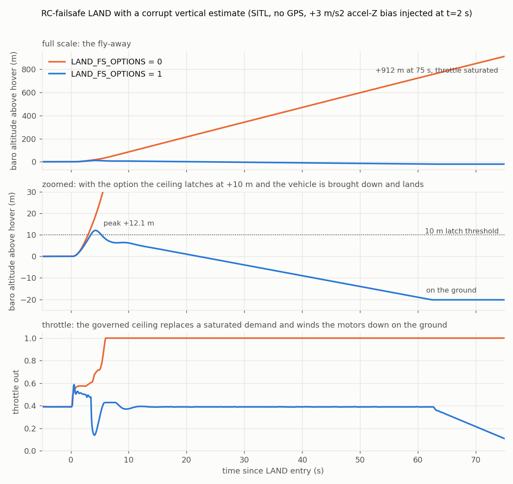

# PR #34210 - Advanced land failsafe (LAND_FS_OPTIONS bit 0)

Analysis archive for [ArduPilot/ardupilot#34210](https://github.com/ArduPilot/ardupilot/pull/34210).
Branch `pr-land-fs-options` (andyp1per fork), base `master`, head `7ffe67da33`
(2026-09-03). Everything committed here is from SITL; the real-flight fly-away
this answers is described generically only.

## Status (one line)

Opened 2026-08-29. Opt-in, default off. The design was reshaped twice by its
own SITL test before submission (see below), which is the reason this archive
exists. Awaiting review; not yet flown.

## The problem

When LAND is entered because of a radio, GCS or EKF failsafe the pilot cannot
intervene. The reported failure was a wrong-sign vertical velocity estimate with
low variance: LAND saw a descent that was not happening, added throttle to
arrest it, and the vehicle climbed away. The stock vibration failsafe exists for
exactly this mechanism but keys on a high velocity variance, which a confident
wrong estimate never shows. The failsafe itself is the right trigger for a
backstop: it has already declared we are flying blind, so the vertical authority
can be bounded without having to detect that the estimate is bad.

The confident wrong estimate is not hypothetical. On a MicoAir743v2 quad,
log36 (not committed), XKF1.VD read +1.2 m/s (descending) while BARO.CRt
read +3 to +9 and GPS.VZ -3 to -7, the vehicle gained 54 m, and XKF4.SV sat
at 0.03 throughout. That flight was VALT on a GPS-denied source set left
active by a throw-mode bug (fixed in #32475), not a failsafe LAND; the LAND
fly-away that motivated this PR was reported without a log, so the
mechanism is inferred from log36 and the SITL runaway, not measured on the
event itself.

## The design, and how the test changed it

With the bit set, two layers engage once the failsafe lands an armed vehicle and
stay engaged for the rest of that landing:

1. The vibration compensation is forced on exactly as `check_vibration()` would
   engage it - the vibration-resistant throttle law *and* the baro-derived
   vertical velocity in the position controller and land detector. A new
   `vibration_check.forced` flag keeps `check_vibration()` the owner of the
   detected state.
2. A baro-only runaway cap: LAND only ever commands a descent, so a net climb of
   more than 10 m on the barometer is a fly-away. That latches a throttle
   ceiling, applied after the vertical controller, governed from the baro climb
   rate (PI on the error from the commanded landing descent).

Three things the runaway test found, in order:

- **A fixed 0.9x-hover ceiling does not descend.** First version. The learned
  hover throttle was 0.44 against a true hover of 0.39 (13% high), so the
  ceiling sat *above* hover and the vehicle kept drifting up at 0.4 m/s after
  the latch (BAlt 39.6 -> 61.6 m over 45 s at ThO 0.40; that log was not kept).
  A learned hover throttle is not a safe reference for a hard floor.
- **A PI ceiling floored at 0.5x hover strands the vehicle armed on the
  ground.** Pre-submission review, verified against the land detector: it needs
  `limit.throttle_lower`, which the mixer only sets at zero thrust. The floor was
  removed and the ceiling now winds down *through* zero on the ground (the
  throttle filter only reaches the lower limit from below), so the motors stop.
- **Forcing the full vibration compensation does not stop the climb on its
  own.** With the baro-derived velocity in the loop the vehicle still climbed
  14 m before the cap latched, because `getVertPosRateD` is a complementary
  filter on the EKF's own height state, which in this scenario has run away too.
  The cap is what brings it down; the forced compensation is what lets the land
  detector work on a sane velocity when the estimate is merely wrong rather than
  gone.

Final numbers: unprotected +912 m in 75 s at full throttle; protected, the
ceiling latches at +10 m, the climb peaks at +12 m, the vehicle is on the
ground at 62 s and the motors are at their minimum by 75 s.

## Why the runaway detector is an integrated baro climb

A baro-velocity cross-check was rejected for VALT because near the ground
the baro is the worse signal. Measured on log36 against unfused GPS
vertical velocity (RMSE m/s; sign = fraction of moving samples with the
right sign):

| regime | baro vs GPS | EKF vs GPS |
|---|---|---|
| near-ground hover, 166-216 s | 1.16, sign 70% | 0.25, sign 100% |
| steady hover, 178-190 s | 0.94, sign 60% | 0.21, sign 100% |
| sustained climb, 658-685 s | 1.24, sign 92% | 3.70, sign 19% |

The regimes invert. A rate-based baro check would false-trip one sample in
three in a normal hover while the EKF was right; in a sustained climb the
baro is the only signal with the right sign. Gating on a large integrated
ascent, not a rate, is what lets the same sensor be trusted here. DCM was
considered as a fallback and is not one: it is an independent attitude
check (the log36 tilt ran 15-22 deg off DCM) but has no independent
vertical velocity.

Open: whether ground effect can fake a 10 m ascent. The detector counts net
climb from the lowest baro reading since it armed, and one indoor quad in
the private notes recorded a -8.2 to +13.1 m baro swing in ground effect
(MicoAir743v2 flow quad, not committed). A dip on the way down followed by
recovery would count as a climb. Not reproduced in SITL yet; a baro offset
step during the landing descent would test it.

## Known limit, stated in the PR

With the EKF height run away (Alt reading -300 m while on the ground) no
EKF-derived descent rate can read "low", so the land detector never declares
landed and the vehicle stays armed at minimum throttle. The stock vibration
failsafe has the same limit (its autotest force-disarms too). The healthy case
(`ModeLandAdvancedFailsafe`) lands and disarms normally with the bit set.

## Plots

| | |
|---|---|
|  | **A** - option off flies away at saturated throttle; option on latches at +10 m, peaks +12 m, descends at the landing speed and winds the motors down on the ground |

## What is here

```
34210/
  README.md          <- this file
  plots/
    A_runaway_ab.png
    make_plots.py    <- regenerates it from data/
  data/
    option_off.BIN   <- LandFailsafeRunaway, LAND_FS_OPTIONS=0 (earlier build of the branch; the bit-off path is identical)
    option_on.BIN    <- LandFailsafeRunaway, LAND_FS_OPTIONS=1 (final design)
```

Both BINs are SITL (ArduCopter V4.8.0-dev, CMAC default home, hundreds of
`SIM_*` parameters).

## Reproduce

```
python3 plots/make_plots.py

git checkout pr-land-fs-options
./waf configure --board sitl && ./waf copter
Tools/autotest/autotest.py --no-configure test.Copter.LandFailsafeRunaway
Tools/autotest/autotest.py --no-configure test.Copter.ModeLandAdvancedFailsafe
```

The runaway test measures altitude from `SIM_STATE` because the estimate is the
thing being broken; a 1 Hz poll of that is what exposed the 0.9x-hover failure.

## Branches and people

- `pr-land-fs-options` - the PR branch.
- Pre-submission review (single-sourced, Claude subagent) also drove: the
  protections latching for the landing instead of following the failsafe flag,
  an armed-only detector, heli excluded from the cap, `POSCONTROL_THROTTLE_CUTOFF_FREQ_HZ`
  on the clamp, the precision-landing-retry incompatibility documented in the
  parameter description, and the event-driven test.

## 2026-10-30: AP-Review fixes at 93dcf216c0

AP-Review's 2026-10-30 pass (REQUEST CHANGES) carried forward one
blocker and two should-fixes from the 2026-09-12 and 2026-10-03
reviews. It also carried rmackay9's 2026-08-30 vibration failsafe
question, which is still unanswered. The work is on local branch
r1030/34210, three commits on top of 93dcf216c0, not pushed. The two
minors (baro-only wind-down, fast-rate double write) were left as they
are.

Ground wind-down band (blocking, verified). On the ground the ceiling's
baro climb rate error equals LAND_SPD_MS, and the integrator only ran
inside a fixed 1 m/s band. From 1.0 m/s up, which is inside the
parameter's documented range, the integrator froze at touchdown and the
motors kept spinning. cee9b6b53f widens the band by the landing speed.
b7a76cda5a adds a LAND_SPD_MS 2.0 subtest (option set) to
LandFailsafeRunaway. That subtest fails at the PR head on the existing
servo wind-down wait and passes with the fix. The same three-subtest
test was run on the PR head (c7c2de3d) and on the fix (9373c49d), with
metrics from SIM/SIM2/CTUN/RCOU:

| LAND_SPD_MS | | PR head | fix |
|---|---|---|---|
| 2.0 | ceiling on the ground (ThO/ThH) | 0.66 until forced disarm 63 s later | 0 at 3.6 s |
| 2.0 | servo1 at or below 1250 after touchdown | never (test fails) | 3.2 s |
| 2.0 | worst descent after the peak | 2.14 m/s | 2.13 m/s |
| 0.5 | motors at minimum after touchdown | 15.8 s | 14.6 s |
| 0.5 | worst descent after the peak | 0.59 m/s | 0.59 m/s |
| 0.5 | peak climb (the test's own figure) | 12.8 m | 12.5 m |

The dive headroom the band protects is unchanged at both speeds. That
was the part the bot left UNCONFIRMED.

Parameter description (should-fix, verified). The gate tests only the
radio, GCS and EKF failsafe flags while in LAND. failsafe.ekf is set
before the report-only return in failsafe_ekf_event(), and a radio
failsafe with continue-if-landing keeps a hand-selected LAND.
f79d3568cb drops "so the failsafe action must be Land" and says that.
It is documentation only.

Saturation feedback (should-fix): mechanism confirmed, not changed.
AC_PosControl learns of throttle limits only through
motors->limit.throttle_upper/lower. The mixer owns them: output_logic()
clears them every loop and the mixer sets them when it clips.
Scripting's external_limits only exists with AP_SCRIPTING_ENABLED and
belongs to the script. Setting the flag from ModeLand before the U
controller runs would also feed thrust_loss_check(). In the runaway
that check sees the throttle saturated, above 0.25, and the EKF
reporting a descent, so it would fire "Potential Thrust Loss" and
engage thrust boost.

The harm the bot names is the carry-over into the next mode. The
existing tool for that is the bumpless handover
set_accel_throttle_I_from_pilot_throttle(), called from
ModeLand::exit() when capped. A probe tested it: after the latch it
waits 15 s, restores RC and switches to ALT_HOLD, with and without the
handover. The windup is real: ThI right after the switch is 15.19
without it and 14.63 with it, so about 0.56 of integrator had built up.
But the corrupt estimate's P term asks for about 14x full throttle
either way. ThO hits 1.0 within one sample in both runs, the climb is
29.2 vs 28.5 m in 3 s, and the peak is 12.7 m/s in both. Windup needs
the baro and the estimate to disagree for a long time, and then the
next mode is flying on that estimate anyway. So the handover was not
committed (ARCH-7). The diff is kept as handover_unused.diff.

rmackay9's question. The stock check cannot see this case. Its
"variance" is sqrt(velTestRatio), which is 0 with no velocity fusion
(XKF4.SV 0 for the whole flight), and badIMUdata needs GPS vertical
velocity. A new measurement settles the response side: with the
compensation forced on and the cap compiled out
(LAND_FS_RUNAWAY_CLIMB_M at 1e6), the vehicle still climbs 87 m in
10 s and 725 m in 60 s at full throttle. Better detection alone would
therefore not help; the ceiling is the response that does.
reply-options.md sets out the fold options: the triggers move into
check_vibration(), and the ceiling stays in LAND as an escalation. It
also has three draft replies.

Checks. ModeLandAdvancedFailsafe and LandFailsafeRunaway pass at
f79d3568cb (5092b98f). The pr_review mechanical gate is clean,
check_branch_conventions passes, flake8 is clean, and astyle flags
only a pre-existing line (mode_land.cpp:266). A draft PR body
correcting the trigger and band sentences is in description.md.

### Follow-up: is the widened band safe in flight?

A cold read of cee9b6b53f called it blocking. Its argument:
|v+s| < 1+s is the same as -1-2s < v < 1, so the integrator now runs
during any climb slower than 1 m/s. At s 2 it winds at up to 0.3/s
there, where the old band admitted no climb at all. That could lower
the ceiling while upward momentum remains and cause a dive.

The rates follow from the constants (I gain 0.1 and P gain 0.1 per
m/s; ceiling 1 - 0.1(v+s) - I):

| s | band (baro v) | max wind | max unwind | on the ground |
|---|---|---|---|---|
| 0.5 old | -1.5 to 0.5 | 0.10/s | 0.10/s | 0.05/s |
| 0.5 new | -2.0 to 1.0 | 0.15/s | 0.15/s | 0.05/s |
| 2.0 old | -3 to -1 | 0.10/s | 0.10/s | frozen |
| 2.0 new | -5 to 1 | 0.30/s | 0.30/s | 0.20/s |

In a climb below 1 m/s at s 2 the ceiling is 0.7 to 0.8 - I. Taking it
to zero would need 2.3 to 2.7 s of continuous slow climb at the full
rate. Under that ceiling a vehicle only keeps climbing if its true
hover is at or below 0.8 of the learned one, or if something lifts it.

Measured with instrumented binaries (cap, I and error logged at the
loop rate), head against fix. Two airframes: the default quad, and a
heavy, slow one (SIM_FRM_MASS 6, HOVR_THR 0.6, SLEW_MAX 1.0). On the
slow one the climb sheds 0.36 m/s in the first 0.2 s after the latch,
against 0.99 m/s on the default:

| frame, s | peak climb | worst descent after peak | min ceiling airborne | I max | ground ceiling, motors min |
|---|---|---|---|---|---|
| default 0.5 | 12.5 / 12.4 m | 0.57 / 0.57 m/s | 0.51 / 0.51 | 0.08 / 0.09 | 14.6 / 14.3 s |
| default 2.0 | 12.2 / 12.3 m | 2.11 / 2.17 m/s | 0.36 / 0.36 | 0.13 / 0.14 | 0.67 frozen / floor at 4.1 s |
| heavy 0.5 | 13.3 / 13.0 m | 0.63 / 0.59 m/s | 0.51 / 0.51 | 0.10 / 0.09 | 15.2 / 15.8 s |
| heavy 2.0 | 12.7 / 12.8 m | 2.14 / 2.27 m/s | 0.36 / 0.36 | 0.13 / 0.15 | 0.67 frozen / floor at 4.1 s |

(head / fix in each cell)

There is no dive on either airframe. The lowest airborne ceiling is the
P term at the latch, while still climbing at 4.4 m/s with I at 0. While
the vehicle is truly climbing, I stays at 0.000 at s 2 in all four
flights. The baro climb rate lags the truth by about 0.5 s: when the
true climb crosses zero the error still reads 3.3 to 3.7, so the
integrator starts only once the vehicle is descending. It then winds
to the hover trim, about 0.12 at touchdown. On the heavy frame at s 2
the fix adds 0.13 m/s of overshoot.

The remaining theoretical path is sustained lift, or a hover learned
more than 25% high, holding a slow climb while I winds. The old band
had the same path at s below 1. Each 0.1 of I beyond the trim costs
about 1 m/s of overshoot, which unwinds at 0.1 x the overshoot per
second.

No alternative was implemented, since no dive appeared. If one is
wanted, the smallest is one line: clamp the error fed to the
integrator to +/-LAND_FS_CAP_I_BAND_MS. That keeps the old 0.1/s
maximum wind rate at every land speed, at the cost of a slower ground
wind-down at s 2 (about 8.5 s instead of 4 s). A proposed commit
message for cee9b6b53f with these numbers is in msg-cee9b6b53f.txt.

Pushed 2026-10-30 to andyp1per with a lease on the old head: `93dcf216c0`
-> `aa2cf2ddcf`.
